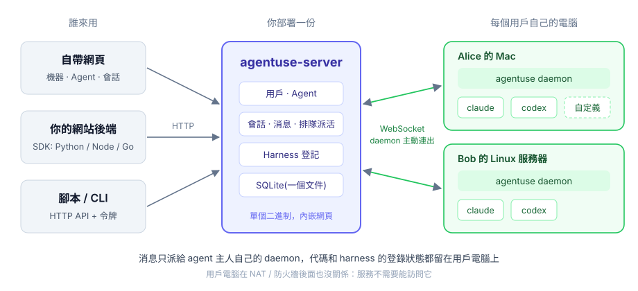
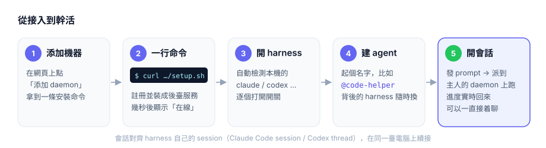

<h1 align="center">agentuse</h1>

<p align="center"><b>让你网站的用户，用他们自己电脑上的 Claude Code / Codex 干活。</b></p>

<p align="center">
  <a href="LICENSE"></a>
  
  
</p>

agentuse 是一个可以自己部署的 agent 中间件。用户用**一行命令**把自己的电脑接进来，在上面建几个有名字的 agent(背后是 Claude Code、Codex 或自己写的程序),之后从网页、你的网站或 API 发出的消息，都会派到 agent 主人自己的电脑上执行，进度和回复实时传回来。

它像 Redis 一样嵌进你的网站：网站后端调用它，网站用户不用知道 agentuse 的存在。

<p align="center"></p>

## 特点

- **一行命令接入**:`curl …/setup.sh … && bash setup.sh`,自动注册并装成后台服务(launchd / systemd),电脑在 NAT 后面也能用。
- **活在自己电脑上跑**:代码、密钥、harness 的登录状态都不离开用户电脑;消息只派给 agent 主人自己的 device。
- **harness 可换**:内置 Claude Code、Codex,也能注册自己写的程序;agent 切换运行时(哪台电脑上的哪个 harness)不用改名字。
- **共享会话**:一个 conversation 可 @ 多个 agent，每次执行读取共享历史；Claude 用 hook、Codex 用 app-server turn/steer 接收执行中的补充。
- **部署简单**:一个 `agentuse-server` 二进制，内嵌网页，数据就一个 SQLite 文件。
- **方便嵌入**:Python / Node.js / Go 零依赖 SDK,带上网站自己的 user id 就能代表这个用户调用。

<p align="center"></p>

## 独立 Harness CLI

[`harnessctl/`](harnessctl/README.md) 定义统一的本机命令与 JSONL 事件协议，提供 Codex 和 Claude Code 适配器。每个 `harnessctl/harness/<name>/` 都是可独立打包分发的完整适配器，仅依赖 Python 标准库和原生 CLI，不依赖 AgentUse。AgentUse client 已使用这个协议执行任务；原生 RPC、插话/排队和会话恢复都由独立适配器负责。内置适配器当前支持 Linux，需要 Python 3.9+ 和对应原生 CLI。

## 快速开始

### 1. 安装并起服务

Linux / macOS(amd64 / arm64)上一行装好:

```bash
curl -fsSL https://raw.githubusercontent.com/memory-co/agentuse/main/install.sh | bash
agentuse-server start                    # 默认监听 :8080,数据在 ~/.agentuse/server.db
```

脚本会从最新 [Release](https://github.com/memory-co/agentuse/releases) 下载 `agentuse-server` 装到 `/usr/local/bin`(没权限就装到 `~/.local/bin`),并把各平台的 `agentuse` 放到 `~/.agentuse/dist`,供用户电脑的 `setup.sh` 下载。装指定版本：`curl … | VERSION=v0.0.5 bash`。

第一次启动会建管理员 `admin`,并在日志里打印登录链接:

```
第一次启动，已创建管理员 admin。登录令牌(只显示这一次): ut_…
登录链接: http://localhost:8080/login?token=ut_…
```

放到公网 / 反向代理后面时，用 `-public-url https://agentuse.example.com` 指定用户电脑访问服务的地址(会写进安装命令)。不指定就按请求的 Host 推断。

### 2. 接入一台电脑

打开网页 →「机器」→「添加设备」,页面会给出一条命令，在要跑 harness 的电脑上执行:

```bash
curl -fsSL "https://agentuse.example.com/setup.sh" -o setup.sh && TOKEN="st_…" bash setup.sh
```

它会下载 agentuse、注册这台电脑、装成后台服务(macOS launchd / Linux systemd --user,都没有就 nohup)。几秒后页面上这台电脑变成「在线」,并列出本机检测到的 harness。

### 3. 选择开启哪些 harness

在这台 device 下打开要用的 harness 开关(默认都关)。之后在「Agent」页建一个 agent(起个名字，选它跑在哪台 device 的哪个 harness 上，以后能切换),再在「会话」页选 agent、写 prompt 开一个会话，会派到 agent 绑定的那台 device 上,进度和回复实时显示，可以接着回复，也可以在执行中给相同 agent 插话。

## 命令

```
# 服务端
agentuse-server start [-addr :8080] [-db 路径] [-public-url URL] [-dist 目录] [-reset-admin-token]
agentuse-server login -server URL -token 管理员令牌     # 之后的管理命令都走 HTTP API
agentuse-server user create 用户名 [-id 用户id] [-role user|admin]
agentuse-server user list [-json]
agentuse-server user token 用户id                       # 重置登录令牌
agentuse-server work threads --work WORK_ID              # Server 管理跨 Client 的工作线程

# 用户电脑
agentuse register -server URL -token 安装令牌           # setup.sh 会替你跑
agentuse start                                          # 前台启动 Client，也支持本地调试
agentuse ui --open                                      # 打开本机页面
agentuse daemon                                         # setup.sh 安装的后台服务入口
agentuse status                                         # 注册和连接状态
agentuse harnesses                                      # 本机检测到的 harness
agentuse conversation read CONVERSATION_ID              # 远端会话管理
agentuse context --path /绝对路径/context.json --run RUN_UUID enter  # 进入本机执行上下文
```

两个 CLI 的完整说明见 [Server CLI](docs/server/cli.md) 和 [Client CLI](docs/client/cli.md)。`start` 的参数也能用环境变量给:`AGENTUSE_ADDR`、`AGENTUSE_DB`、`AGENTUSE_PUBLIC_URL`、`AGENTUSE_DIST`。

## API

网页用的就是这些接口，脚本里带 `Authorization: Bearer <登录令牌>` 即可调用。完整接口、请求和响应以 Server 的 `/api/docs` 自动文档为准。

| 方法 | 路径 | 说明 |
|---|---|---|
| GET | `/api/devices` | 我的设备(admin 看全部) |
| POST | `/api/devices` | 添加设备,返回安装命令 |
| PUT | `/api/devices/{id}/harnesses/{harness}` | `{"enabled": true}` 开关 harness |
| POST | `/api/devices/{id}/reset` | 重新生成安装命令 |
| DELETE | `/api/devices/{id}` | 删除 |
| GET / POST | `/api/agents` | 列 agent / 建 agent `{"id":"code-helper","name":"写代码助手","device_id":"dm_…","harness":"claude"}`(id 全局唯一) |
| GET / DELETE | `/api/agents/{id}` | 读取 Agent / 删除 |
| POST | `/api/agents/{id}/versions` | 发布固定配置版本，修改名称、运行时、指令和 skills |
| GET / POST | `/api/conversations` | 列会话 / 开会话 `{"to_agent_ids":["code-helper"],"prompt":"…"}` |
| POST | `/api/conversations/{id}/messages` | 发送消息及收件人，返回消息与投递关系，Client accepted 后关联实际 run |
| GET / DELETE | `/api/conversations/{id}` | 会话详情(消息和回报) / 删除 |
| GET | `/api/harnesses` | 列设备上报的 harness |
| GET / POST | `/api/users` | (admin)列用户 / 建用户 |

Server 和 Client 都使用 [Huma](https://github.com/danielgtaylor/huma) 自动生成 API 文档。登录对应服务后访问 `/api/docs` 可查看并调试接口；OpenAPI JSON/YAML 位于 `/api/openapi.json`、`/api/openapi.yaml`，JSON Schema 位于 `/api/schemas/{schema}.json`。文档使用现有 cookie 或 Bearer token 鉴权。运行路由与文档共用注册定义，请求和响应 schema 从 Go 类型生成，包含用户、工作及设备令牌的适用范围和文件上传下载格式。WebSocket 文档描述握手，连接后的消息协议见 [protocol.md](designs/v3/designs/protocol.md)。

## 文档

当前使用方法放在 [`docs/`](docs/README.md)，设计方案、协议及历史资料放在 [`designs/`](designs/README.md)。

| 入口 | 内容 |
|---|---|
| [Server 文档](docs/server/README.md) · [CLI](docs/server/cli.md) | 启动服务、存储设置、管理员登录、用户和工作线程管理 |
| [Client 文档](docs/client/README.md) · [CLI](docs/client/cli.md) | 注册、启动、本机调试、远端会话和附件 |
| [Server Work](docs/server/work.md) | 跨 Client 编排、协调工具和工作授权 |
| [执行上下文](docs/client/context.md) | AI 使用 context 查询执行状态、读写文件；人类选择或进入 run |
| 运行中的 `/api/docs` | 两端分别提供的 Huma API 交互文档 |
| [SDK](sdk/README.md) | Go、Node.js 和 Python 接入示例 |
| [Server 设计](designs/v3/designs/server-main.md) · [Client 设计](designs/v3/designs/client-main.md) | 业务划分及实现约定 |
| [通信协议](designs/v3/designs/protocol.md) | Client 与 Server 的 WebSocket 报文和恢复规则 |
| [设计资料索引](designs/README.md) | 原 docs 中保留的各版本设计、历史接口和插图 |

## 从源码构建

需要 Go 1.25+ 和 Node 18+:

```bash
make build dist                          # bin/agentuse、bin/agentuse-server + dist/ 下各平台 agentuse
bin/agentuse-server start -dist dist
```

开发常用:

```bash
make test     # 单元测试 go test -short ./...
make e2e      # e2e 场景(编好二进制再跑):make e2e E2E=install / E2E=session 只跑一个，见 test/e2e/
make build    # bin/agentuse、bin/agentuse-server(先构建两端 frontend/dist 再嵌进去，需要 Node 18+)
make dist     # dist/agentuse-{linux,darwin}-{amd64,arm64}(只有用户电脑上的 agentuse)
```

## 布局

```
client/
├── cmd/agentuse/      用户电脑上的 CLI
├── internal/         cli、五个 service、本机 controller、通用 fileutil
└── frontend/         本机会话、执行记录和 token 统计网页
server/
├── cmd/agentuse-server/ 服务端 CLI
├── internal/         cli、HTTP controller、WebSocket hub、业务 service、SQLite store
└── frontend/         管理网页
internal/             protocol、harness、attachment 校验、command、version
sdk/                  HTTP API 类型及客户端：golang / nodejs / python
test/e2e/             两个二进制的端到端场景
test/architecture/    分层依赖检查
docs/                 当前使用文档：server / client
designs/              设计方案、协议、历史资料及插图：v1 / v2 / v3
```

client 和 server 通过 Go internal 规则隔离；本机 controller 分别查询 sessionService 和 runService；client 各 service 直接管理文件，fileutil 仅提供通用文件操作。服务端写操作和事务编排经过 service，store 保存 SQL、schema 和行解码。详见[Server 设计](designs/v3/designs/server-main.md)。

## License

[Apache License 2.0](LICENSE)

## 会话附件

会话支持输入文件和输出文件，接口是 `/api/conversations/{id}/attachments`。人类在 Server 页面或通过 API/SDK 上传输入，Client AI 在当前 run 中读取；AI 上传输出后，人类在 Server 查看或下载。

```bash
context status
context attachment list
context attachment download user_input/截图.png
context attachment upload ./report.pdf
```

`download` 使用 conversation 相对路径，把文件下载到 workspace 的对应路径，校验大小和 SHA-256 后返回本地绝对路径及 MIME 类型，图片交给原生看图工具读取。`list` 直接查询整个 conversation 的文件，使用 `direction` 区分用户输入和 Agent 产物。`upload` 自动关联 conversation/run，返回可引用的 `download_path`，不会自动回复或结束执行。人类可以用 `agentuse context` 调试同一上下文，详见 [执行上下文手册](docs/client/context.md)。

每个 conversation 有独立的文件树，用户输入位于 `user_input/`，AI 产物保留相对路径。页面右侧浏览文件，输入框选择每条消息的附件，消息显示可预览的文件卡片。详见 [对话文件](docs/server/conversation-files.md)。

网页会话页和 Go、Python、Node SDK 均支持附件。服务端默认单文件 100 MiB、每会话总计 1 GiB；文件统一通过 fileService 的 conversations 命名空间保存，本地默认 `~/.agentuse/files`，也支持 S3；须与数据库一起管理和备份。[文件树设计](designs/v3/designs/conversation-files.md) · [Client CLI](docs/client/cli.md)。HTTP API 说明见运行中 Server 的 `/api/docs`。

## 多 agent 共享会话

网页新建 conversation 不绑定 agent，每条消息通过 @ 选择一个或多个执行者。Server 将 conversation message 投递给目标 Agent，Client 准备或复用对应的本机 session。输入属于当前 run 还是排队产生新 run，由适配器的 accepted 事件确认；用户消息只保存一次。

```json
{}
```

用上面的 body 创建 conversation 后，向 `/api/conversations/{id}/messages` 发送：

```json
{"prompt":"分别看看实现和风险","to_agent_ids":["coder","reviewer"],"to_user_ids":["alice"]}
```

返回 `{message, runs, deliveries}`。也支持 `agentuse conversation send CONVERSATION_ID --agents coder,reviewer "…"`、读取、等待和取消，以及 Go/Node/Python SDK。所有 conversation 统一使用共享消息模型，不再提供 mode/input/defer_start 包装。消息以 author_role 区分 user/agent，content 是原始正文，执行事实单独保存在 run 中。Server 与 Client 使用 `agentuse-client/2` 通信。[设计](designs/v3/designs/server-conversation.md) · [API](docs/server/conversations.md)。

### Client 本机页面与文件配置

运行 `agentuse start` 连接已注册的平台，`agentuse ui -open` 打开本机页面（默认 `127.0.0.1:7801`）。页面沿用 server 的布局：左侧切换 endpoint、浏览 conversation，右侧查看 session、run 和详情弹窗。查询只读取所选目录，不提供全局 runs 扫描。

Endpoint 下拉默认包含“本地调试”（`endpoint_id: local`），无需注册或声明。输入任意名称创建 conversation，选择已安装的 harness，输入文本或 JSON 即可实际执行；详情中可查看输出、错误、插话及取消，适合验证自定义适配器。本地记录与 workspace 都保存在 `<session.work_root>/local/` 下。

平台注册信息保存在 `~/.agentuse/endpoints.yaml`，支持多个平台；endpoint_id 从地址推导，不用手动填写。重复运行 `agentuse register -server URL -token 安装令牌` 可注册其他平台。旧 `daemon.json` 不再读取，已有设备需重新注册。`agentuse daemon` 命令作为安装脚本的启动入口仍可使用。

本机设置保存在 `~/.agentuse/setting.yaml`：

```yaml
local_http:
  enabled: true
  host: 127.0.0.1
  port: 7801
session:
  work_root: ~/.agentuse/tmp
  quota:
    max_bytes: 21474836480
```

需要从外网访问时将 local_http.host 显式设置为 `0.0.0.0`，重启后使用服务器地址和本机页面令牌访问。

省略 quota 则不限容量；声明即自动清理空闲 conversation 目录，运行中、等待回答和未获中心确认的结果均受保护。端口或根目录修改后重启 client，根目录变更需要保留记录时先完整迁移目录。端口变更不会自动重启正在运行的进程。

适配器位于 `~/.agentuse/harness/<harness>/<revision>/`。默认适配器首次自动写入本机目录，后续从文件加载。自定义适配器安装到 `<harness>/local/`，提供 `manifest.json` 与可执行的 `harnessctl` 入口，遵循四命令、五事件协议。写入 `local/disabled` 文件可禁用。旧的 harness.yaml 不再加载。

Client 不再使用 SQLite，文件结构为：

```text
<session.work_root>/<endpoint_id>/<conversation_id>/
  workspace/                    # 所有 Codex / Claude Code 的共同 cwd
  sessions/<session_id>/
    events.jsonl                # 固定的 harnessctl 会话地址
    events.jsonl.d/              # 适配器私有状态
    session.yaml
    context.json                # 当前执行上下文的固定路由信息
    bin/context                 # run 环境可直接调用的入口
    runs/<run_id>.jsonl          # adapter accepted.run_id 的最小索引
    .server/                    # 新版消息投递、事件确认与控制收据
```

Agent 指令与 skills 由 Client 按固定版本 API 获取，通过 init 保存资源快照，不覆盖共享 workspace 中的 AGENTS.md / CLAUDE.md。Codex 恢复指定 thread，Claude Code 恢复指定 session；不同 session 可并行执行。执行事实只保存在 events.jsonl，run_id 由适配器决定；补充输入可能属于同一个 run，也可能排队形成新 run。client 不创建 attempt。中心输入收据、事件 ACK 游标和控制收据隔离在 .server/，未确认事件仍受目录保护。

详见 [Client 设计与 API](designs/v3/designs/client-main.md)。

配置生命周期统一为：启动时加载 setting.yaml、endpoints.yaml 和 harness 包，运行期间固定使用快照。修改、增删、启停和凭据变更一律重启生效；没有热更新、周期重读、重新探测或 active_work_root / restart_required 双态字段。自动重连、任务控制和 quota 检查属于运行行为，不重新加载配置。

### 执行协议升级

消息使用 `to_agent_ids` 和 `to_user_ids` 指定收件人：只有 Agent 收件人触发执行，用户收件人必须已有会话读取权限，两组省略时均为 `[]`。CLI 通过 `--agents`、`--users` 分别指定；不保留旧字段别名。

Server/client 使用 `agentuse-client/2`：Server 直接投递 conversation message 和目标 Agent，Client 按需获取固定版本配置与 skills 并在本地 init，适配器通过 accepted 返回真实 run UUID。只支持数据库 schema 7 和新版消息收据，不保留旧数据迁移或兼容逻辑。升级需重建 Server 数据库、清空 Client 本地工作目录并重新初始化、注册设备；两端必须一起更新。详见 [协议](designs/v3/designs/protocol.md) 和 [server-run 设计](designs/v3/designs/server-run.md)。
