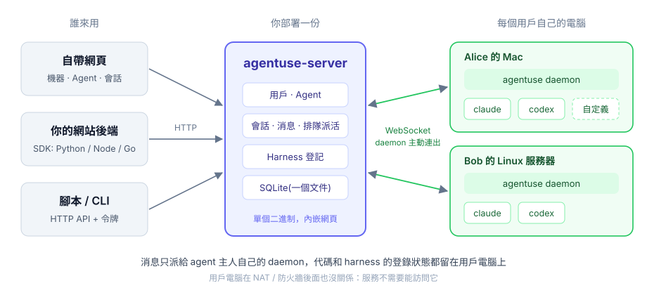
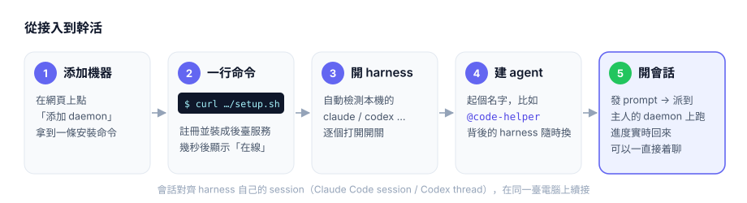

<h1 align="center">agentuse</h1>

<p align="center"><b>让你网站的用户，用他们自己电脑上的 Claude Code / Codex 干活。</b></p>

<p align="center">
  <a href="LICENSE"></a>
  
  
</p>

agentuse 是一个可以自己部署的 agent 中间件。用户用**一行命令**把自己的电脑接进来，在上面建几个有名字的 agent(背后是 Claude Code、Codex 或自己写的程序),之后从网页、你的网站或 API 发出的消息，都会派到 agent 主人自己的电脑上执行，进度和回复实时传回来。

它像 Redis 一样嵌进你的网站：网站后端调用它，网站用户不用知道 agentuse 的存在。

<p align="center"></p>

## 特点

- **一行命令接入**:`curl …/setup.sh … && bash setup.sh`,自动注册并装成后台服务(launchd / systemd),电脑在 NAT 后面也能用。
- **活在自己电脑上跑**:代码、密钥、harness 的登录状态都不离开用户电脑;消息只派给 agent 主人自己的 device。
- **harness 可换**:内置 Claude Code、Codex,也能注册自己写的程序;agent 切换运行时(哪台电脑上的哪个 harness)不用改名字。
- **共享会话**:一个 conversation 可 @ 多个 agent，按本地 session 补齐共享历史，支持执行中的补充输入；协作模式可拆分子会话并汇总结果。
- **部署简单**:一个 `agentuse-server` 二进制，内嵌网页，默认使用一个 SQLite 文件，也可选择 MySQL 或 PostgreSQL，构建无需 CGO。
- **方便嵌入**:Python / Node.js / Go 零依赖 SDK,带上网站自己的 user id 就能代表这个用户调用。

<p align="center"></p>

## 独立 Harness CLI

[`harnessctl/`](harnessctl/README.md) 定义统一的本机命令与 JSONL 事件协议，提供 Codex 和 Claude Code 适配器。每个 `harnessctl/harness/<name>/` 都是可独立打包分发的完整适配器，仅依赖 Python 标准库和原生 CLI，不依赖 AgentUse。AgentUse client 已使用这个协议执行任务；原生 RPC、插话/排队和会话恢复都由独立适配器负责。内置适配器当前支持 Linux，需要 Python 3.9+ 和对应原生 CLI。

## 快速开始

### 1. 安装并起服务

Linux / macOS(amd64 / arm64)上一行装好:

```bash
curl -fsSL https://raw.githubusercontent.com/memory-co/agentuse/main/install.sh | bash
```

脚本会从最新 [Release](https://github.com/memory-co/agentuse/releases) 下载 `agentuse-server` 装到 `/usr/local/bin`(没权限就装到 `~/.local/bin`),并把各平台的 `agentuse` 放到 `~/.agentuse/dist`,供用户电脑的 `setup.sh` 下载。装指定版本：`curl … | VERSION=v0.0.5 bash`。

安装结束时可设置管理员登录密码，输入并确认后会后台启动或重启脚本管理的 Server。直接回车则保留原流程，手动启动：

```bash
agentuse-server start                    # 默认监听 :8080,数据在 ~/.agentuse/server.db
```

未设置自定义密码时，第一次启动会建管理员 `admin`,并在日志里打印登录链接:

```
第一次启动，已创建管理员 admin。登录令牌(只显示这一次): ut_…
登录链接: http://localhost:8080/login?token=ut_…
```

放到公网 / 反向代理后面时，在 Server 主机的 `~/.agentuse/settings.yaml` 配置公开地址：

```yaml
public_url: https://agentuse.example.com
```

保存后重启 Server。登录链接、设备安装命令和安装脚本统一使用这个地址；未配置时使用本机监听地址。可用 `--public-url` 或 `AGENTUSE_PUBLIC_URL` 临时覆盖，详见 [Server CLI](docs/server/cli.md)。

### 2. 接入一台电脑

打开网页 →「机器」→「添加设备」,页面会给出一条命令，在要跑 harness 的电脑上执行:

```bash
curl -fsSL "https://agentuse.example.com/setup.sh" -o setup.sh && TOKEN="st_…" bash setup.sh
```

它会下载 agentuse、注册这台电脑、装成后台服务(macOS launchd / Linux systemd --user,都没有就 nohup)。几秒后页面上这台电脑变成「在线」,并列出本机检测到的 harness。

### 3. 选择开启哪些 harness

在这台 device 下打开要用的 harness 开关(默认都关)。之后在「Agent」页建一个 agent(起个名字，选它跑在哪台 device 的哪个 harness 上，以后能切换),再在「会话」页选 agent、写 prompt 开一个会话，会派到 agent 绑定的那台 device 上,进度和回复实时显示，可以接着回复，也可以在执行中给相同 agent 插话。

## 命令

```
# 服务端
agentuse-server start [-addr :8080] [-db 路径] [-public-url URL] [-dist 目录] [-reset-admin-token]
agentuse-server login -server URL -token 管理员令牌     # 之后的管理命令都走 HTTP API
agentuse-server user create 用户名 [-id 用户id] [-role user|admin]
agentuse-server user list [-json]
agentuse-server user token 用户id                       # 重置登录令牌

# 用户电脑
agentuse register -server URL -token 安装令牌           # setup.sh 会替你跑
agentuse start                                          # 前台启动 Client，也支持本地调试
agentuse ui --open                                      # 打开本机页面
agentuse daemon                                         # setup.sh 安装的后台服务入口
agentuse status                                         # 注册和连接状态
agentuse harnesses                                      # 本机检测到的 harness
agentuse conversation read CONVERSATION_ID              # 远端会话管理
agentuse context --path /绝对路径/context.json --run RUN_UUID enter  # 进入本机执行上下文
```

两个 CLI 的完整说明见 [Server CLI](docs/server/cli.md) 和 [Client CLI](docs/client/cli.md)。`start` 的参数也能用环境变量给:`AGENTUSE_ADDR`、`AGENTUSE_DB`、`AGENTUSE_PUBLIC_URL`、`AGENTUSE_DIST`。

## 文档

当前使用方法放在 [`docs/`](docs/README.md)，设计方案、协议及历史资料放在 [`designs/`](designs/README.md)。

| 入口 | 内容 |
|---|---|
| [Server 文档](docs/server/README.md) · [CLI](docs/server/cli.md) | 启动服务、存储设置、管理员登录和用户管理 |
| [Client 文档](docs/client/README.md) · [CLI](docs/client/cli.md) | 注册、启动、本机调试、远端会话和附件 |
| [Conversation 协作](docs/server/conversations.md#模式与嵌套) | 单体/协作模式、跨 Client 子会话和消息回传 |
| [数据库配置与升级](docs/server/database.md) | 默认 SQLite、MySQL/PostgreSQL 配置、无 CGO 构建及版本迁移 |
| [执行上下文](docs/client/context.md) | AI 使用 context 查询执行状态、读写文件；人类选择或进入 run |
| [Server API](docs/server/api.md) · [Client API](docs/client/api.md) | 鉴权、接口索引、请求示例和在线交互文档入口 |
| [SDK](sdk/README.md) | Go、Node.js 和 Python 接入示例 |
| [Server 设计](designs/v3/server-main.md) · [Client 设计](designs/v3/client-main.md) | 业务划分及实现约定 |
| [通信协议](designs/v3/protocol.md) | Client 与 Server 的 WebSocket 报文和恢复规则 |
| [设计资料索引](designs/README.md) | 原 docs 中保留的各版本设计、历史接口和插图 |

## 从源码构建

需要 Go 1.25+ 和 Node 18+:

```bash
make build dist                          # bin/agentuse、bin/agentuse-server + dist/ 下各平台 agentuse
bin/agentuse-server start -dist dist
```

开发常用:

```bash
make test     # 单元测试 go test -short ./...
make e2e      # e2e 场景(编好二进制再跑):make e2e E2E=install / E2E=session 只跑一个，见 test/e2e/
make build    # bin/agentuse、bin/agentuse-server(先构建两端 frontend/dist 再嵌进去，需要 Node 18+)
make dist     # dist/agentuse-{linux,darwin}-{amd64,arm64}(只有用户电脑上的 agentuse)
```

## 布局

```
client/
├── cmd/agentuse/      用户电脑上的 CLI
├── internal/         cli、五个 service、本机 controller、通用 fileutil
└── frontend/         本机会话、执行记录和 token 统计网页
server/
├── cmd/agentuse-server/ 服务端 CLI
├── internal/         cli、HTTP controller、WebSocket hub、业务 service、notification、GORM database
└── frontend/         管理网页
internal/             protocol、skillbundle、attachment 校验、command、version
sdk/                  HTTP API 类型及客户端：golang / nodejs / python
test/e2e/             两个二进制的端到端场景
test/architecture/    分层依赖检查
docs/                 当前使用文档：server / client
designs/              设计方案、协议、历史资料及插图：v1 / v2 / v3
```

client 和 server 通过 Go internal 规则隔离；本机 controller 分别查询 sessionService 和 runService；client 各 service 直接管理文件，fileutil 仅提供通用文件操作。服务端写操作和事务编排经过 service，database 管理 GORM 模型、版本迁移、查询方言和行解码。详见[Server 设计](designs/v3/server-main.md)。

## License

[Apache License 2.0](LICENSE)
