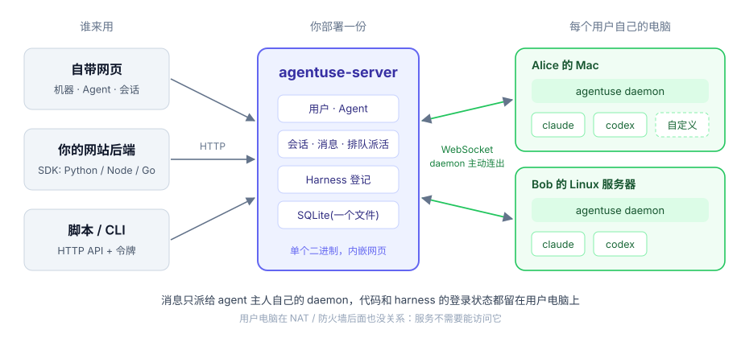
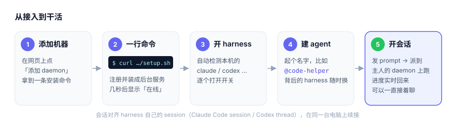

<h1 align="center">agentuse</h1>

<p align="center"><b>让你网站的用户，用他们自己电脑上的 Claude Code / Codex 干活。</b></p>

<p align="center">
  <a href="LICENSE"></a>
  
  
</p>

agentuse 是一个可以自己部署的 agent 中间件。用户用**一行命令**把自己的电脑接进来，在上面建几个有名字的 agent(背后是 Claude Code、Codex 或自己写的程序),之后从网页、你的网站或 API 发出的消息，都会派到 agent 主人自己的电脑上执行，进度和回复实时传回来。

它像 Redis 一样嵌进你的网站：网站后端调用它，网站用户不用知道 agentuse 的存在。

<p align="center"></p>

## 特点

- **一行命令接入**:`curl …/setup.sh … && bash setup.sh`,自动注册并装成后台服务(launchd / systemd),电脑在 NAT 后面也能用。
- **活在自己电脑上跑**:代码、密钥、harness 的登录状态都不离开用户电脑;消息只派给 agent 主人自己的 daemon。
- **harness 可换**:内置 Claude Code、Codex,也能注册自己写的程序;agent 切换运行时(哪台电脑上的哪个 harness)不用改名字。
- **多轮会话**:会话对齐 Claude Code 的 session / Codex 的 thread,在同一台电脑上续接。
- **部署简单**:一个 `agentuse-server` 二进制，内嵌网页，数据就一个 SQLite 文件。
- **方便嵌入**:Python / Node.js / Go 零依赖 SDK,带上网站自己的 user id 就能代表这个用户调用。

<p align="center"></p>

## 快速开始

### 1. 安装并起服务

在 Linux 服务器上(amd64 / arm64)一行装好:

```bash
curl -fsSL https://raw.githubusercontent.com/memory-co/agentuse/main/install.sh | bash
agentuse-server start                    # 默认监听 :8080,数据在 ~/.agentuse/server.db
```

脚本会从最新 [Release](https://github.com/memory-co/agentuse/releases) 下载 `agentuse-server` 装到 `/usr/local/bin`(没权限就装到 `~/.local/bin`),并把各平台的 `agentuse` 放到 `~/.agentuse/dist`,供用户电脑的 `setup.sh` 下载。装指定版本：`curl … | VERSION=v0.0.5 bash`。

第一次启动会建管理员 `admin`,并在日志里打印登录链接:

```
第一次启动，已创建管理员 admin。登录令牌(只显示这一次): ut_…
登录链接: http://localhost:8080/login?token=ut_…
```

放到公网 / 反向代理后面时，用 `-public-url https://agentuse.example.com` 指定用户电脑访问服务的地址(会写进安装命令)。不指定就按请求的 Host 推断。

### 2. 接入一台电脑

打开网页 →「机器」→「添加 daemon」,页面会给出一条命令，在要跑 harness 的电脑上执行:

```bash
curl -fsSL "https://agentuse.example.com/setup.sh" -o setup.sh && TOKEN="st_…" bash setup.sh
```

它会下载 agentuse、注册这台电脑、装成后台服务(macOS launchd / Linux systemd --user,都没有就 nohup)。几秒后页面上这台电脑变成「在线」,并列出本机检测到的 harness。

### 3. 选择开启哪些 harness

在这台 daemon 下打开要用的 harness 开关(默认都关)。之后在「Agent」页建一个 agent(起个名字，选它跑在哪台 daemon 的哪个 harness 上，以后能切换),再在「会话」页选 agent、写 prompt 开一个会话，会派到 agent 绑定的那台 daemon 上,进度和回复实时显示，可以接着回复(会话对齐 Claude Code / Codex 自己的 session,在同一台电脑上续接)。

## 命令

```
# 服务端
agentuse-server start [-addr :8080] [-db 路径] [-public-url URL] [-dist 目录] [-reset-admin-token]
agentuse-server login -server URL -token 管理员令牌     # 之后的管理命令都走 HTTP API
agentuse-server user create 用户名 [-id 用户id] [-role user|admin]
agentuse-server user list [-json]
agentuse-server user token 用户id                       # 重置登录令牌

# 用户电脑
agentuse register -server URL -token 安装令牌           # setup.sh 会替你跑
agentuse daemon                                         # setup.sh 装成的后台服务跑的就是它
agentuse status                                         # 注册和连接状态
agentuse harnesses                                      # 本机检测到的 harness
```

两个 CLI 的完整说明见 [`docs/v2/cli/`](docs/v2/cli/README.md)。`start` 的参数也能用环境变量给:`AGENTUSE_ADDR`、`AGENTUSE_DB`、`AGENTUSE_PUBLIC_URL`、`AGENTUSE_DIST`。

## API

网页用的就是这些接口，脚本里带 `Authorization: Bearer <登录令牌>` 即可调用。完整说明见 [`docs/v2/apis/`](docs/v2/apis/README.md)。

| 方法 | 路径 | 说明 |
|---|---|---|
| GET | `/api/daemons` | 我的 daemon(admin 看全部) |
| POST | `/api/daemons` | 添加 daemon,返回安装命令 |
| PUT | `/api/daemons/{id}/harnesses/{harness}` | `{"enabled": true}` 开关 harness |
| POST | `/api/daemons/{id}/reset` | 重新生成安装命令 |
| DELETE | `/api/daemons/{id}` | 删除 |
| GET / POST | `/api/agents` | 列 agent / 建 agent `{"id":"code-helper","name":"写代码助手","daemon_id":"dm_…","harness":"claude"}`(id 全局唯一) |
| PATCH / DELETE | `/api/agents/{id}` | 改名字、切换运行时 `{"daemon_id":"dm_…","harness":"codex"}` / 删除 |
| GET / POST | `/api/sessions` | 列会话 / 开会话 `{"agent_id":"code-helper","prompt":"…","cwd":"可选"}` |
| POST | `/api/sessions/{id}/messages` | 回复 `{"prompt":"…"}`,harness 还没回时 409 |
| GET / DELETE | `/api/sessions/{id}` | 会话详情(消息和回报) / 删除 |
| GET / POST | `/api/harnesses` | 列 harness / 注册自定义 harness |
| GET / POST | `/api/users` | (admin)列用户 / 建用户 |

## 文档

| | |
|---|---|
| 总体设计 | [`docs/v2/designs/main.md`](docs/v2/designs/main.md) |
| 接入与通信 | [`docs/v2/designs/connect.md`](docs/v2/designs/connect.md) |
| 嵌入到网站 | [`docs/v2/designs/embedding.md`](docs/v2/designs/embedding.md)、[`sdk/`](sdk/README.md) |
| 表结构 | [`docs/v2/tables/`](docs/v2/tables/) |
| 接口 | [`docs/v2/apis/`](docs/v2/apis/README.md) |
| 命令行 | [`docs/v2/cli/`](docs/v2/cli/README.md) |
| 旧版(v1) | [`docs/v1/`](docs/v1/README.md) |

## 从源码构建

需要 Go 1.24+ 和 Node 18+(macOS 上跑服务也走这个):

```bash
make build dist                          # bin/agentuse、bin/agentuse-server + dist/ 下各平台 agentuse
bin/agentuse-server start -dist dist
```

开发常用:

```bash
make test     # go test ./...
make build    # bin/agentuse、bin/agentuse-server(先构建网页 frontend/dist 再嵌进去，需要 Node 18+)
make dist     # dist/agentuse-{linux,darwin}-{amd64,arm64}(只有用户电脑上的 agentuse)
```

## 布局

```
cmd/agentuse/        用户电脑上的 CLI:register / daemon / status / harnesses
cmd/agentuse-server/ 服务端 CLI:start / login / user
internal/
├── cli/             命令行
├── store/           SQLite 存储(表结构见 docs/v2/tables/)
├── protocol/        daemon ⇄ 服务的注册接口和 WebSocket 消息
├── server/          HTTP API、WebSocket 派活、setup.sh、托管网页
└── daemon/          注册、连接、调用本地 CLI harness、汇报
frontend/            网页:React + Vite + shadcn/ui,构建产物 dist/ 嵌进 agentuse-server
sdk/                 嵌入用客户端:python / nodejs / golang
docs/                v2(当前) / v1(旧版)
```

## License

[Apache License 2.0](LICENSE)
