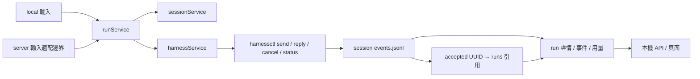

# Client 總覽：以 harnessctl 爲執行模型

Server/client WebSocket 報文、字段和恢復規則見 [protocol.md](protocol.md)。

Client 從輸入來源接收文本，選擇本機 session，調用 harnessctl，並讀取該 session 的 events.jsonl。執行身份只有適配器公佈的 run_id；client 不預分配 run_id，也沒有執行 attempt。Server 的業務編排和調度設計不在本文擴展。

## 五個 service

| Service | 職責 | 文件來源 |
|---|---|---|
| endpointService | 提供輸入來源及其身份；內置 local | endpoints.yaml 的啓動快照 |
| settingService | 本機監聽、工作根目錄和 quota | setting.yaml 的啓動快照 |
| sessionService | session 選擇、佔用、共同工作目錄和回收 | conversation 下的 session.yaml |
| runService | 接收輸入、驅動 session、登記實際 run、查詢、控制和執行上下文工具 | runs/<run_id>.jsonl 引用及 events.jsonl |
| harnessService | 安裝和固定適配器，通過 init 和四個交互命令執行、讀取公共事件 | ~/.agentuse/harness/ 下的啓動快照 |

controller 處理本機 HTTP，通過 sessionService 和 runService 的只讀查詢接口獲取頁面數據。各 service 直接管理自己負責的 YAML / JSONL 文件；client 不設 store、repository、Ledger 或統一 Reader / Writer 層。fileutil 只提供路徑檢查、原子文件寫入、YAML 編解碼和進程文件鎖，不包含業務實體、索引或恢復策略。原生 Codex RPC、Claude stream-json、權限策略和進程生命週期全部屬於獨立 harnessctl 包，client 不實現另一套原生協議。



## 代碼和文件歸屬

```text
client/internal/
  cli/                    啓動、配置裝配、進程鎖和 HTTP 啓停
  controller/             本機 API；分別注入 session / run 的只讀查詢接口
  fileutil/               通用路徑、原子寫入、YAML 和文件鎖
  service/
    endpoint/             endpoints.yaml、endpoint 身份推導和註冊
    setting/              setting.yaml 的配置校驗與啓動快照
    session/              conversation/session 元數據、目錄、佔用和 quota
    run/                  原生 run 引用、事件查詢、計量、執行和中心事件傳輸
    harness/              獨立適配器包的安裝、命令調用和公共事件讀取
```

sessionService 直接讀取 conversation.yaml / session.yaml，並決定 workspace 及目錄回收。runService 直接創建 runs/<run_id>.jsonl，從 events.jsonl 形成展示視圖；恢復索引和 Server 消息受理記錄也由 runService 負責。兩者沒有包級循環依賴。

重啓恢復時，runService 先通過 sessionService 查詢未完成 session，把其 harness / revision / events 地址交給 harnessService 確認取消，再重建 run 引用及交付狀態，最後由 sessionService 恢復元數據。harnessService 不掃描 conversation 目錄或解釋 session.yaml。

quota 回收由 sessionService 負責；中心未確認事件是否保護目錄，由 runService 提供判斷。sessionService 不解析 .server/ 文件，fileutil 不承擔目錄保護策略。內存互斥鎖協調併發文件操作，不保存另一套持久化事實。

## 身份與生命週期

- endpoint 標識來源；local 永遠存在，不需要註冊配置。
- conversation 是目錄及共同 workspace 的歸屬，可以包含多個本機 session。
- session 是一個固定 events.jsonl 地址及其原生上下文，client 的 session UUID 僅用於目錄定位。
- run 是 events.jsonl 中一個適配器分配的 UUID。一次輸入得到哪個 run，由 accepted 決定。
- input_id、request_id 同樣由適配器公佈。client 不用預先生成的標識替代它們。

send 可能繼續當前 run，也可能產生新 run；調用者不選擇 steer/queue。結果到來前可以繼續 send 或針對 request_id reply。cancel 作用於 session 的當前工作和排隊輸入，不假裝支持只取消某個 run。

local 和遠端採用同一個 harnessService、公共事件格式、run 引用、讀取和用量模型。差別僅在輸入來源與額外的來源通信，不存在 local 專用的 run/attempt 賬本。

## 文件佈局

```text
~/.agentuse/
  setting.yaml
  endpoints.yaml
  harness/<name>/<revision>/...
  ui.token
  tmp/<endpoint_id>/<conversation_id>/
    conversation.yaml                 # local 標題等命名信息
    workspace/                        # 此 conversation 所有 harness 的共同 cwd
    sessions/<session_id>/
      session.yaml
      context.json                    # 固定來源與 session 的工具描述
      bin/context                     # 指向 agentuse 的裸命令入口
      events.jsonl                    # 執行事實的唯一來源
      events.jsonl.d/                 # 適配器私有目錄，保持不變
      runs/<adapter_run_uuid>.jsonl    # client 的引用，不復制執行正文
      resources/<content>.history.json  # 僅實際需要的非空輸入資源
```

不使用 client SQLite，也沒有全局 run 掃描接口。列表限定在指定 endpoint/conversation/session。配置及適配器包不屬於 quota 回收對象；quota 回收完整的空閒 conversation 目錄。

runs 文件名必須來自 accepted.run_id。文件內 reference 記錄 session、來源和接入包等定位元數據；完整輸入、正文、問題、結果、日誌和計量從同一 session 的 events.jsonl 按該 UUID 讀取。不保存 client 自建執行 UUID、attempt 或 harness_run_ids 二級映射。

## 啓動與退出

1. 加載並校驗 setting、endpoints、適配器包，固定爲當前進程的快照。
2. 取得 client 單進程鎖，初始化受管目錄及會話狀態。
3. 通過公開 harnessctl 命令確認遺留前臺執行已清理；不能確認時拒絕釋放目錄。
4. 掃描公共 accepted 事件重建缺失的 run 引用；不轉換舊記錄，也不重放輸入。
5. 恢復 session 元數據，再開放 HTTP 和來源連接。
6. 運行期間處理輸入、結果、重連及固定 quota 的檢查，不重新加載配置。

退出時停止接收，取消受管的活動 session 並等待清理。適配器決定其後臺進程的空閒回收和原生上下文恢復。

本機 HTTP 關閉時，遠端輸入和執行不依賴頁面端口。enabled=true 時監聽失敗會明確啓動報錯；需要不啓動頁面時設置 local_http.enabled=false 後重啓。原生控制連接不借用本機 HTTP。

## 本機 API

所有接口使用本機 token / HttpOnly cookie。配置和平臺輸入來源在頁面中只讀；local 入口用來驗證相同的 harnessctl 執行鏈路。文檔見 /api/docs，OpenAPI 見 /api/openapi.json。

| 方法 | 路徑 | 含義 |
|---|---|---|
| GET | /api/settings | 當前啓動配置，只有一份值 |
| GET | /api/endpoints | 固定的來源列表，不含憑據 |
| GET | /api/harnesses | 啓動時的適配器及可用性 |
| GET | /api/local/harnesses | 同一份啓動探測結果，不重新探測 |
| GET | /api/status | 來源連接與佔用 session 數 |
| GET | /api/conversations?endpoint_id=… | 指定來源的 conversation |
| GET | /api/conversations/{endpoint}/{conversation} | conversation 與 workspace 位置 |
| GET | 同上 /sessions | session 列表 |
| GET | 同上 /sessions/{session} | session 元數據 |
| GET | 同上 /sessions/{session}/status | harnessctl 公開的 state、run_id、queued、requests、cwd、model |
| GET | 同上 /sessions/{session}/runs | 實際 adapter run 列表，含完整輸入、正文、插話和結果；日誌僅詳情返回。支持 limit/cursor/status/since/until |
| GET | 同上 /sessions/{session}/runs/{run} | 該 UUID 對應的完整公共事件及結果 |
| GET | 同上 /sessions/{session}/usage | 彙總保留的實際 run 計量 |
| POST | /api/local/conversations | 創建命名空間，body 爲 title |
| POST | /api/local/conversations/{conversation}/runs | 輸入 harness、prompt 或 input；等待 accepted，返回真實 run |
| POST | /api/local/conversations/{conversation}/sessions/{session}/{action} | action 爲 send、reply、cancel |

send body 爲 prompt，返回此次 accepted 對應的 run，可能與先前相同；reply body 爲 request_id、answer，answer 使用原生公共協議的字符串或 JSON 對象；cancel body 爲 {}，確認 session 前臺工作停止後返回。空閒 session 可以再次 send。失敗發生在 accepted 之前時直接返回錯誤，不僞造 run。

## Server 事件傳輸

Server 與 client 使用 agentuse-client/2。Server 直接下發 message 和目標 Agent，client 用同一 harnessctl 執行路徑處理；accepted 回報實際 run UUID，五種公共事件原樣上傳。Server 準備業務上下文和協調者規則，client 不據憑據推斷角色。

輸入收據、源 ACK 遊標和控制收據位於 session/.server/；執行事實仍只在 events.jsonl，不再有舊版 run/attempt、租約或結果彙總層。詳見 client-run.md。

配置修改一律重啓生效。運行中任務輸入、答案、取消和來源重連屬於正常運行行爲，不是配置熱更新。

## Server Agent 版本接入（已實現）

Server 的 agentService/skillService 分別發佈不可變版本，輸入只關聯固定的 agent_version_id 和 skill 包版本。runService 下載、校驗並解包；sessionService 按 agent 版本選擇獨立 session/events，繼續使用同 conversation 的 workspace；harnessService 將準備好的資源交給 init/send。舊版本輸入和執行不跟隨最新配置變化，local 也走相同版本快照和初始化流程。詳見 [server-agent.md](server-agent.md)、[client-session.md](client-session.md) 和 [通信協議](protocol.md)。

本地啓動 run 的請求可帶 `model`、`agent_instructions` 和 `skill_packages`（本機 ZIP 絕對路徑數組）。runService 對配置和 ZIP 內容摘要生成穩定的本地 agent_version_id；相同內容複用綁定，內容變化創建新 session。前端“初始化配置”提供對應輸入，遠端任務則完全採用 server 固定的版本資源。

## 執行中的 context 命令（已實現）

AI 在執行環境直接使用 `context` 讀取當前 run 的輸入與文件，無需知道 Client 管理命令。人類用 `agentuse context` 顯式選擇本機上下文或進入 shell；遠端會話管理改為 `agentuse conversation`。同 session 多 run 的選擇、附件快照見 [client-context.md](client-context.md)，操作見 [執行上下文手冊](../../../docs/client/context.md)。

Work 編排及業務工具由 Server 維護，Client 不包含 work 命令或角色/令牌邏輯；詳見 [server-work.md](server-work.md)。
