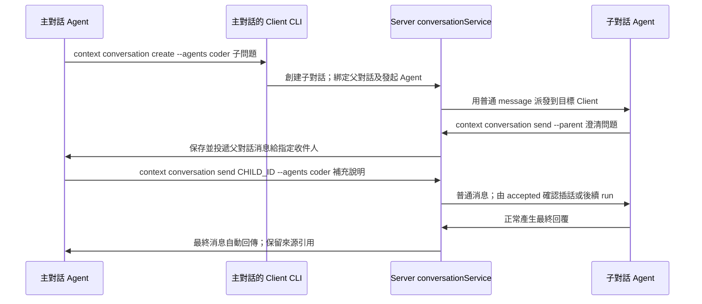

# 嵌套 conversation：派發、協作與回傳

> 本文描述已實作的端到端協作。數據結構及 API 的唯一規範見 [conversation 設計](server-conversation.md#父子對話)，此處不重複建表 SQL。Work 已整體移除。

## 要完成的閉環

主 conversation 中的 Agent 分析問題後，必須有能直接調用的工具來創建子 conversation、選擇執行者並投遞消息。子 conversation 遇到問題、需要澄清或產出結果時，也必須有明確的回傳入口。回到主對話的消息須指定收件人，才能經既有消息機制讓相應 Agent 繼續處理。

主、子對話均支持多 Agent。協調者是一個 conversation，具體由哪些 Agent 處理每條消息，仍由 to_agent_ids 決定。



## 兩層分工與提示詞

創建頂層 conversation 時指定 mode：single（默認）自己執行，collaborative 協調並拆分子對話。mode 創建後不可修改，兩種模式都允許多個 Agent。

協作最多兩層：「collaborative 頂層 → single 子對話」。子對話只能 single；single 頂層不能拆分，也沒有父側回傳命令。同一 Agent 在不同 conversation 可因 mode 和父子關係承擔不同分工，無需變更 Agent 版本。

協作模式頂層的 Agent 負責理解需求、拆解子問題、選擇執行者、創建子對話、回答澄清問題、驗收及匯總。實際編碼、調研或其他業務執行交給子對話，不因任務簡單就改為在頂層直接完成。

內層的 Agent 必須在當前對話中直接完成分配的任務，不得再創建 conversation 或把任務繼續向下委派。遇到歧義、缺少資源、需要更換或增加執行者時，使用 send --parent 說明問題，交給頂層決定如何處理。子對話仍可包含多個 Agent，各自執行本次分配的工作。

### 頂層提示詞模板

以下固定平台提示詞使用英文，與具體用戶需求分開：

```text
You are coordinating this top-level conversation. Do not perform the delegated
implementation, research, or other execution work yourself, even for a small task.
Analyze the request, inspect the available agents with `context conversation agents`,
and create execution conversations with `context conversation create`.
Keep each child's ID; the server records you as its parent agent. Read child feedback, answer clarification
questions by sending messages to the appropriate child agents, review their results,
and provide the consolidated response to the user.
If the work needs to be split again, create or update execution children from here.
Do not wait indefinitely while a child is asking you for a decision.
```

### 內層提示詞模板

```text
You are executing an assigned task in a child conversation. Perform the work yourself
using the tools available in this conversation. Do not create another conversation
or delegate the task into another child conversation.
If you need clarification, resources, a different assignment, or additional agents,
use `context conversation send --parent` to report the issue to the parent.
Continue in this conversation when the parent sends instructions.
Give your final result normally; the server will forward the final message to the
recorded parent agent. Do not send the same final result a second time.
```

### 提示詞與工具必須同步生效

分工提示詞由 Server 根據已保存的 mode 及對話關係產生，作為每次 message.context 的平台執行約束，並隨投遞快照固定。Client 將其與本次輸入一起交給原生執行鏈路；不能只在建會話的界面、第一條消息或 CLI help 中說一次。

Agent 的版本固定指令仍作為 init 資源；對話分工不寫回 Agent 配置、不生成新 Agent 版本，也不改寫已有 session 的初始化快照。Client 按 Server 的關係元數據準備本地工具入口，不從 Agent 名稱、技能或舊 run 推斷角色。

| 所在對話 | CLI 暴露的協作能力 | Server 約束 |
|---|---|---|
| collaborative 頂層 | agents、create、list、read、send、wait | 只可在當前頂層下創建執行子對話；沒有父側回傳入口 |
| single 頂層 | 僅 status/attachment 等執行工具 | 自己完成任務，禁止創建其他對話 |
| single 內層 | send --parent；保留 status 和 attachment 等執行工具 | 禁止再創建 conversation、訪問其他執行分支或繞回頂層代建 |

內層執行 create 時，CLI 立即返回明確錯誤並指向 send --parent。即使直接調用 HTTP、僅篡改本地 parent_conversation_id 或省略創建請求的父 ID，Server 仍用真實來源及父子關係拒絕這次創建；直接要求在內層之下創建第三層也返回 403。這個限制對手工 API 和管理員同樣適用，不依賴提示詞自律。

上述分工針對 Server 的遠端對話。本地 local 調試沒有這套父子協作能力，仍執行用戶給出的本地輸入，不被改成一個無法派發子對話的協調者。

## Client 必須給 Agent 的 CLI

Agent 統一使用既有的 context 工具入口。Client 在執行環境準備命令、綁定描述文件並設置 PATH；通用工具說明和 `context --help` 須列出下面的能力。Agent 無需安裝 agentuse-server、下載 Work 腳本或手工填寫 Server 地址和憑據。

| 命令 | 行為 |
|---|---|
| `context conversation agents` | 查詢本次來源對話可選的 Agent，取得實際 ID、名稱和說明 |
| `context conversation create [--title TITLE] [--mode single] [--agents IDS] [--users IDS] [MESSAGE]` | 僅 collaborative 頂層可用：在當前對話下創建執行子對話，可同時發出首條消息 |
| `context conversation list` | 列出當前對話的直接子對話及其既有狀態 |
| `context conversation read CHILD_ID` | 頂層讀取自己直接子對話的消息和狀態 |
| `context conversation send CHILD_ID [--agents IDS] [--users IDS] MESSAGE` | 向子對話發普通消息；接收者明確指定 |
| `context conversation wait CHILD_ID [--timeout DURATION]` | 等待對話進展；完成、需要父側響應、有新輸入或超時時返回，不把 idle 當作執行成功 |
| `context conversation send --parent MESSAGE` | 向父對話中的 parent_agent_id 提問或匯報進展，無需也不能指定回信收件人 |

所有結果為 JSON。create 返回既有 conversation 創建結果，含 parent_conversation_id / parent_agent_id，Agent 應讀取並保留子對話 ID；CLI 不預先分配 run UUID。省略消息及收件人可先創建空子對話，後續再 send。頂層對話沒有父對話，send --parent 明確報錯。

### 主 Agent 的使用示例

```bash
context conversation agents
context conversation create --title "Search API" --agents coder,tester "Implement and verify the search endpoint"
context conversation list
context conversation read CHILD_ID
context conversation send CHILD_ID --agents coder "Use cursor pagination; keep the response fields stable"
```

### 子 Agent 的使用示例

```bash
context conversation send --parent "Which authentication scheme should the search endpoint use?"
```

子 Agent 用這個入口發問題或階段性信息。最終答案仍正常輸出，由 Server 在保存最終對話消息後自動回傳，無需 Agent 再手工發送一份相同結果。子對話有多個 Agent 時，各自的最終消息獨立回傳，不等待全部 Agent 結束後合成一份結果。取消或已確認的拒絕等沒有正文時，也需回傳清楚的狀態反饋，讓父側能決定如何繼續。

## 創建關係自動綁定

Client 從當前 execution context 取得 endpoint、conversation 和 agent_id。create 固定發往同一 endpoint；Server 驗證來源後，將當前 conversation 記為 parent_conversation_id，當前 Agent 記為 parent_agent_id。這兩個字段固定記錄誰在何處創建了子對話，不從本次輸入消息或其收件人推算，也不接受調用方任意改寫發起者。

例如，父對話 P 同時有 planner 和 reviewer。planner 從自己的 context 創建 C，即使 C 的首條消息發給 coder、tester，C 仍記錄 parent_conversation_id=P、parent_agent_id=planner。C 的問題、進展和最終回覆均回到 P 中的 planner。reviewer 在同一父對話中另行創建子對話時，那個子對話則記錄 reviewer。

頂層的這兩個字段為空，內層均非空。子對話只由 Agent context 創建；人類通過頂層消息讓 Agent 發起委派，不引入回傳用戶或自定義回信地址的分支。普通消息仍使用 to_agent_ids / to_user_ids 選擇收件人，與這個固定的創建關係分開。

Client 根據當前對話是頂層還是內層，僅暴露該層的操作；Server 將頂層限制在其直接子對話，將內層限制在自身執行和明確的父側反饋入口。Server 要依設備憑據、已派發的消息/Agent 關係及真實父子關係核對來源，不能信任 CLI 自報的 ID。通用接口須支持這種來源訪問；只有 CLI 命令而接口仍拒絕設備身份，整條鏈路就不可用。不增加 Work 授權兌換或第二套令牌。

本地 local context 沒有 Server 時，這組遠端操作明確返回不可用，不自動切換到某個默認 endpoint。

## 回傳後怎樣繼續執行

send --parent 先在子對話保存一條 Agent 反饋消息，再由 conversationService 將正文和作者引用送入父對話。最終回覆走同一條消息回傳路徑。父對話收到的是普通消息，由 Server 設置 to_agent_ids=[parent_agent_id]、to_user_ids=[]。send --parent 不接受改寫這個目標的參數。

父 Agent 正在執行時，新消息沿既有投遞鏈路送入其 session，由 accepted 確認是同一 run 的補充輸入還是新 run；父 Agent 已結束時，正常排隊並啟動後續執行。設備離線時消息留在 Server，不依賴原先的父 run 仍在運行。

wait 必須可中斷：子對話提問回父側、父 Agent 收到新輸入或遇到需要人類處理的請求時，提前返回等待原因，讓 Agent 恢復協調。不得一直等子對話結束而阻塞子對話正在等待的答案。反饋正文仍經普通 message/accepted 進入原生上下文，wait 不再返回一份待執行的輸入列表。

父 Agent 回應子問題時，使用 send CHILD_ID 並明確選擇子對話的接收 Agent。子 Agent 同樣可以處於執行中或已結束，兩種情況都復用普通消息鏈路。反饋問題不是新的 run request 類型，發消息也不自動取消或暫停子 run。

## 落庫、重放與邊界

- 子對話的消息與實際執行結果先可靠提交。父 Agent 暫時不可用時，不回滾子對話的最終結果。
- 回傳只處理明確請求回父對話的 Agent 反饋，以及子對話本地產生的最終回覆；父對話下發的任務和已轉發的消息副本不再自動回傳，避免回聲和循環。
- 父消息保存 source_conversation_id / source_message_id。相同來源消息向同一父對話最多生成一份，回傳記錄及父對話的輸入分配原子提交。
- 中斷後按已提交的源消息和父消息的來源引用補送，掃描的是對話消息，不是 run 終態；不另建 Work 結算對象。
- CLI 返回須區分「源消息已保存、等待回傳」與「父消息已保存」；兩者都不等於父 Agent 已完成處理。寫操作結果不確定時先讀取核對，不盲目重發 create/send。
- 文件仍屬於來源對話的文件樹。父消息保留來源鏈接，通過授權接口讀取源文件；不將子對話的附件 ID 當作父對話附件。

## 實作驗收

1. 主 Agent 能僅靠 PATH 中的 context 查到可用 Agent，創建並派發子對話。
2. 多個主 Agent 並存時，每個子對話精確記錄其創建 Agent；消息收件人改變、父 run 結束或 Agent 發布新版本都不改寫這個關係。
3. 子 Agent 的澄清問題可回到父對話，父 Agent 的答覆可再次進入原子對話。
4. 子對話的最終回覆可自動回傳；父 run 已結束或父設備短暫離線不丟消息。
5. 重啟及重放不重複生成父消息，跨層轉發不形成消息回聲。
6. collaborative 頂層每次輸入均帶協調提示詞；single 頂層帶直接執行提示詞；所有內層輸入均帶直接執行及禁止再拆分的提示詞，包含同一 session 的後續消息。
7. 內層在 CLI 中看不到 create；直接調用、替換父 ID、缺失可核對來源或管理員手工建立第三層均會被 Server 拒絕。
8. 主 Agent 正在 wait 時，子側提問能使等待返回，父 Agent 可回應後繼續等待，不形成互相等待。
9. 多 endpoint、無父對話、來源無權訪問和投遞失敗均有明確結果。

實作位置：Client 的 context_conversation CLI 與 run/context_conversations.go；Server 的 conversation/parent.go、conversation/delivery.go 和 controller/conversation_auth.go。前端只保留 conversation，以子樹、父鏈接、來源消息和回傳狀態展示協作。

來源驗證使用當前 endpoint 的設備密鑰，以及 X-Agentuse-Conversation/Agent/Session/Run 四個通用執行來源 header；Server 核對已上報的實際執行事實，parent_agent_id 仍只記錄穩定 Agent ID。CLI 只為讀取來源校驗短暫等待 accepted 上報，不盲目重試寫操作。

文件不隱式複製。根協調 Agent 可用 context attachment list/download --conversation CHILD_ID 讀取直接子對話文件；子 Agent 可用 --conversation parent 讀取父輸入。跨對話下載位於當前 workspace/.context/conversations/ID/ 下，避免與本對話路徑衝突；不允許跨分支或跨對話上傳。
