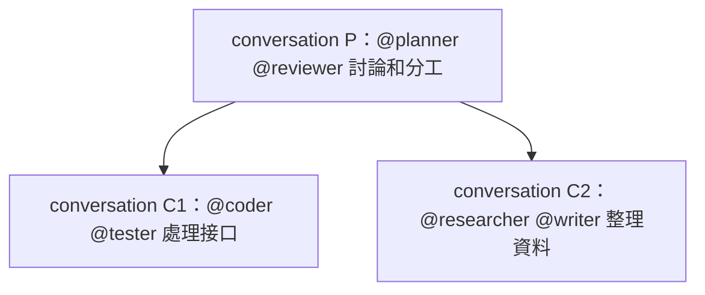

# 嵌套 conversation：父子對話協作

> 本文只說明協作場景。父子模型、API、權限、生命週期及數據結構以 [conversation 設計](server-conversation.md#父子對話)為唯一規範，不在此重複定義。新模型尚未實作，當前代碼及 [Work 使用手冊](../../docs/server/work.md)仍保留舊實作。

嵌套對話直接使用 conversation 的父子關係。主、子對話都是普通 conversation，各自支持多 Agent；使用者無需把普通對話轉換為另一種業務實體。

## 一次協作如何進行

1. 使用者在普通對話 P 中向 planner 和 reviewer 發消息，討論目標與分工。
2. 在 P 下創建子對話 C1，提供接口子問題和必要背景，向 coder、tester 發送消息；也可以先創建空子對話。
3. 在 P 下創建另一個子對話 C2，交給 researcher、writer。各對話按既有消息機制執行，可以分佈在不同 Client。
4. 使用者或 Agent 讀取 C1、C2 的回覆，再在 P 發普通消息繼續討論。需要在同一輪等待時，復用對話的等待／讀取能力。

界面復用普通對話頁，增加子對話列表或樹。點選任一節點即可查看它的消息和文件；沒有子對話的節點仍可隨時新增子對話。

## 職責落點

父子關係與普通對話操作由 conversationService 管理。多 Agent 收件人、版本固定、Client session 和實際 run 均沿用既有鏈路。界面只組織和展示這些資料，不另外保存協調角色、憑據或執行狀態。

當前獨立 Work 結構及接口的刪除清單也在 [conversation 設計](server-conversation.md#待替換的舊-work-結構)中維護。本文不擁有數據表或 API 定義。
