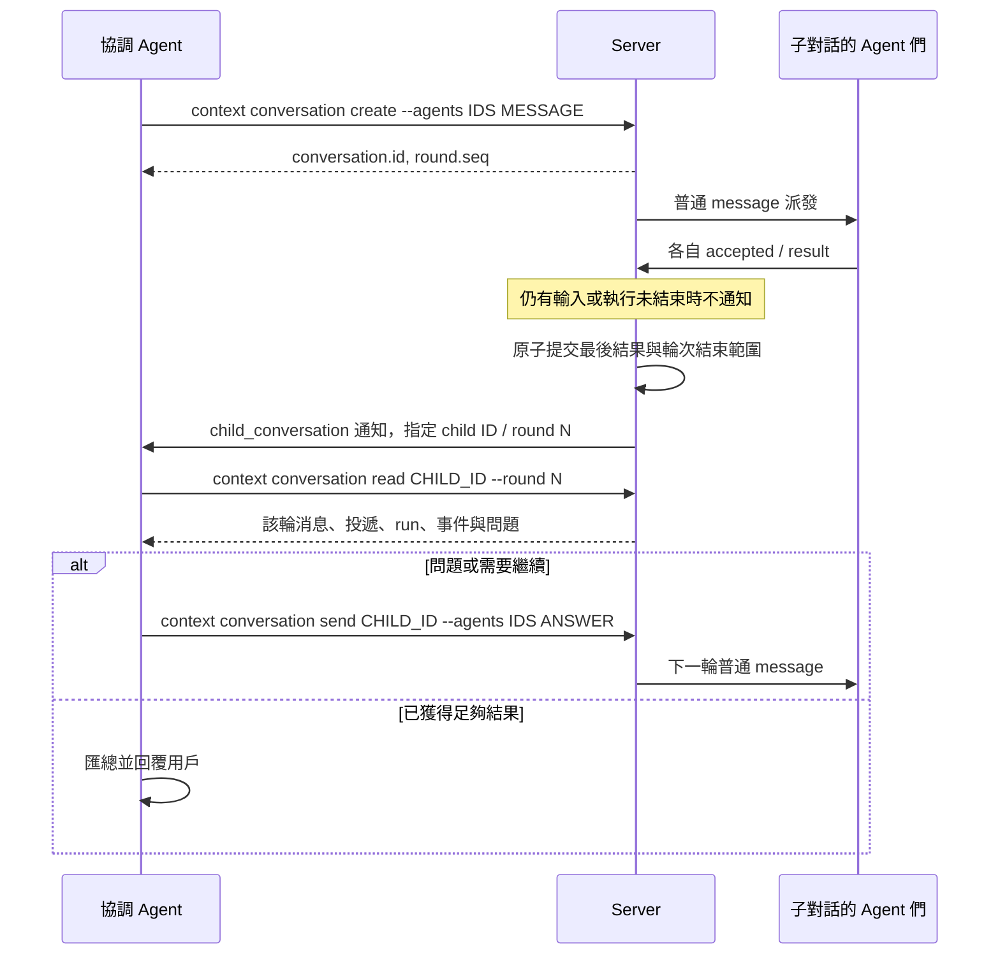

# 嵌套 conversation：拆分與按輪次協作

本稿關注「主會話如何交辦，子會話如何結束，以及協調者如何收到結果」。父子關係、作者、輪次及唯一 SQL 定義見 [server-conversation.md](server-conversation.md#父子對話)，不在這裡重複數據庫結構。

## 一進一出的閉環

協作根 conversation 的 Agent 分析需求後，用已放進執行環境的 context 命令創建 single 子 conversation，明確指定子 Agent 和任務內容。可以創建多個子對話，分布在不同 Client；一個子對話也可以有多個 Agent。

子 Agent 的回覆保留在子對話。**整輪所有輸入和執行收束後，Server 自動在父對話放入一條 author_role=child_conversation 的消息**，author_conversation_id 和 author_round_seq 指向來源。父側收件人固定為創建子對話的 parent_agent_id，然後走普通消息派發。通知不複製某個 Agent 的結果，也不要求子 Agent 再調用一個報告工具。



## 兩層分工與提示詞

創建根對話可選 single 或 collaborative，默認 single，之後不可修改。只有 collaborative 根允許創建子對話；子對話固定 single，最多兩層。single 表示直接執行，不限制 Agent 數量。

Server 根據 mode 和真實父子關係，隨每次 message.context 注入英文分工說明；Client 的 context 工具幫助同樣按能力展示。這不修改 Agent 已發佈版本，也不把協調角色綁到啓動時的某個 run。

協調者的核心指令：

```text
Coordinate this top-level conversation. Do not execute the delegated work yourself.
Use context conversation agents and create to delegate into child conversations.
Keep each child ID. Server sends one child_conversation notification after every
completed child round. Read CHILD_ID --round N, review all results and failures,
answer child questions with send CHILD_ID --agents IDS MESSAGE, and consolidate.
A completed round is not proof of success. Waiting is optional.
```

子 Agent 的核心指令：

```text
Execute the assigned work yourself. Do not create another conversation.
If you need clarification or resources, explain the question or obstacle in your
final response and end this round normally. Do not wait for a coordinator reply
within the same round. Server notifies the creating parent Agent after all inputs
and executions settle. The coordinator may send instructions for a later round.
```

內層沒有主動發父消息的入口。若缺失「鑑權方式」才能繼續，它直接在最終答復中提問並結束本輪；協調者被通知後讀取該輪，決定回答、換人或停止，再發下一輪輸入。原生權限審批/人工提問仍用 request/reply，等待時不偽造輪次結束。這樣不用混合進展回報、手動最終報告和自動結果轉發。

Server 用設備、已上報的實際 session/run、Agent 版本核對來源；子 Agent 不能用普通發送接口寫入父對話，也不能直接 HTTP 創建根或第三層來繞過分工限制。人類創建根，再要求協調 Agent 拆分；不能代填 parent_agent_id 創建子節點。

## context 命令已在執行環境中

Client 將裸 context 放入每個 session 的 PATH，綁定 endpoint、conversation、Agent、原生 session 及當前實際 run；設備憑據由私有配置取得，AI 不手填 Server 地址、ID 頭或令牌。所有操作復用普通 conversation API，無專用工具腳本或工作令牌。

| 命令 | 用途 |
|---|---|
| context conversation agents | 協調者查詢可用 Agent |
| context conversation create --mode single --title TITLE --agents IDS MESSAGE | 創建子對話並交辦；返回 conversation 和 round |
| context conversation list | 列出直接子對話，包含空對話 |
| context conversation read CHILD_ID [--round N] | 讀取完整對話或指定輪次範圍 |
| context conversation send CHILD_ID --agents IDS MESSAGE | 向子 Agent 發普通輸入；未結束時加入當輪，已結束則開始下一輪 |
| context conversation wait CHILD_ID [--round N] [--timeout 5m] | 可選等待；不負責生成通知 |

這組管理子對話的命令僅 collaborative 根可用。single 根與 single 子對話保留 status、attachment 等執行能力；子對話 help 提示自行執行並正常結束，create 等操作由 CLI 和 Server 同時拒絕。

create 省略消息及收件人可先建空子對話，此時沒有 round。create/send 的成功結果若包含 Agent 輸入會有 round.seq，協調者可保留它作固定等待目標。原生 run UUID 仍只能由 accepted 產生。

```bash
context conversation agents
context conversation create --mode single --title "Search API" --agents coder,tester "Implement and test the API"
context conversation wait CHILD_ID --round 1 --timeout 5m
context conversation read CHILD_ID --round 1
context conversation send CHILD_ID --agents coder "Use the existing OAuth mechanism"
```

wait 返回 {reason, detail}。指定輪次 finished_at 已寫入即 settled，不因下一輪啓動繼續等待；不表示業務成功。省略 --round 固定開始等待時的最新輪次，空對話返回 no_round。new_input、needs_input、run_ended、timeout 可中斷等待；協調者隨後處理正常輸入。通知也可能在父 run 結束後觸發下一次執行，協調者不必保持同一 run 阻塞等待。

## 邊界和可靠性

一次 Agent-targeted 輸入開始一輪，直到對話沒有活躍 run、等待原生請求或未收束投遞。多 Agent 各自結束只更新子歷史；失敗、取消、已確認拒絕也納入同一輪，不逐條報告。斷線和 unknown 不能被推斷為完成。

子結果及輪次邊界先落庫。父通知獨立原子保存作者來源、輪次及給創建 Agent 的分配；父側故障不抹掉子結果。Server 從已結束但缺通知的輪次補送，進程重啓及事件重放不重複生成父消息。同一子對話按輪次順序補送。發起 Agent 已刪除則顯示 failed，保留來源，不回退其他收件人。

GET 的 round=N 只返回該輪固定的消息與執行範圍；對話當前狀態和通知送達狀態仍為當前值。父通知點開該輪，子頁面展示輪次分隔與 pending/delivered/failed；delivered 僅指父消息已落庫，並非已被處理。

## 文件回路

每個對話有獨立文件樹。子 Agent 用 context attachment list/download --conversation parent 讀父輸入；協調者用 --conversation CHILD_ID 讀子產物。跨對話下載保存到 workspace/.context/conversations/ID/；不能跨兄弟分支讀取或跨對話上傳。產物在本輪 result 前 upload，最終回覆引用返回的 download_path。父通知只帶來源導航，附件仍屬於子對話。

## 驗證重點

多 Agent 與追加輸入必須全部收束才通知一次；同一 Agent 在父子對話中不得混淆作者。失敗/取消/拒絕、unknown/離線/人工等待、空對話/備註均遵守上述邊界。固定輪次不能讀入下一輪，重啓/故障/重放不能丟結果或重複通知；舊手動父消息入口不保留。
