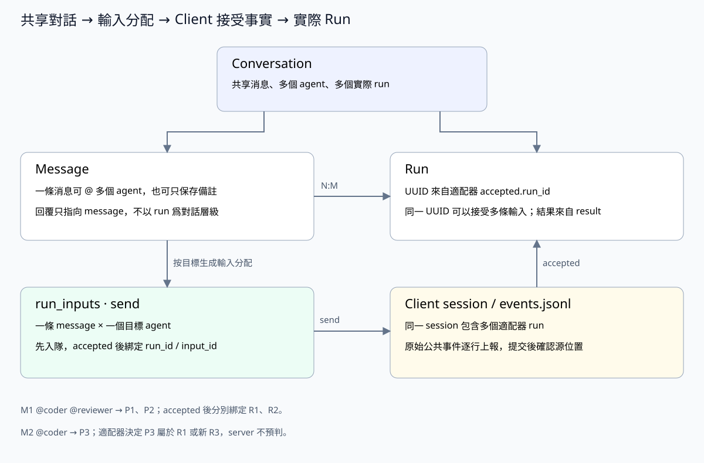

# conversationService：共享對話與消息編排

> 執行鏈路使用 [agentuse-client/2](protocol.md)：直接投遞 message，消息/Agent 關係見 [server-run.md](server-run.md)，不再有 task 或獨立輸入 ID。

> 執行關係已採用 client 公共事件協議。本文的 conversation/device 是業務名稱，元數據已按下列結構實現；執行記錄及消息附件業務元數據分別見相關設計。目標表不聲明數據庫外鍵，關聯校驗和清理由 service 完成。

## 職責

Conversation 是原共享對話概念的新名稱，不新增另一層 conversationService；原有消息、任務和文件歸屬隨之統一改名。session 是 client 本地的原生執行會話，見 [client-session.md](client-session.md)。

conversationService 管理 conversation、message 和共享歷史，並編排消息分配。一個 conversation 包含若干 message 和若干 run；message 與 run 的任務輸入關係是 **N:M**，由 runService 中 message_agents 連接。

- 創建/讀取/刪除對話，維護標題、歸屬和共享歷史。
- 接收消息，保存 to_agent_ids 和 to_user_ids；按 to_agent_ids 調用 runService，對話原文只保存一次，每個目標 agent 保存一條 message_agents 關係，等待 accepted 關聯實際 run。
- 消費執行結果事件，把最終回覆寫爲 agent message，並記錄作者和被回覆的 message。
- 讀取對話時組合對話、run、message_agents、事件和問題的統一快照。

附件元數據、發佈與刪除編排、重名策略和消息附件快照都屬於 conversationService，源碼統一歸入 `conversation_*` 文件。文件字節通過獨立的 `service/file/` 本地/S3 後端存取；完整的源碼分工見 [fileService 實現分工](server-file.md#實現分工)。



## 發送和回覆

發送鏈路是 `controller → conversationService → runService`：先檢查發送權限及兩組收件人的有效性，在一個事務中寫一條 message 和 to_agent_ids 中每個 Agent 的 message_agents，提交後按 heartbeat 容量主動發送 message。任一收件人校驗失敗則整體回滾。

`to_user_ids` 表示消息發給哪些用戶，不建立 message_agents 或 run。只有用戶收件人時保存發給用戶的消息；兩組都為空時保存普通對話備註。省略的數組統一保存為 `[]`，不默認調用上次 Agent，也不從正文中的 @ 名稱推斷執行目標。

此時只分配輸入，run_id 爲空。這一事務內爲每條 message_agents 固定 agent_version_id，後續派發不追隨 latest。Server 不能根據某個 agent 仍在執行，就認定新消息一定屬於它當前的 run。

```text
M1 @coder @reviewer → (M1,coder)、(M1,reviewer)
client accepted (M1,coder)：run_id=R1，input_id=I1
client accepted (M1,reviewer)：run_id=R2，input_id=I2
M2 @coder → (M2,coder)
client accepted (M2,coder)：
  run_id=R1 → 同一次交互的補充輸入
  run_id=R3 → 後續一次交互
```

(M2,coder) 最終關聯哪個 run，由適配器決定，並通過 accepted 上報。message 與 run 的 N:M 關係由此建立，消息/Agent 複合鍵直接關聯消息，不另分配執行身份。conversation 不綁定 agent，不設置參與者表或每個 agent 獨立的共享歷史。

收到 client result 後，在**同一事務**保存原始事件、更新 run 與輸入狀態、寫入 agent message、綁定 runs.result_message_id，並重算對話狀態。最終回覆的 reply_to_message_id 指向 first_message_id；messages 不保存 run_id。事務提交後才確認源事件位置，重複上報直接確認已有記錄，不重複寫回復或觸發 Work 彙總。

message、request、log 是執行記錄，不能都變成普通聊天消息。cancel 入隊和送達只表示控制傳輸，斷線也只改變設備連接狀態；這些操作都不生成執行結果。只有 client result 決定 completed/failed/cancelled，cancelled 可以沒有最終回覆。

## 狀態和刪除

Conversation 狀態是實際 run 與未完成輸入的聚合投影，優先 waiting、running、pending，再到 idle；resolved 是用戶的完成標記。投影由 conversationService 通過 runService 查詢當前狀態後更新，run 狀態變化和最終結果事件都觸發重算；重算讀取當前實際 run 和未完成輸入集合，不用舊事件直接覆蓋投影。idle 不表示歷史任務全部成功。

有活躍 run 或待領取/待受理輸入時拒絕刪除，檢查與刪除共用事務；回覆消費前也要重新檢查對話是否存在，已刪除的對話不恢復創建。刪除對話由 conversationService 協調相關 service，在同一事務內清理消息、run、message_agents、事件、問題及輔助記錄；本地目錄或 S3 對象前綴由 fileService 清理。Work 的協調對話和線程歸屬由 workService 決定。

## 標識和消息順序

conversations.id 和 messages.id 均爲 server 生成的 UUID，SQLite 中使用 TEXT 保存。所有 conversation_id、message_id、reply_to_message_id 等關聯字段使用相同的 UUID 字符串。

UUID 只用於標識，不承擔消息排序。messages.seq 保存 conversation 內的遞增順序號。message 派發快照只包含本次正文、附件和必要業務說明，不把整份共享歷史放進 context。

Client 選定實際本地 session 後，向 Server 讀取 `complete_messages`：以該設備、Agent 固定版本及本地 session 最後一條已受理輸入為界，只補其後、本次消息之前的共享消息，並排除該 session 自己產生的回覆。新 session 尚無受理記錄時，補齊本次之前的歷史。消息保留作者、收件人、正文和附件，不攜帶舊 result、用量或執行日誌；本次正文只傳一次。

邊界直接來自既有 message_agents 的 accepted 關聯，不增加游標表或 harnessctl 命令。未受理的派發不推進邊界，未來消息不提前注入。Client 保存實際組裝的 context，供本機執行上下文查閱。

發送請求不做去重：每次成功發送創建新的 message UUID，不需要請求 key 或內容摘要字段。

## 元數據實現

本文下列 SQL 定義元數據的目標命名和字段。物理對話表為 conversations，HTTP 入口為 /api/conversations，SDK 和響應字段亦使用 conversation；消息、附件和執行記錄使用 conversation_id。session_id 唯一表示 Client 上報的本地執行會話，不提供 client_session_id 別名。當前 schema 7 的 conversation/message ID 均為 UUID，messages.seq 是對話內順序；to_agent_ids 和 to_user_ids 已在存儲、發送 API、SDK、CLI 和前端統一實現。發送接口接受 prompt，以及獨立的收件人和 attachment_ids；messages.attachments 已保存所選附件的元數據快照。author_role 使用 user/agent，content 是未包裝的原始正文字符串；不再提供 role、agent_key、agent_name、消息 run_id、mode、input 或 defer_start 別名。作者名稱透過 users 或固定 Agent 版本讀取。通用 fileService 的目錄/S3 後端已實現，conversation 附件元數據歸本 service 管理，字節統一保存在 fileService 的 conversations 命名空間。執行關係見 [server-run.md](server-run.md)。只接受新字段及 schema 7，不保留舊字段別名或數據遷移。

## 表結構

### conversations

共享對話主表。`user_id` 是資源所有者，`created_by` 是創建者；可歸屬一個 work，不綁定 agent。所有 conversation 都支持多 agent，不設 mode 字段。狀態是聚合投影，不替代 run 明細。

```sql
CREATE TABLE conversations (
    id TEXT NOT NULL PRIMARY KEY,
    user_id TEXT NOT NULL,
    created_by TEXT NOT NULL,
    work_id TEXT,
    title TEXT NOT NULL DEFAULT '',
    status TEXT NOT NULL DEFAULT 'idle',
    created_at INTEGER NOT NULL,
    updated_at INTEGER NOT NULL
);
CREATE INDEX conversations_work
    ON conversations(work_id,updated_at);
CREATE INDEX conversations_status
    ON conversations(status, updated_at);
CREATE INDEX conversations_user
    ON conversations(user_id, updated_at);
CREATE INDEX conversations_created_by
    ON conversations(created_by, updated_at);
```

### messages

共享對話的原始消息。`content` 統一保存對話正文；`author_role` 爲 user/agent；`author_user_id`、`author_agent_id` 按作者類型二選一。Agent 回覆還記錄 `author_agent_version_id`，關聯具體不可變版本讀取當時名稱；用戶名稱關聯 users，不保存 agent_key、agent_name 字符串快照。

`to_agent_ids` 和 `to_user_ids` 保存消息的收件人，兩者均為 JSON 字符串數組，可同時非空，用戶消息和 Agent 消息使用相同規則：

- `to_agent_ids`：穩定的 agents.id 數組，表示哪些 Agent 要處理這條消息；具體版本和實際執行歸屬保存在 message_agents 與 runs。
- `to_user_ids`：users.id 數組，表示消息發給哪些用戶；這些收件人不觸發 Agent 執行。

service 校驗元素為非空 ID 字符串，分別去重，檢查 Agent 可在該 conversation 使用、用戶存在且有權讀取該 conversation。收件人字段不授予對話訪問權；消息仍屬於共享歷史，由 conversation 權限決定可見性，不因定向收件而變成私信。

兩組收件人在消息首次入庫時固定，即使後續派發失敗、Agent 改名或 run 結束，也保留原始收件人。每條新回覆獨立指定收件人，不自動繼承父消息的收件人數組。重複 ID 在保留首次出現順序的前提下去重；空 ID 或帶首尾空白的 ID 拒絕寫入。

發送請求用 `attachment_ids` 選擇本條消息的附件。例如：

```json
{"prompt":"請查看這兩個文件","to_agent_ids":["coder"],"to_user_ids":["user-alice"],"attachment_ids":["at_input","at_report"]}
```

文件先通過附件 API 上傳，再在消息中引用；省略或空數組表示本條消息沒有附件，不繼承會話的其他文件。service 在寫入消息的同一事務內校驗附件屬於當前 conversation，將完整元數據快照保存到 `messages.attachments` JSON 數組，包含 `id`、`relative_path`、文件名、大小和摘要等字段。字節內容按 conversation_id/relative_path 存儲，`attachments.relative_path` 定義會話內的文件樹；用戶上傳位於 `user_input/`，AI 輸出可以使用多級相對路徑。最終 Agent 回覆保存本次 run 上傳的輸出文件快照。路徑和刪除規則見 [conversation-files.md](conversation-files.md)。

service 寫入時保證 user 消息只填 author_user_id，agent 消息填寫 author_agent_id 和 author_agent_version_id，並檢查版本屬於該 agent。讀取作者用 LEFT JOIN；角色選擇器展示當前版本名稱，歷史 agent 回覆按作者版本展示，不受後來改名影響。軟刪除不清空消息作者或已發佈版本。

message 永遠回覆另一條 message，不回覆 run。發送請求可顯式填寫 `reply_to_message_id`；service 在同一事務檢查它是同一 conversation 的既有消息，跨對話引用整體回滾。`reply_to_message_id` 表示被回覆的消息，字段保存被回覆消息的 UUID，開頭的根消息爲空；後續用戶消息、agent 回覆都可以引用同 conversation 中已有的消息。messages 不保存 run_id，也不以 run 爲對話層級。

`author_*` 表示誰發送，`to_*` 表示發給誰，`reply_to_message_id` 表示回覆哪條消息，三者獨立。寫入 Agent 最終回覆時，Server 明確填寫收件人；例如 user-alice 發給 coder 的消息，其 Agent 最終回覆設 `to_user_ids=["user-alice"]`、`to_agent_ids=[]`。僅引用 reply_to_message_id 不會再次喚起父消息中的 Agent；要讓另一個 Agent 繼續處理，須在新消息的 to_agent_ids 中明確指定。

```text
M1：@coder @reviewer 修復並評審
  ├─ M2：coder 的回覆，reply_to_message_id=M1
  ├─ M3：reviewer 的回覆，reply_to_message_id=M1
  └─ M4：用戶追問，reply_to_message_id=M1 或選中的具體回覆
```

一個 run 消費多條輸入時，最終回覆默認指向其主任務 message；補充輸入仍通過 message_agents 記錄。service 檢查父消息已存在、屬於同一 conversation，避免跨對話引用和循環回覆。

執行結果的內部關聯留在 runs.result_message_id，允許 runService 追蹤及去重，但不會出現在 messages 的字段或回覆語義中。conversationService 在同一事務調用 runService 檢查結果是否已綁定，未綁定才新增回覆並綁定；重複結果直接返回已有回覆。取消可以沒有回覆。

```sql
CREATE TABLE messages (
    id TEXT NOT NULL PRIMARY KEY,
    conversation_id TEXT NOT NULL,
    seq INTEGER NOT NULL,
    author_role TEXT NOT NULL CHECK(author_role IN ('user','agent')),
    content TEXT NOT NULL,
    attachments TEXT NOT NULL DEFAULT '[]',
    author_user_id TEXT,
    author_agent_id TEXT,
    author_agent_version_id TEXT,
    to_agent_ids TEXT NOT NULL DEFAULT '[]',
    to_user_ids TEXT NOT NULL DEFAULT '[]',
    reply_to_message_id TEXT,
    created_at INTEGER NOT NULL
);
CREATE UNIQUE INDEX messages_conversation_seq ON messages(conversation_id,seq);
CREATE INDEX messages_replies ON messages(conversation_id,reply_to_message_id,seq);
```

### 合併掉的輔助表

| 原表 | v3 處理 |
|---|---|
| message_formats | 不再建表，也不保留 format 字段；消息與執行副本均保存正文 |
| message_authors | 不再建表，作者保存在 messages.author_role、author_user_id、author_agent_id、author_agent_version_id；名稱關聯用戶或固定 agent 版本讀取；回覆關係使用 reply_to_message_id，執行關聯留在 runs |

這些信息仍有作用，但都是一條消息自身的屬性，不需要再各拆一張 1:1 的表。

## 相關設計

[Server 總覽](server-main.md) · [userService](server-user.md) · [deviceService](server-device.md) · [agentService](server-agent.md) · [skillService](server-skill.md) · [Client harnessService](client-harness.md) · [runService](server-run.md) · [fileService](server-file.md) · [workService](server-work.md)

消息附件採用顯式 attachment_ids 選擇，messages.attachments 保存元數據快照；省略時為空，不繼承會話文件。每個 conversation 的文件樹與目錄操作 TODO 見 [conversation-files.md](conversation-files.md)。

送入模型的 `complete_messages` 使用可讀的對話文字，按順序標示作者、@收件人、引用的消息正文及附件名稱／ID／路徑；不把 API JSON、消息 UUID、序號、雜湊或執行資料直接拼入提示詞。API 維持結構化資料，Client 只負責排版。程式產生的標題、工具說明與提示詞統一使用英文，使用者和 Agent 的原始正文保留原文；既有 native session 的初始化快照不改寫。
