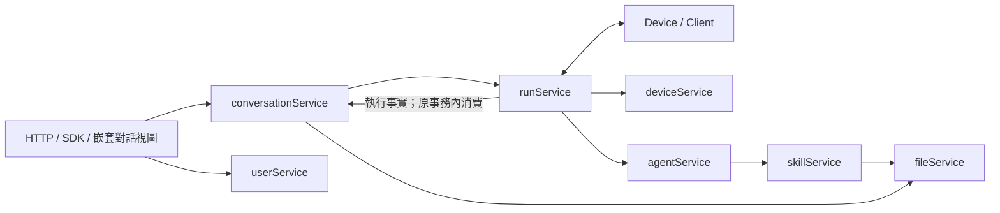
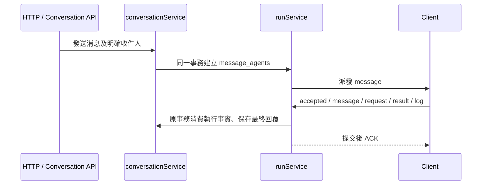

# Server 設計

Server/client WebSocket 報文、字段和恢復規則見 [protocol.md](protocol.md)。

Server HTTP API 通過 Huma 註冊，從共用的請求和響應 Go 類型自動生成 OpenAPI。用戶登錄後可打開 `/api/docs` 交互文檔，或讀取 `/api/openapi.json`、`/api/openapi.yaml` 和 `/api/schemas/{schema}.json`。文檔入口沿用用戶 cookie / Bearer 鑒權；每個操作分別標明用戶與設備身份的適用範圍。文件接口使用 multipart 或二進制格式，WebSocket 入口僅描述 HTTP 握手。

> 本文定義 Server 的業務劃分。嵌套 conversation 模型為本次目標設計，尚未實作，見 [conversation 設計](server-conversation.md#父子對話)；其他已實現鏈路仍按各自說明。controller 處理傳輸和身份，service 按下表組織業務與事務，store 保存 schema、查詢與行解碼。Client 職責見 [client-main.md](client-main.md)。

Conversation 表示共享對話，由 conversationService 管理；原 session 業務整體改用此名稱，session 專指 client 對應 Codex/Claude Code 的原生執行會話，見 [client-session.md](client-session.md)；server 不增加 sessionService 或 sessions 表。

Server 保存對話、組織任務並跟蹤執行。用戶的一臺執行設備稱爲 **device**，設備上運行的程序稱爲 **client**。Client 從 server 領取輸入分配，由本地 harnessService 解析 YAML、準備資源、執行 harness 並處理交互。Server 保存輸入分配與 client 上報的 run 事實，不理解原生 harness 協議。

一臺 client 可以向多個獨立 server 註冊，由本地 [endpointService](client-endpoint.md) 保存註冊信息，[client runService](client-run.md) 負責連接、接收 message 和執行；每個 server 只看到本中心註冊的 device，不共享其他中心的任務或憑據。

## 實現約束

執行協議已採用 agentuse-client/2：server 不預創建 run，只有 client 的 accepted 創建實際 UUID；五種公共事件原樣入庫，沒有 attempt、租約、原生能力分支或 server harnessService。詳細協議、實際 SQL、重連規則及 schema 7 升級約束見 [server-run.md](server-run.md)。

Server 的對話 HTTP 入口、SDK 模型、響應字段和存儲均使用 conversation：`/api/conversations`、`conversation`、`conversations` 表及 `conversation_id`。Client 生成唯一的 `session_id`，Server 只記錄這個值以關聯原生執行，不生成另一套會話 ID，也不提供 `client_session_id` 別名。設備管理入口為 `/api/devices`，Client 註冊與身份查詢為 `/api/client/register`、`/api/client/me`。消息 UUID、兩組收件人和消息附件快照均在 schema 7 實現。附件存儲提供按 conversation 隔離的文件樹，見 [conversation-files.md](conversation-files.md)；通用 fileService 的本地/S3 後端仍獨立處理其他資源文件。

Agent/Skill 版本化已實現，分別見 [agentService](server-agent.md) 與 [skillService](server-skill.md)：有效配置變更發佈不可變版本；輸入入隊時固定版本，client 首次使用該版本時創建新的 session/init 綁定。共享 ZIP 經 fileService 的 skills 命名空間保存，通過 HTTP 下載，不在 WebSocket 發送文件或原生命令。

runService 直接保存 message_agents 複合關係，accepted 建立實際 run；answer/cancel 各自保存傳輸收據，不再共用一個輸入業務對象。配置和 skills 由 Client 按固定版本 HTTP API 讀取，init 是 Client 內部步驟。

## 一、整體關係

Server 分爲三層：

- **controller**：HTTP / WebSocket 入口，處理身份、請求和響應，把業務交給 service。
- **service**：按業務對象劃分職責，決定如何保存對話、分配任務、管理設備和業務狀態。
- **store**：表、查詢和事務；各 service 通過它保存自己的業務數據。

設備的在線連接由連接管理組件維護。Service 通過通知接口讓它派活、推送輸入、取消或答案；連接本身不承擔 conversation/run 的業務規則。

## 二、有哪些 Service

| Service | 負責什麼 | 主要擁有的表或數據 |
|---|---|---|
| [userService](server-user.md) | 用戶、角色、訪問令牌和身份校驗 | `users` |
| [deviceService](server-device.md) | 執行設備的登記、憑據、在線狀態、可用 harness 和執行能力 | `devices`、`device_harnesses`、`device_capabilities` |
| [agentService](server-agent.md) | Agent 身份、不可變配置版本，以及具體 Skill 版本的固定關聯 | `agents`、`agent_versions`、`agent_version_skills` |
| [skillService](server-skill.md) | 共享 Skill 身份、ZIP 版本發佈與校驗、權限和下載；複用 fileService | `skills`、`skill_versions` |
| [conversationService](server-conversation.md) | 創建父子對話、保存消息和共享歷史；調用 runService 分配消息，消費執行事實保存回覆；支撐 嵌套對話視圖 | `conversations`、`messages`，以及逐消息附件引用的業務元數據 |
| [runService](server-run.md) | 分配消息輸入、接收實際 run、原樣保存公共事件、轉發回答和取消 | `message_agents`、`runs`、`run_events`、問題及控制投影 |
| [fileService](server-file.md) | 按業務命名空間封裝本地/S3；conversation 文件與 agent skill 包分目錄 | 本地目錄或 S3 對象前綴，無數據庫表 |

這裏的“擁有”指主要維護職責，不表示其他 service 不能讀取。跨業務修改通過所屬 service 完成；由編排操作統一事務，不能把各次調用做成互不相關的獨立提交。

各 service 的詳細職責和表結構見上表。runService 文檔給出已實現的執行層結構；Agent/Skill 版本表和 fileService 已實現，設備與單對話消息元數據已實現，父子對話組織仍待按嵌套對話設計調整；輸入分配、client 執行身份和原樣事件上報已實現。

所有表不聲明數據庫外鍵，只保存關聯 ID。創建/修改時由 service 檢查目標存在、歸屬和狀態；刪除時協調相關 service 顯式清理或清空關聯字段，並在同一事務提交。數據庫保留主鍵、唯一索引和必要的 CHECK 約束，不依賴自動級聯。

conversationService 負責發送消息的業務編排，調用 runService 建立任務分配。runService 透過 executionEventConsumer 發出執行事實，由 conversation 編排器在同一事務保存回覆及對話狀態；run 投影不直接寫 messages。回覆保存到來源 conversation；嵌套對話視圖讀取主、子對話的既有消息與狀態，不建立執行結算或自動彙總鏈路。

### 2.1 userService、deviceService、agentService

這三個對象分別回答“誰使用系統”“在哪裏執行”“由哪個 agent 承擔任務”。

- 一個用戶可以有多臺 device 和多個 agent。
- 一臺 device 可以運行多種 harness；可用與是否允許使用由 deviceService 維護。
- 一個 agent 是穩定角色身份；名稱、說明、device/harness/model、指令與固定 skill 版本屬於不可變 agent_version。
- 輸入入隊時固定 agent_version_id；發佈新版不改寫排隊輸入或已有 run，client 新版綁定新 session/events 並執行 init。

**Device 是執行位置，agent 是任務角色，harness 是執行方式。** 三者不能合併成一個概念。

### Agent 與 Skill 的獨立版本

agentService 管角色配置和 agent_version_skills，skillService 管共享技能和 skill_versions；兩者各自發布版本，只通過具體版本 ID 關聯。agentService 在發佈事務中調用 skillService 校驗選中的版本，skillService 再複用 fileService 保存包，不反向更新 agent。升級 Skill 不會自動改變任何 Agent 版本；需要使用新版時，顯式發佈新的 Agent 版本。

### 2.2 Client 的 harnessService

harnessService 放在 client，不屬於 server service。YAML、hook、skill、指令資源和原生交互都由 client 本地管理，詳情見 [Client harness 設計](client-harness.md)。

| Server 負責 | Client 的 harnessService 負責 |
|---|---|
| 保存消息、建立輸入分配並接收實際 run | 讀取本地 YAML、hook、skill 與指令資源 |
| 按 device 和上報能力分配任務 | 本地探測 harness，報告可用性和業務能力 |
| 下發輸入、答案、取消 | 啓動進程，進行原生 RPC、hook 與工具交互 |
| 接收 accepted/message/request/result/log 公共事件 | 本地解釋原始輸出，轉換爲標準業務事件 |

WebSocket 只傳 run 業務協議，不傳 shell 命令、argv/env、YAML、執行腳本、原生 RPC 幀或 hook 請求。原生交互在設備上閉環，減少代理/WAF 對執行類消息的誤判；這不保證任意業務正文都不會觸發 WAF。

Server 只認識設備上報的 harness 標識、版本和能力，不設 harnessService 或 harnesses 配置表，也不維護接入包分發服務。

### 2.3 conversationService 與 runService

- **conversationService 管對話與消息編排**：保存用戶消息，調用 runService 分配任務；接收結果事件，把最終回覆追加到同一 conversation。
- **runService 管任務執行**：哪些消息交給哪個 agent，在哪個 device 上執行，目前執行到哪一步。

發送消息時，conversationService 統一事務，消息與任務分配一併提交。收到 client result 時，原始事件、執行狀態、最終回覆、runs.result_message_id 和對話狀態在同一事務提交；重複上報不會重複追加回復。messages 不保存 run_id。

進度、計劃、問題和插話確認屬於 run 的執行記錄；需要作爲最終回覆展示的結果進入 messages。讀取對話時可以組合這些數據，但不能把執行事件全當作普通聊天消息。

### 2.4 fileService 與嵌套對話視圖

fileService 統一按命名空間存儲字節，不綁定 conversation。conversations 空間保存共享對話文件；skills 空間保存獨立的 skill 版本 ZIP。conversationService 和 skillService 分別校驗業務權限與清理時機。fileService 不寫文件數據庫記錄；conversation-files.md 定義的附件業務元數據歸 conversationService 管理，文件字節仍走同一命名空間；skill 包摘要和路徑屬於 skillService 的版本元數據。

嵌套對話用一個 conversation 管理多個子 conversation。主、子對話均支持多 Agent，收件人由每條消息明確指定。conversationService 用 parent_conversation_id 保存父子關係，復用普通創建、列表、讀取、發送及文件接口；無獨立 Work ID、固定協調 Agent 或工作授權層。具體操作及舊結構的刪除清單見 [conversation 設計](server-conversation.md#父子對話)。

## 三、每次消息進入 Server

1. controller 驗證用戶和 conversation 權限。
2. conversationService 在事務內保存消息，runService 為每個目標保存一條 message_agents 關係。此時不創建 run。
3. 提交後 Server 依 heartbeat 容量直接發送 message 和目標 Agent/版本；Client 缺少配置或技能時自己讀固定版本 API，準備資源並 init。
4. client 通過 harnessctl send 執行。accepted 決定實際 run UUID，可能與上次相同，也可能不同。
5. Server 驗證並保存五類公共事件，提交後確認源位置；只從這些事件投影執行狀態。
6. result 與來源 conversation 的最終回覆一起提交；嵌套對話視圖按需讀取子對話，不因某次 run 結束自動向另一個對話派發消息。

原生執行及原生工具的權限交互在 Client；Server 的 HTTP 身份及業務訪問權限由 controller 和所屬 service 校驗。HTTP 取消或回答只入傳輸隊列，斷線不製造執行結果。完整規則以 server-run.md 爲準。

瀏覽器透過獨立 WebSocket 接收變更通知，再由既有 HTTP API 讀取資料；詳見 [瀏覽器通知與 Markdown 顯示](server-browser.md)。

## 四、當前源碼組織

本節描述目前代碼的職責拆分。上文及 [conversation 設計](server-conversation.md#父子對話) 定義父子對話的目標模型；當前仍運行 schema 7 的舊 Work 行爲，該部分將隨新模型實作移除。

`server/internal/service/service.go` 中的 `Service` 是組裝入口，負責創建業務對象、連接依賴和配置存儲與通知。HTTP controller、WebSocket hub 及啓動流程顯式調用對應對象，例如 `ConversationService.SendMessage`、`RunService.DispatchMessage`。

| 當前業務對象 | 實現位置，相對於 `server/internal/service/` |
|---|---|
| `UserService` | `user_service.go`、`users.go` |
| `DeviceService` | `device_service.go`、`devices.go`、`device_*`；包含設備上報的 harness 視圖、能力與可用性校驗 |
| `AgentService` | `agent_service.go`、`agents.go`；身份與不可變版本發佈 |
| `ConversationService` | `conversation_service.go`、`conversations.go`、`conversation_*`；包含狀態、歷史、投遞上下文、結果回覆和文件業務 |
| `RunService` | `run_service.go`、`runs.go`、`run_*`；包含投遞、事件路由、問題、控制與已分配資源的憑據授權 |
| `skill.Service` | 獨立的 `skill/` 包；版本校驗、發佈、元數據和包讀取 |
| `file.Service` | 獨立的 `file/` 包；通用字節後端 |
| `WorkService`（過渡實作） | `work_service.go`、`works.go`、`work_*`；隔離舊的協調授權、指令和自動彙總，待父子對話模型落地時移除 |

協作業務對象目前保留在同一 Go package 中，各自有獨立接收者及顯式協作依賴；`file/`、`skill/` 是獨立 package。共用的 `serviceRuntime` 承載數據庫、時鐘、日誌和通知設施，業務依賴由各對象顯式持有。Conversation 的文件鎖和附件限制由 `ConversationService` 自己持有。

跨業務寫入通過接收同一 `*sql.Tx` 的所屬 service 方法完成：設備刪除由 runService 處理投遞狀態，由 conversationService 清空附件的設備歸屬；目前舊 Work 的刪除和協調授權撤銷同樣遵守此邊界。文件清理和瀏覽器通知在提交後執行。架構測試檢查 SQL 寫入的業務歸屬，回滾測試覆蓋跨業務清理失敗。

沒有 `service/v3` 運行時服務或版本分支。原 `v3_test.go` 的回歸測試現已按 conversation、device、work 分拆，Agent/Skill 版本測試也按業務命名；`v3` 表示本組設計文檔的版本。
