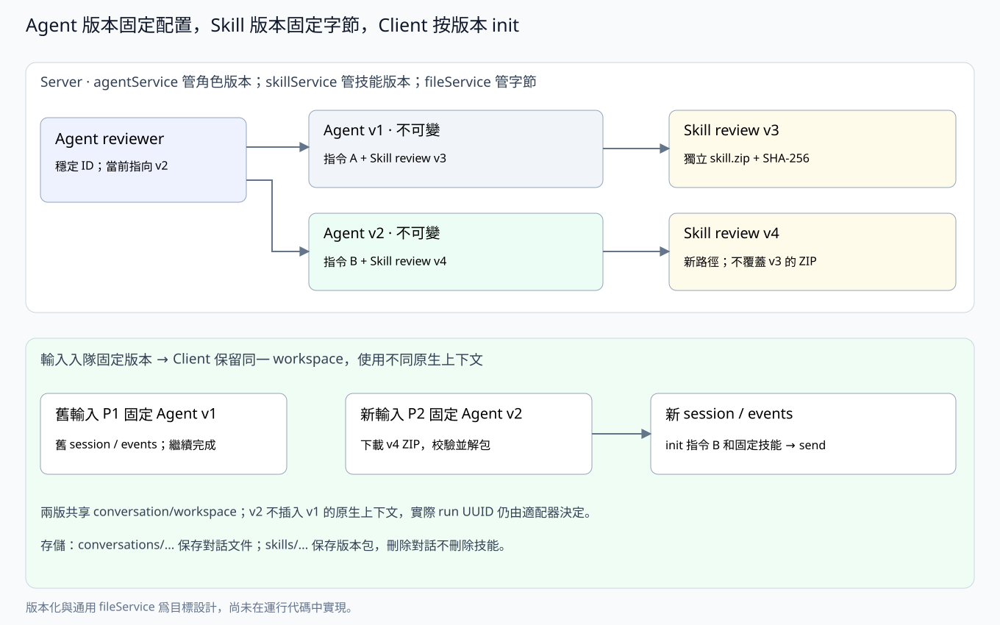

# skillService：共享 Skill 與不可變包版本

> 獨立 skillService 已實現，擁有 skills 和 skill_versions，表之間不聲明數據庫外鍵；ZIP 字節使用通用 fileService。

## 職責與關係

skillService 管理可被多個 agent 複用的技能身份、版本、ZIP 上傳、包校驗、發佈、訪問權限及下載。它擁有 skills 和 skill_versions；文件字節委託給 [fileService](server-file.md) 的 skills 命名空間，不自建存儲後端。

agentService 負責 agent 和 agent_version，以及 agent_version_skills 關聯。它通過本 service 校驗指定 skill_version_id；本 service 不向 agent 自動推送最新版本，不修改 agent 配置，也不調用原生 harness。

| 對象 | 擁有者 | 作用 |
|---|---|---|
| skills | skillService | 穩定技能身份、所有者和當前版本指針 |
| skill_versions | skillService | 不可變壓縮包及名稱、描述、路徑、摘要和大小 |
| agent_version_skills | agentService | 將某個 agent 版本關聯到指定 skill 版本，並保存順序 |
| skills 命名空間的文件字節 | fileService 提供存儲能力，skillService 決定生命週期 | 本地/S3 的獨立版本 ZIP，不屬於任何 conversation 或 agent |



## 包與不可變版本

每個 skill 版本就是**一個 ZIP 壓縮包，包含一個 skill**。包根直接包含 SKILL.md，腳本和參考資料放在同一根下：

```text
skill.zip
  SKILL.md
  scripts/...
  references/...
  assets/...
```

AgentUse 初版只接收 ZIP，不同時支持多種歸檔格式。SKILL.md 的 name、description 是該版本的技能元數據；server 校驗包結構、必需元數據和路徑，不解釋其中的原生執行策略。包內不攜帶插件安裝器或 harness 配置；Claude 的技能插件容器由本地適配器生成。

上傳到相同 skill ID 的新內容創建新的 skill_version。壓縮包、名稱、描述、sha256 和 size_bytes 一經發布就不可變；舊下載地址永遠對應舊字節。已有 agent 版本繼續引用舊 skill_version_id；用戶顯式升級依賴時，才創建新的 agent 版本。

創建 skill 時發佈 v1；後續發佈帶 base_version_id，在版本提交事務內檢查仍是當前版本，並分配遞增 version。併發衝突返回 409。版本 UUID 用於穩定引用，數字版本用於展示。回退也複製舊包內容發佈新版本，不重寫歷史。

Skill 的共享範圍沿用用戶歸屬和管理權限，同一用戶的多個 agent 可以引用同一個已發佈版本。SKILL.md 的 name 是該版本的原生名稱；agentService 根據所選版本的名稱檢查一個 agent 配置內的衝突。

包校驗和解壓拒絕絕對路徑、..、重複歸檔路徑、鏈接和特殊文件，並限制歸檔大小、解壓總量與條目數；超限明確失敗。只恢復普通文件和必要的用戶執行位，不恢復其他用戶權限。Server 不執行包內腳本。

## fileService 的複用與發佈流程

skillService 擁有 skill 的業務身份、版本與包生命週期；agentService 只保存固定引用。fileService 只保存對象字節。存儲命名空間分開：

```text
<file_root>/
  conversations/<conversation_id>/<relative_path>
  skills/<skill_id>/<skill_version_id>/skill.zip
```

S3 使用相同的相對 key，前面可加部署配置的 prefix。Skill 包不屬於任何 conversation；刪除某個 conversation 不刪除 skill 包。SHA-256、包大小和 package_path 保存在 skill_versions，是業務版本的一部分；fileService 仍無 files/attachments 元數據表。

發佈順序是：校驗壓縮包 → 通過 fileService 寫入本次新版本的獨立路徑並確認完整落盤 → 事務寫入 skill_versions、推進 skill 當前指針 → 對外返回版本。對象寫入失敗不發佈版本；事務失敗刪除本次未發佈對象。SQLite 與本地/S3 存儲不是分佈式事務，異常遺留對象由清理流程處理。

版本路徑不提供覆蓋上傳 API。清理必須檢查**所有歷史版本**的引用，不能只看當前版本，也不能按 conversation 的生命週期回收。

## 對外接口與權限

| 方法 | 接口 | 行爲 |
|---|---|---|
| POST | /api/skills | multipart 上傳一個 ZIP，創建 skill 和 v1 |
| POST | /api/skills/{id}/versions | multipart 上傳新 ZIP，帶 base_version_id，發佈下一版本 |
| GET | /api/skills、/api/skills/{id} | 查看技能及當前版本，默認隱藏軟刪除身份 |
| GET | /api/skills/{id}/versions | 列出歷史版本 |
| GET | /api/skills/{id}/versions/{version_id} | 查看不可變版本描述 |
| GET | /api/skills/{id}/versions/{version_id}/package | 流式下載固定版本 ZIP |
| DELETE | /api/skills/{id} | 軟刪除技能，不刪除版本、不破壞已有引用 |

Owner/admin 可上傳和發佈。設備只能下載本設備已分配 prompt 的固定 agent 版本所引用的 skill 包，不能憑 device key 枚舉整個技能庫。Work 憑據也只能在對應輸入和工作範圍內授權。

download_path 是當前 server 的相對 API 路徑。skillService 校驗業務範圍後調用 fileService 讀取，不向 client 下發本地路徑、存儲密鑰，也不要求向任意外域 URL 附帶 device key。Client 校驗下載包的大小、SHA-256 和 SKILL.md 元數據，再安全解包給 harnessctl init。

## 提供給其他 Service 的能力

- agentService 發佈版本時，在同一業務事務上下文調用版本校驗讀取接口，取得固定版本元數據，自己保存關聯；skillService 不自行提交調用方事務。
- runService 根據輸入固定的 agent_version_id 獲取其依賴；本 service 提供那些具體 skill 版本的包描述和下載授權，不在領取時解析 latest。
- fileService 提供 skills 空間的完整寫入、讀取和刪除原語，不理解版本發佈或 agent 依賴。

不引入跨 service 的互相發佈：agentService → skillService → fileService。Skill 新版發佈只推進 skills.current_version_id，不修改 agent_version_skills。

## 刪除與歷史保留

軟刪除的 skill 不可用於發佈新的 agent 版本，但已有配置、已入隊輸入和執行歷史仍能按固定版本讀取。刪除 agent 只刪除/隱藏角色選擇，不刪除共享 skill；刪除 conversation 只回收該對話的文件，不回收 skills 空間。

當前實現保留全部已發佈 skill_versions 及其 ZIP，不提供覆蓋或刪除單個已發佈版本的 API。沒有顯式版本淘汰設計前，只清理確認未發佈、無 skill_versions 記錄引用且不在上傳中的孤立對象，不把“沒有當前 agent 引用”當成刪除舊包的理由。清理由 skillService 編排，fileService 執行字節刪除。

## 表結構

時間爲 Unix 秒；skill 歸屬和當前指針是身份元數據，包內容和描述位於不可變版本中。發佈時由 skillService 在事務內保持指針和版本一致，不聲明 REFERENCES。

### skills 與 skill_versions

```sql
CREATE TABLE skills (
    id TEXT PRIMARY KEY,
    user_id TEXT NOT NULL,
    current_version_id TEXT NOT NULL,
    created_at INTEGER NOT NULL,
    updated_at INTEGER NOT NULL,
    deleted_at INTEGER
);
CREATE INDEX skills_user ON skills(user_id, updated_at);

CREATE TABLE skill_versions (
    id TEXT PRIMARY KEY,
    skill_id TEXT NOT NULL,
    version INTEGER NOT NULL CHECK(version > 0),
    name TEXT NOT NULL,
    description TEXT NOT NULL,
    package_path TEXT NOT NULL UNIQUE,
    sha256 TEXT NOT NULL,
    size_bytes INTEGER NOT NULL CHECK(size_bytes > 0),
    created_at INTEGER NOT NULL,
    UNIQUE(skill_id, version)
);
CREATE INDEX skill_versions_skill ON skill_versions(skill_id, version);
```

package_path 是 skills 命名空間內的相對路徑，如 `<skill_id>/<skill_version_id>/skill.zip`，不存本地根目錄、bucket 或 endpoint。切換文件後端不改版本的業務引用。

agent_version_skills 不在本 service 重複定義或寫入，其完整 SQL 見 [server-agent.md](server-agent.md)。

[Server 總覽](server-main.md) · [agentService](server-agent.md) · [fileService](server-file.md) · [runService](server-run.md) · [通信協議](protocol.md)

## 實現約束

上傳 multipart 的文件字段爲 `file`，發佈新版本另帶 `base_version_id`。單 ZIP 最多 50 MiB、解壓最多 200 MiB、最多 4096 個條目。根 SKILL.md 的 name/description 必須是字符串；name 爲 1–64 個 ASCII 字母、數字、下劃線或連字符，首字符爲字母或數字。重複路徑按不區分大小寫檢查，拒絕原生插件清單目錄。

Server 前端 Skills 頁面支持上傳、發佈、查看歷史、下載和軟刪除；Agent 頁面選擇明確的 skill 版本。Go SDK 提供 PublishSkill、ListSkillVersions 和 DownloadSkillPackage 等方法。

正常事務失敗會補償刪除候選 ZIP；進程異常退出可能留下未發佈對象。當前沒有自動掃描孤立對象的後臺任務，也沒有已發佈版本的淘汰 API。
