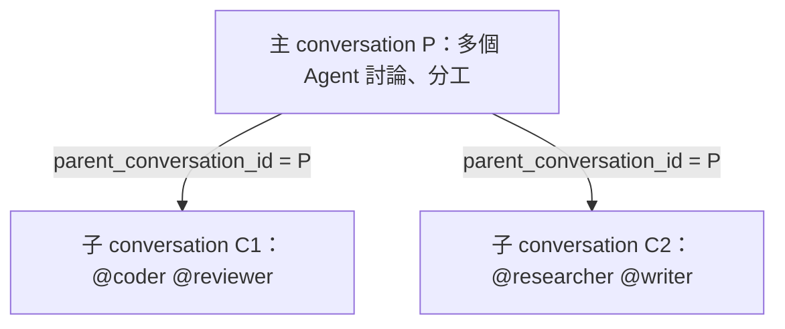

# Work：用一個 conversation 管理多個 conversation

> 本文是本次重新收斂後的目標設計，尚未實作。當前 schema 7 和代碼仍有獨立 works、固定協調 Agent 及工作授權等舊結構；實作時直接刪除，不保留舊入口、字段別名或數據遷移。當前操作手冊見 [Work 使用文檔](../../docs/server/work.md)。

## 模型

Work 是一個 conversation 及其子 conversation 的組織視圖。主 conversation 本身就是協作場所，可以有多個 Agent 參與；每個子 conversation 同樣使用既有的多 Agent 消息模型。



Work 視圖直接使用主 conversation 的 ID。名稱就是 conversation.title，所有者就是 conversation.user_id，工作目標和約束寫在消息中。創建空的主 conversation 不需要選 Agent；沒有子 conversation 時，子列表為空。

界面復用同一個對話頁展示子對話列表或樹。普通對話隨時可以創建子對話，無需轉換模式或另外創建一個協調對話。

每條消息通過 to_agent_ids 和 to_user_ids 指定收件人。主 conversation 可以同時發給多個 Agent，也可以在下一條消息選擇不同 Agent。子 conversation 的收件人由其自己的消息指定；創建子對話不繼承主對話上一次的收件人。

## 業務分工

Work 入口只做兩件事：在指定 conversation 下創建子 conversation，以及列出這些子 conversation。兩者均由 conversationService 完成；Server 無需再建立一個有獨立數據、角色或執行狀態的 workService。

| 操作 | 使用的既有能力 |
|---|---|
| 開始一項工作 | 創建普通 conversation，作為主對話 |
| 分出一個子問題 | 創建 conversation，填寫 parent_conversation_id |
| 多 Agent 協作 | 向所選 conversation 發消息，明確填寫 to_agent_ids |
| 查看進展 | 讀取所選 conversation 的消息及既有狀態快照 |
| 討論結果 | 讀取子對話後，在主對話發普通消息 |
| 文件操作 | 使用目標 conversation 的附件和文件 API |

conversationService 管父子關係、消息、權限和各對話的狀態；runService 照常處理每條消息的執行分配及實際結果。Agent 版本、Client session、run 和初始化均沿用原有鏈路。

## 消息和結果

例如，主 conversation P 的一條消息發給 planner 和 reviewer。討論後，在 P 下創建 C1，向 coder 和 tester 發送一條明確的子問題消息；還可以在 P 下創建 C2，交給其他 Agent。

C1、C2 的回覆各自保存在自己的 messages 中。主對話中的使用者或 Agent 按需讀取子對話，再在 P 發消息繼續協調。P 與子對話可以並行進行，主對話的一次執行結束不影響父子關係或後續訪問。

需要在同一輪等子問題完成時，調用方使用既有 conversation 的等待／讀取能力，再決定下一條消息。等待策略屬於調用方，無需 Work 再建立一個調度或結果結算流程。

本版不再由 Work 掃描 run、等待全部目標結束、合成結果摘要或自動喚醒某個固定 Agent。也不默認把子對話的每條消息廣播給主對話中的所有 Agent。若需要自動回傳，後續應單獨設計 conversation 之間的消息轉發規則，明確來源消息、目標對話和收件人；不恢復 Work 專屬的執行結算機制。

父子對話各自保留完整歷史與文件樹。創建子對話時，調用方在首條消息中提供要處理的內容和必要背景；不隱式複製主對話的全部歷史、初始化指令或附件。reply_to_message_id 仍只引用同一 conversation 的消息。

## Conversation API

創建、讀取和發送都沿用 /api/conversations。Work 視圖或 Server 提供的工具直接調用這些接口。

| 方法 | 接口 | 行為 |
|---|---|---|
| POST | /api/conversations | 創建對話；可選 parent_conversation_id 表示父對話 |
| GET | /api/conversations | 列出當前身份可見的頂層對話 |
| GET | /api/conversations?parent_conversation_id=P | 列出 P 的直接子對話，包含空對話 |
| GET | /api/conversations/{id} | 讀取普通對話快照，含 parent_conversation_id |
| POST | /api/conversations/{id}/messages | 明確選擇收件人及附件，發送普通消息 |
| POST | /api/conversations/{id}/resolve、reopen | 操作該對話自身的完成標記 |
| DELETE | /api/conversations/{id} | 刪除無子對話且可刪除的對話 |
| DELETE | /api/conversations/{id}?recursive=true | 顯式刪除該對話及整個子樹 |

創建主對話：

```json
{"title":"改進搜索體驗","prompt":"請一起規劃並分工","to_agent_ids":["planner","reviewer"]}
```

在該主對話下創建子對話：

```json
{"parent_conversation_id":"parent-conversation-uuid","title":"搜索接口","prompt":"實現接口並驗證邊界條件","to_agent_ids":["coder","tester"]}
```

省略 prompt 和收件人即可先創建空子對話。之後上傳文件、發消息，使用同一套 conversation API。返回值仍為 conversation、message、runs、deliveries，不新增 Work 響應包裝。

創建子對話及其首條消息共用普通創建事務，任一收件人或內容校驗失敗時整體回滾。指定父對話的創建或列表請求先校驗父對話存在且可訪問，否則返回 404；不將不存在或無權訪問的父對話當作空列表。

## 關係、權限和生命週期

每個 conversation 最多有一個父對話。父對話必須已存在；子對話與父對話的 user_id 相同，created_by 按普通創建規則記錄。parent_conversation_id 只在創建時指定，首版不提供掛接、移動或重新指定父對話，因而不會生成自引用或環。子對話也可使用同一接口繼續創建下一級對話。

HTTP 入口復用通用身份校驗，conversationService 校驗父對話的訪問與創建權限。讀取、發消息和文件操作繼續按目標 conversation 校驗。Work 入口接收已校驗的身份與父對話，無需自己的授權流程；Client 不增加 Work 協議、角色或命令。通用 Agent 工具的身份接入屬於 HTTP/conversation 邊界，不在 Work 中重新設計。

主、子對話各自投影 pending/running/waiting/idle 狀態。resolved 也只標記所選對話；不根據某個 Agent 或某次 run 宣告整個 Work 結束。Work 視圖可展示各子對話的現有狀態，不持久化另一份總狀態。

普通刪除遇到子對話時返回 409，提示需要顯式選擇遞歸刪除。遞歸刪除由 conversationService 在同一事務確定子樹、檢查全部對話的權限與可刪除狀態，再清理全部消息和執行關聯；任一對話忙碌則整體拒絕。文件前綴在數據庫提交後按既有方式清理。刪除單個子對話不刪除主對話，也不改動其兄弟對話。

## 數據結構

僅在 conversations 中保存父對話引用，表由 conversationService 擁有：

```sql
CREATE TABLE conversations (
    id TEXT NOT NULL PRIMARY KEY,
    user_id TEXT NOT NULL,
    created_by TEXT NOT NULL,
    parent_conversation_id TEXT,
    title TEXT NOT NULL DEFAULT '',
    status TEXT NOT NULL DEFAULT 'idle',
    created_at INTEGER NOT NULL,
    updated_at INTEGER NOT NULL
);
CREATE INDEX conversations_parent
    ON conversations(parent_conversation_id, updated_at, id);
```

父對話為空表示頂層對話。沒有獨立的 Work ID、Work 配置副本或 Work 狀態表。父對話引用不聲明數據庫外鍵，存在性、歸屬和刪除由 conversationService 在事務內維護。

## 待實作的刪除與替換清單

| 現有結構 | 目標 |
|---|---|
| works 及獨立工作 UUID | 移除，直接使用主 conversation 的身份和元數據 |
| conversations.work_id、coordinator_id、work_role | 用 parent_conversation_id 表達對話關係 |
| coordinator_agent_id | 移除，每條消息明確指定零個、一個或多個 Agent |
| work_run_tokens、工作授權兌換接口 | 移除；Work 不擁有憑據或身份校驗邏輯 |
| run_notifications、Work 結算與補償掃描 | 移除；不再基於執行終態生成協調消息 |
| /api/works 及獨立 threads API | 移除，使用上述 conversation 創建、查詢和消息接口 |
| Work 專用工具及返回包裝 | 收斂為 conversation API 的調用入口，不另行管理角色或執行身份 |

本次只改設計稿。當前運行代碼及使用文檔仍描述舊實作；後續整體實作時同步修改 schema、controller、SDK、Server 工具、界面及使用文檔，不做新舊模型混用。

## 相關設計

[Server 總覽](server-main.md) · [conversationService](server-conversation.md) · [runService](server-run.md) · [userService](server-user.md) · [瀏覽器通知](server-browser.md)
