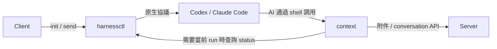

# 執行上下文：context

Client 爲每個執行環境提供 `context`。AI 用它查詢執行身份與狀態、讀取 conversation 下的全部附件，並把輸出文件交給 Server，也提供對話協作命令；人類用 `agentuse context` 調試同一份上下文，也可以進入綁定該 run 的 shell。

## 與 harnessctl 的關係

`context` 是 AgentUse Client 提供給原生模型使用的工具。Client 通過 harnessctl 啓動或恢復 Codex、Claude Code 等原生程序；執行中的 AI 再通過原生 shell 工具調用 `context`。harnessctl 的公開命令仍是 init、send、cancel、status、reply，`context` 不屬於這套命令，也不是獨立適配器包的運行依賴。

| 組件 | 負責的上下文 |
|---|---|
| Client | 準備 endpoint、conversation、Agent、本機 session、共享 workspace 及 Server 訪問配置，提供 `context` 命令入口 |
| harnessctl | 管理原生執行會話、run、輸入受理、插話、排隊和執行事件；通過公共 status 和事件確認執行事實 |
| context | 讀取 Client 提供的業務綁定，需要執行身份時查詢適配器，再調用對應 Server 的附件及 conversation API |
| Server | 校驗業務歸屬及訪問權限，保存 conversation、消息和文件 |



### 為甚麼 AI 不需要傳入各種 ID

Client 為本機 session 建立 `context.json` 和 `bin/context` 命令入口，將描述文件路徑放入 `AGENTUSE_CONTEXT`，並把命令目錄加入 harness 的 `PATH`。harnessctl 啓動的原生程序及其工具子進程繼承這個環境。因此 AI 可以直接執行：

```bash
context attachment list
context attachment download user_input/截图.png
context attachment upload reports/result.pdf
```

Server 地址、憑據和業務 ID 由 Client 的綁定提供，AI 只需指定文件路徑。這些業務信息不屬於 harnessctl 的原生協議；單獨使用 harnessctl 時不會自動獲得 AgentUse 的 `context` 工具。

`endpoint_id + conversation_id` 定位共享文件空間。同一 conversation 可以同時由多個 Agent 或不同本機 session 執行，因此描述文件還會綁定本機 session 和適配器，供需要執行身份的命令定位實際 run。這些內部定位信息不需要 AI 作為命令參數傳入，也不通過當前工作目錄猜測。

### 哪些命令需要 run

| 命令 | 使用範圍 |
|---|---|
| `attachment list/download` | 綁定的 endpoint 和整個 conversation；不要求活動 run |
| `status` | 查詢所選 run 的身份和狀態 |
| `conversation …` | 來源必須有可核對的實際 run；按 Server 的 mode 和父子關係限定操作 |
| `attachment list/download --conversation ID 或 parent` | 同樣校驗實際來源，只讀取直接相關的父/子文件樹 |
| `attachment upload` | 文件保存到 conversation，並關聯當前活動 run；Server 校驗執行歸屬與活動狀態 |
| `agentuse context enter` | 為人工調試打開綁定所選 run 的 shell |

原生進程可能跨多個 run 複用；適配器也可能提前受理其他排隊 run。當前 run 必須由執行綁定或適配器的公共 status 確認，不能一直沿用進程啓動時的 run ID，也不能選擇最後一條 accepted 作為當前執行。人類通過 `enter` 固定的 run 則保持明確選擇，不會自動切換。

消息及補充消息由 `harnessctl send` 投遞到原生模型，受理和結果覆蓋範圍由 accepted/result 確認。AI 不需要輪詢 context 讀取消息；查詢狀態、下載或上傳文件也不會開始新的 run 或結束當前執行。harnessctl 的獨立協議見 [協議規範](../../harnessctl/README.md)。

## 文件交互

文件交互採用兩個方向：

| 方向 | 上傳 | 讀取 |
|---|---|---|
| 輸入文件 | 人類在 Server 頁面或通過 API/SDK 上傳 | Client AI 通過 context 讀取 |
| 輸出文件 | Client AI 通過 context 上傳 | 人類在 Server 頁面查看、下載 |

## 執行身份與狀態

Client 初始化 session 時注入英文工具說明，將 `context` 加入 harness 的 `PATH`。直接調用：

```bash
context status
```

| 字段 | 含義 |
|---|---|
| `endpoint_id` | 輸入來源；本地調試爲 `local` |
| `conversation_id` | Server 或本地 conversation ID |
| `session_id` | Client 本機 session ID |
| `run_id` | 適配器 accepted 事件公佈的實際 run UUID |
| `agent_id` | 當前 Agent |
| `status` | `running`、`waiting` 或實際 result 的終態 |
| `workspace` | conversation 共享工作目錄的絕對路徑 |

`status` 只返回執行身份、狀態和工作目錄，不返回輸入正文、輸入列表或設備憑據。默認通過適配器公開的 status 確認當前 run；歷史 run 可顯式指定。

## 列出文件

```bash
context attachment list
```

結果為 `{"attachments": [...]}`，直接查詢 Server 中整個 conversation 的附件，不按 run 篩選，也不下載文件。附件包含：

| 字段 | 含義 |
|---|---|
| `relative_path` | 當前 conversation 文件樹中的相對路徑 |
| `id`、`name` | 文件 ID 和名稱 |
| `direction` | `input` 為使用者輸入文件，`output` 為 Agent 產物（包含其他 run） |
| `conversation_id` | 當前 conversation |
| `run_id` | 輸出文件所屬的 run；輸入文件不填此字段 |
| `mime_type`、`size_bytes`、`sha256` | 文件類型、大小、SHA-256 |
| `download_path` | Server 上可供用戶下載的路徑 |

列表以 Server 為準，包含歷史消息、補齊消息及後續上傳的文件；不依賴本地 run 附件收據。

## 下載圖片或其他文件

```bash
context attachment download user_input/截图.png
```

參數是 conversation 文件樹中的完整相對路徑，即 `list` 返回的 `relative_path`，不使用附件 ID。路徑包含空格時用引號包住，例如 `context attachment download "user_input/会议 截图.png"`。不接受絕對路徑或 `..` 等越界路徑。

命令從 Server 按路徑查找文件，下載並校驗大小和 SHA-256，返回 `local_path = workspace/<relative_path>`。例如 `user_input/截图.png` 保存到 `/絕對路徑/workspace/user_input/截图.png`。目標始終是 context 綁定的 workspace，從其他工作目錄調用也一樣。目錄不存在時自動建立；已下載且校驗一致的文件重用，缺失或損壞時重新下載。
圖片用模型原生看圖工具讀取 `local_path`，例如 Codex 的 `view_image` 或 Claude Code 的 `Read`。文本、PDF 等文件使用模型已有的文件工具。命令返回的 JSON 本身只提供文件信息。

## 上傳輸出文件

生成文件後直接上傳：

```bash
context attachment upload ./report.pdf
```

只接受 workspace 內的普通文件，保留相對路徑；workspace 外的文件應先複製進來。`user_input/` 為使用者上傳保留，AI 產物應放在 `reports/` 等其他位置。Server 若為避開重名而改變路徑，Client 會保存至返回的相同路徑，後續使用返回的 relative_path/local_path。目標自動綁定當前 conversation/run，不需要填寫 Server、token、conversation 或 run ID。結果爲 JSON，例如：

```json
{
  "id": "at_示例",
  "name": "report.pdf",
  "relative_path": "report.pdf",
  "direction": "output",
  "conversation_id": "當前conversation的UUID",
  "run_id": "當前run的UUID",
  "mime_type": "application/pdf",
  "size_bytes": 12345,
  "sha256": "文件內容的SHA256",
  "download_path": "/api/conversations/當前conversation的UUID/attachments/at_示例/content"
}
```

產物必須先 upload，再在最終回覆中引用返回的 `download_path`；本地相對路徑不是瀏覽器下載連結。人類可在 Server 頁面查看、下載該附件。上傳只保存文件，不自動發消息或結束執行；AI 繼續按原流程回覆用戶。

Server 在接收和發佈文件時檢查 run 的設備、conversation 和活動狀態。已結束的 run 無法繼續上傳。連接中斷時 Server 可能已經保存，先用 `list` 覈對再決定是否重傳；工具不會自動重複上傳。輸出列表以 Server 記錄爲準，不依賴本機另存一份上傳清單。

## 人類調試上下文

Client 爲本機 session 生成描述文件：

```text
<session.work_root>/<endpoint_id>/<conversation_id>/sessions/<session_id>/context.json
```

默認工作根目錄是 `~/.agentuse/workspace`。在本機頁面找到 endpoint、conversation、session 和 run 後，可顯式查看：

```bash
agentuse context --path /絕對路徑/context.json --run RUN_UUID status
agentuse context --path /絕對路徑/context.json attachment list
agentuse context --path /絕對路徑/context.json attachment download user_input/截图.png
agentuse context enter --path /絕對路徑/context.json --run RUN_UUID
# 進入後：
context status
context attachment list
exit
```

`--path` 默認讀取 `AGENTUSE_CONTEXT`；省略 `--run` 時詢問適配器當前執行。`enter` 使用 `$SHELL`，未設置時使用 `/bin/sh`，工作目錄切換到 conversation workspace，並通過 `AGENTUSE_CONTEXT_RUN` 固定所選 run。裸 `context` 不提供切換 Server、session 或 run 的參數。

文件保留期間可以顯式查詢歷史 run 的狀態；附件查詢及下載需要 Server 可用。歷史 run 的上傳會被拒絕。上下文文件和緩存隨 conversation quota 回收。本地調試支持執行狀態查詢，沒有 Server 上傳目標。

## 對話協作

創建 conversation 時 mode 為 single（默認）或 collaborative；前者直接執行，後者負責拆分、協調、匯總。協作根對話可使用：

```bash
context conversation agents
context conversation create --mode single --title "API" --agents coder "Implement the API"
context conversation list
context conversation read CHILD_ID
context conversation send CHILD_ID --agents coder "Use cursor pagination"
context conversation wait CHILD_ID --timeout 5m
```

子對話固定 single，不能再拆分，也沒有主動向父發消息的命令。缺信息或遇到阻礙時，在最終答復中說明並正常結束本輪，不在當輪等待協調者回信。Server 在所有 Agent 輸入和執行收束後，自動生成一條 child_conversation 通知給創建者 parent_agent_id；Agent 結果只保存在子對話。協調者按通知讀取該輪，再向子 Agent 發答案或下一步要求。

```bash
context conversation read CHILD_ID --round 1
context conversation wait CHILD_ID --round 1 --timeout 5m
```

create/send 有 Agent 輸入時會返回 round.seq；空對話、備註、上傳文件不啓動一輪。read --round N 僅返回這一輪的消息及執行範圍。wait 省略輪次時固定開始等待時最新的一輪；空對話返回 no_round。指定輪次結束即 settled，不追逐下一輪，也不代表任務成功。new_input、needs_input、run_ended、timeout 可以中斷等待。原生人工請求仍走 request/reply，不視為輪次完成。

單體根對話沒有協作管理命令。context conversation help 按當前能力顯示幫助。父側故障不回滾子結果，Server 會補送每輪唯一通知；輪次上的 parent_delivery=delivered 僅指父消息已保存，不表示已處理。

各對話文件樹獨立。協調者用 `context attachment list/download --conversation CHILD_ID` 讀子產物，子 Agent 用 `--conversation parent` 讀父輸入。跨對話文件下載到 `workspace/.context/conversations/ID/`；上傳仍僅限當前對話，不支持跨分支讀取。

人類可用 `agentuse context --path CONTEXT_JSON --run RUN_UUID conversation …` 調試同一命令組。Server 地址和執行來源由綁定取得；沒有獨立工具下載或工作授權流程。詳細接口見 [Conversation](../server/conversations.md#模式与嵌套)。
