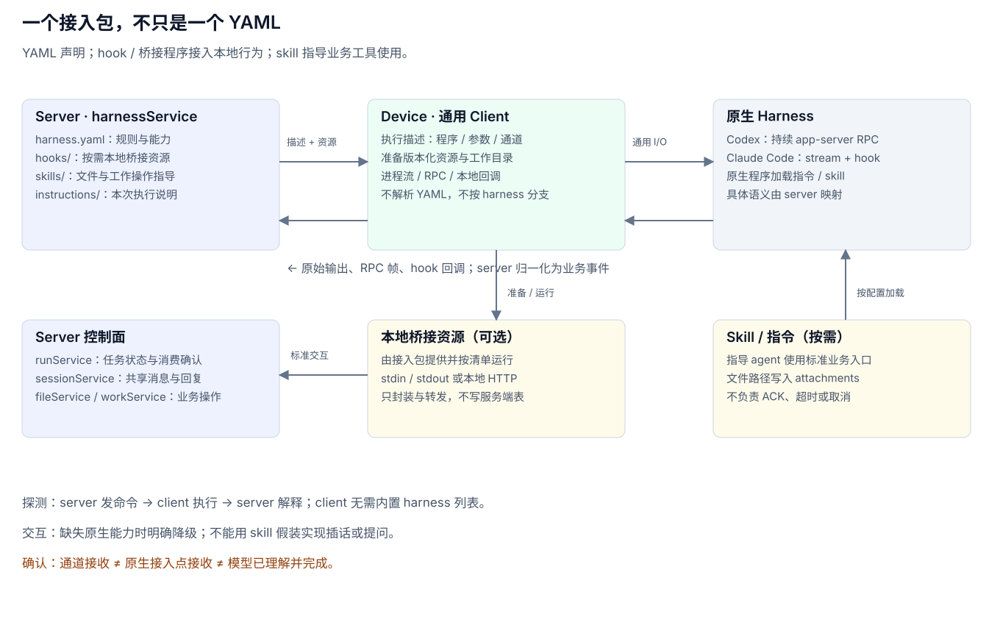
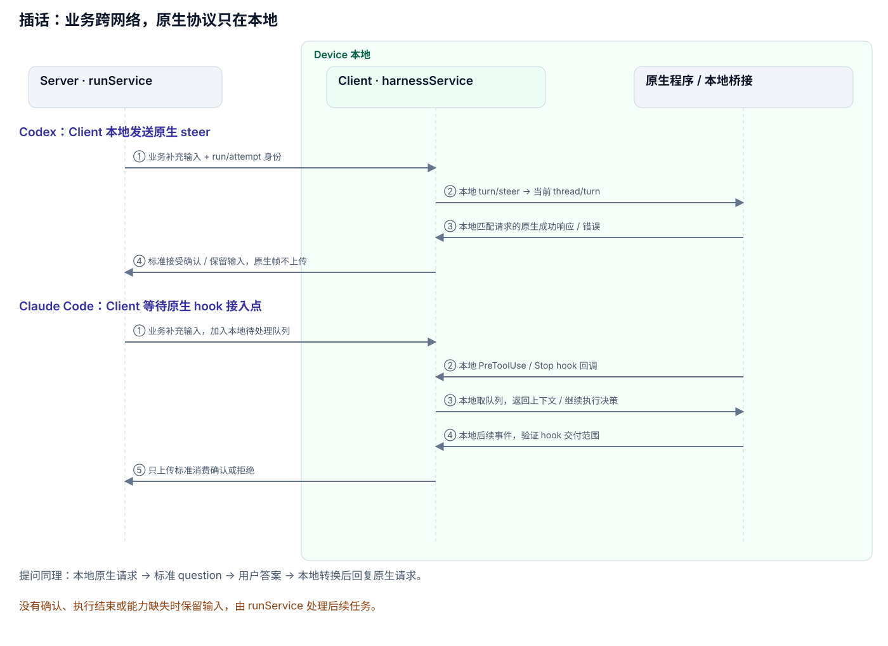

# Client harnessService：本地探测、执行与交互

> v3 目标设计。harnessService 属于 client；YAML、hook、桥接程序、skill、指令文件及原生协议状态都留在设备上。Server 的职责到 run 调度和标准业务状态为止，client 整体装配见 [client-main.md](client-main.md)，服务端见 [Server 总览](server-main.md)。

## 一、职责边界

Client 从 server 领取 run，然后由本地 harnessService 选择已安装的接入包，探测/启动程序、准备输入和文件、处理原生交互、解释输出并回报标准业务事件。

| Server | Client 的 harnessService |
|---|---|
| 保存共享消息，为目标 agent 建立 run/run_prompts | 管理本地 YAML、hook、桥接程序、skill 和指令资源 |
| 保存设备上报的 harness 标识、版本、可用性与业务能力 | 本地探测程序和功能，再报告探测结论 |
| 下发 run、任务输入、补充消息、答案和取消 | 解析 YAML，启动进程，处理原生 RPC、hook 与提问 |
| 记录标准进度、计划、问题、用量和终态 | 本地解释原始输出，转换为统一事件 |
| 维护租约、重排、消息回复和工作汇总 | 清理进程/回调，记录本机执行信息 |

Server 不再有 harnessService 或 harnesses 配置表，不编译执行描述，不管理接入包分发。Client 可以认识具体 harness，但差异应集中在本地 harnessService 中；进程、流、RPC、回调等底层能力尽量复用。

## 二、WebSocket 只传 Run 业务协议

| 方向 | 内容 |
|---|---|
| client → server | 本地探测后的可用 harness、接入包/程序版本、业务能力 |
| server → client | run/attempt 身份、harness 标识/版本、任务输入和上下文/文件引用 |
| server → client | 补充输入、用户答案、取消请求 |
| client → server | started/progress/plan、插话确认、question/answered、usage、result/error/cancelled |

YAML、shell 命令、argv/env、脚本、原生 RPC 帧、hook 请求和控制回包都不经过 server WebSocket。原生交互在设备本地闭环，只把归一化后的业务信息发给 server，减少网关/WAF 对执行类消息的误判。任务正文仍是业务文本，不承诺其内容一定不会触发外部网关规则。

共享消息、run_prompts 和文件可按业务 API 通过 HTTP 获取；读取文件不等于从 server 下载执行脚本。接入包安装和升级由设备本地完成，不通过 run 消息附带执行资源。



## 三、接入包不只是 YAML

YAML 能声明已有能力的接入方式，不能让原生程序凭空具有插话或提问能力。Client 本地的接入包按需包含：

```text
harness-package/
├── harness.yaml       探测、启动、协议映射、能力和资源清单
├── hooks/             本地 hook / 桥接程序，可为空
├── skills/            文件、工作线程等业务操作说明，可为空
└── instructions/      工作规则和输入组织模板，可为空
```

| 部分 | 负责什么 | 不承担什么 |
|---|---|---|
| YAML | 声明命令/参数、环境、输入输出、动作映射、能力、资源挂载 | 不代替实际进程或复杂协议实现 |
| hook / 桥接程序 | 接入原生扩展点，向本地 harnessService 请求输入/答案并返回结果 | 不绕过 run 身份直接写服务端业务表 |
| skill | 指导 agent 使用文件、工作线程等业务入口，描述结果交付方式 | 不保证模型一定调用工具，不确认插话消费，不取消进程 |
| 指令文件 | 指明共享历史、工作说明和文件路径 | 不产生每个 agent 独立的服务端历史 |

YAML 优先表达声明式规则；复杂协议需要适配代码时，也放在 client 本地 harnessService 或包内桥接程序中。两种形式都不把执行逻辑推回 server。

### 资源准备和版本

Client 维护本地接入包及其内容摘要 harness_revision，摘要包括 YAML、hook、skill 和指令资源。探测结论携带该版本上报；run 固定 server 选定的本地版本，缺少版本时回报错误，不静默替换。

每次执行把需准备的资源放到当前 run/attempt 的独立目录，通过本次启动参数加载；同 session 的并行 agent 不互相覆盖 hook 配置、AGENTS.md 或 CLAUDE.md。小型协议关联信息与原生连接对象只保存在本地执行期间，进程结束后清理，session 文件空间保留。

## 四、统一业务动作

对 runService 暴露统一语义，内部接入方式可以不同：

| 功能 | 本地 harnessService 的职责 | 给 server 的结果 |
|---|---|---|
| 探测 | 检测程序、版本和真实交互能力 | 可用性、版本、能力，不回传探测命令 |
| 启动 | 准备资源、共享上下文和文件，启动原生程序 | started 或启动失败 |
| 输出/计划 | 解释文本、工具调用与计划通知 | progress / plan |
| 插话 | 把 run_prompts 补充输入交给当前原生执行 | accepted/rejected 及可验证的确认范围 |
| 提问/答案 | 挂起对应原生请求，等待业务答案，返回原请求 | question / answered / expired |
| 取消 | 使用原生取消或终止进程树，清理交互 | cancelled / error |
| 结果/用量 | 依据原生终态提取结果与计量 | result/error、usage；未知用量为空 |

Server 只使用这些业务事件。它不需要知道接受输入用了哪个 RPC 方法，也不需要把某个 hook JSON 作为业务答案发回来。能力可缺失；不能确认插话时，保留补充输入供后续 run 处理。

## 五、Codex 与 Claude Code 功能对照

下表是目标接入方式，需按本机探测到的程序版本验证。Client 支持某个 harness 不等于它支持表中全部交互。

| 功能 | Codex 本地接入 | Claude Code 本地接入 | 所需资源 |
|---|---|---|---|
| 探测 | 版本命令及 app-server 功能探测 | 版本命令及 stream-json、hook、提问功能探测 | 本地 YAML |
| 启动 | app-server 持久双向 RPC，初始化、建 thread、开 turn | print 模式流式输入/输出，启动前准备 hook/配置 | YAML、按需 hook 配置 |
| 输入/上下文 | 将 run_prompts、共享消息和文件引用组织为 turn 输入/指令 | 将相同材料组织为 user 输入和工作说明 | 输入模板、指令文件 |
| 进度 | 解析 item、文本和工具通知 | 解析 assistant 文本与 tool_use | 本地输出映射 |
| 计划 | 原生计划通知 | 任务工具调用 | 输出映射；skill 可提示使用工具，不能制造事件 |
| 结果 | 以 turn 终态确认完成，提取最终回复 | 以 result 和进程状态确认完成 | 输出映射 |
| 用量 | token usage 通知 | result.usage / cost | 输出映射 |
| 插话 | 当前 turn 的原生 steer RPC | PreToolUse / Stop hook 注入 | Codex 无需额外 hook；Claude 需要 hook 或等价控制回调 |
| 提问 | 接住原生用户输入 RPC，等待 server 的业务答案后回同一请求 | AskUserQuestion 经交互宿主或 PreToolUse 桥接，取得业务答案后回原请求 | 双向 RPC / hook 桥接 |
| 工具审批 | 原生 approval 请求由本地明确策略或已声明的业务审批流程处理 | 权限宿主或 hook 处理 | 与业务提问分开；未知请求不能一律 allow |
| 取消 | 原生 interrupt，等待终态，超时再终止进程树 | 选定协议可用时原生 interrupt，否则通用终止进程树 | 本地适配与进程控制 |
| 文件交付 | 标准文件操作调用 server fileService | 同左 | 业务 skill/工具，结果路径进入 messages.attachments |
| 工作线程 | 标准 session/work 业务 API | 同左 | 业务 skill/工具和 work 授权 |

### 5.1 Codex：本地持续 RPC

Client 本地启动 `codex app-server`，管理初始化、thread/turn 和事件状态，原始 RPC 不上传 server。新 run 创建新的原生上下文，历史来自共享 session；原生 thread 不等同于 agentuse session。

- 启动链：`initialize → initialized → thread/start → turn/start`。
- 插话：本地发 `turn/steer`，携带 thread 和 expectedTurnId。只有匹配请求且返回目标 turnId 的成功响应才能确认接收，再向 server 上报该 run_prompt 的标准确认。
- 提问：本地接住用户输入请求，保留原请求 ID，把问题归一化上报 server；收到业务答案后在本地回复原 RPC。本机 codex-cli 0.165.0 的 schema 使用 `item/tool/requestUserInput`，返回格式为 `answers[questionId].answers` 字符串数组；实验能力必须显式开启且探测通过。
- 取消：本地发 `turn/interrupt`；响应只说明请求被接受，等待 `turn/completed` 的 interrupted 状态才确认结束。

方法语义参见 [Codex App Server 官方文档](https://learn.chatgpt.com/docs/app-server)。仓库当前实现从 item/started、item/completed 提取进度，turn/plan/updated 提取计划，thread/tokenUsage/updated 提取用量，turn/completed 确认终态；版本变化需重新校验。

业务 skill 可在本地使用 `.agents/skills/<name>/SKILL.md` 或显式 skill 输入。工作说明与文件操作指导是行为资源，RPC 插话不靠 skill 实现。[Codex skills 官方说明](https://learn.chatgpt.com/docs/build-skills)

### 5.2 Claude Code：本地流与 Hook

Client 本地以 `claude -p` 和 stream-json 接入，启动前准备 hook、skill 和指令。不使用跳过这些资源发现的裸配置后又假设 hook 已加载。[Claude Code 程序化运行说明](https://code.claude.com/docs/en/headless)

本地 harnessService 映射 user 输入、assistant 文本/工具块、TaskCreate/TaskUpdate 等计划信息和 result/usage；不让 skill 自报结果替代协议终态。

1. **PreToolUse 插话**：原生 hook 调用包内桥接程序或本地 HTTP 回调；本地 harnessService 取待注入 run_prompts，返回原生上下文输出。待处理业务输入来自 server，但 callback 和 hook JSON 都不离开设备。
2. **Stop 插话**：本地在结束前检查补充输入，有新输入则按 hook 协议要求继续执行，无新输入则正常结束；避免反复 Stop 阻止退出。
3. **AskUserQuestion**：本地 hook/交互宿主将问题变成标准 question 上报，等待 server 传回用户答案，再在本地转换为原工具输入并结束同一次回调。

所选版本必须验证完整交互宿主条件、回包格式和超时，不能把“配置了一个 hook”当成提问已经可用。[Claude Code hooks 官方说明](https://code.claude.com/docs/en/hooks)

可以用 command hook（本地桥接程序的 stdin/stdout）或支持的 HTTP hook；两条路径都由本地 harnessService 处理。网络断线、等待超时、取消和原生进程退出需要终止对应回调，回报业务状态，不无限挂起。

仓库旧实现使用过 `--permission-prompt-tool stdio` 和 stream-json control_request/control_response；继续使用需要锁定验证过的版本，不能视为所有新版本公开契约。当前公开 CLI 的 permission-prompt-tool 描述为 MCP 工具入口。[Claude Code CLI 官方说明](https://code.claude.com/docs/en/cli-reference)

业务 skill 使用本地 `.claude/skills/<name>/SKILL.md` 或独立插件目录，工作规则按本次启动配置加载，不能覆盖其他执行的配置。Skill 指导文件/工作操作，不承担 hook 确认。[Claude Code skills 官方说明](https://code.claude.com/docs/en/skills)



## 六、确认与恢复

accepted 不等于模型已经理解或完成输入；client 必须报告确认方式和范围：

- Codex 使用匹配当前 turn 的原生 RPC 成功响应作为接收依据。
- Claude 在 hook 边界交付，必须验证该版本的交付/继续执行证据，记录 hook-delivery 范围，不能伪造 Codex 式 ACK。
- 只有网络消息或通道写入回执时，输入仍 pending；run 已结束、不支持或不能确认交付时，由 server runService 将未消费输入安排到后续 run。
- run/attempt 变更后，旧原生请求、旧 hook、旧答案不能影响新执行；client 清理本地连接、桥接脚本和子进程。

本机 harnessService 记录本次包版本和本地运行信息；server 只保存 run 业务状态、上报的包版本和标准事件，不保存执行配置。

## 七、当前实现与目标差距

当前仓库已有 client 侧 Codex 原生执行、Claude hook/提问专用代码，方向与本地执行一致；仍需收拢为 client harnessService，并把共享 YAML/资源移到 client。

现有 Codex 接法尚未接通用户输入类 server request；Claude 的历史 stdio 方式和旧附件 skill 也需要按目标版本及 fileService 设计调整。不能把本文功能表当作所有能力均已实现。

每个接入包至少验证：探测、首个任务、进度/计划、结果/用量、执行中与结束前插话、提问/回答/超时、取消、错误退出、资源隔离、文件交付。升级接入包后重新验证再上报能力。

## 八、存储与代码归属

接入包及版本存于 client 本地文件，不新增 server harnesses 表。YAML、hook、skill、指令及原生适配代码属于 client；本地进程/RPC/回调原语也在 client 内复用。根共享部分只保留 run 业务协议、标准事件和必要 DTO，不放 harness YAML 或原生适配逻辑。

本地账本仍由 client store 负责，harnessService 向主循环返回标准执行信息，不混入 server 数据库访问。

## 相关设计

[Server 总览](server-main.md) · [deviceService](server-device.md) · [agentService](server-agent.md) · [runService](server-run.md) · [fileService](server-file.md)
