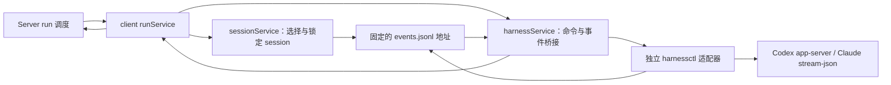

# Client harnessService：harnessctl 接入

harnessService 是 client 的执行桥接服务。它管理 `~/.agentuse/harness/` 中的适配器包，把 runService 的任务、补充输入、答案和取消转换为 harnessctl 命令，读取事件文件后回报业务状态。原生协议、原生会话恢复和后台进程生命周期全部由独立适配器处理。

Server 只调度 run、维护共享 conversation 和业务结果，不发送执行命令或原生协议帧。client 的本机 HTTP 页面也是可选入口；执行桥接不依赖页面端口。

## 服务关系



| 组件 | 负责的内容 |
|---|---|
| runService | 领取任务、准备业务输入和附件、传递控制、保存 run/attempt、回报 server |
| sessionService | 按 endpoint/conversation/agent/harness/revision 选择会话、串行占用、保护共享工作目录 |
| harnessService | 安装和探测包、四个命令、五种事件、业务 run 与适配器交互的关联 |
| harnessctl 适配器 | 创建/恢复原生会话、原生插话或排队、问答与权限、取消、进程回收和故障恢复 |

client Go 代码不再实现 Codex JSON-RPC、Claude control_request、hook 或原生输出解析。复杂差异放在适配器代码中；manifest 只声明入口、依赖和能力，不能仅靠 YAML 抹平两种原生协议。

## 本地包

```text
~/.agentuse/harness/<harness>/<revision>/
  manifest.json
  harnessctl
  EVENT.md
  event.schema.json
  lib/                 # 包自己的运行时与原生适配代码
```

内置的 Codex、Claude Code 包随 client 二进制嵌入，首次探测时释放到本地目录。`<harness>/local/` 可安装自定义包，优先于内置包；`local/disabled` 可禁用。旧的 harness.yaml 不再作为执行描述加载，不删除已有文件。内容摘要作为 harness_revision，版本变化后新任务选择新 session。

AgentUse 注册名沿用 `codex`、`claude`；独立包名分别是 `codex`、`claudecode`。自定义适配器只要提供相同命令与事件，无须修改 client 的原生协议代码。

## 命令与会话地址

```text
harnessctl send <events.jsonl> [--cwd DIR] [--model MODEL]
harnessctl cancel <events.jsonl>
harnessctl status <events.jsonl>
harnessctl reply <events.jsonl> <request_id>
```

send 的正文和 reply 的答案通过 UTF-8 stdin 传递，避免 shell 字符转义。client 使用 argv 直接执行入口。命令细节见仓库顶层 harnessctl/README.md。

每个 client session 的地址固定为：

```text
<session.work_root>/<endpoint_id>/<conversation_id>/sessions/<session_id>/events.jsonl
```

所有适配器仍从同一 conversation 的 `workspace/` 启动。session.yaml 不保存原生 thread/session ID；原生身份及恢复信息由适配器保存在事件文件相邻的私有目录中，client 不解析它。首次 send 自动创建，后续 send 自动复用。

业务指令（包括协调者职责和工作规则）由 server 生成，client 不根据工作凭据推断角色。runService 准备本机共享历史和附件，harnessService 将 server 指令与本机资源说明组织为输入文本。历史按 session 已同步的位置传增量，不覆盖 workspace 内其他 agent 的说明文件。

## 五种事件

| 类型 | client 的处理 |
|---|---|
| accepted | 关联输入与适配器生成的 run_id；补充输入到此才回报已接收 |
| message | 按 message_id 处理完整正文快照，转为进度 |
| request | pending 转业务问题或权限问题；replied/expired 更新问题终态 |
| result | 汇总输出、标准化用量、费用和执行状态 |
| log | 可选工具进度与计划；不依赖日志判断输入受理、完成或问题状态 |

前四种事件可靠保存；log 可丢。完整字段及生命周期见 harnessctl/EVENT.md。client 按文件偏移读取完整 JSONL 行，忽略末尾尚未写完的一行。每次任务从当前文件末尾开始读取，不把旧结果算到新任务上。

适配器 run_id 为适配器生成的 UUID，与 server run_id 不同。一个 server run/attempt 可包含多个适配器 run：例如 Claude 正在执行时收到补充输入，适配器内部排队后再执行。Codex 确认的插话可与当前输入共享适配器 run_id，完成竞态也可能进入下一次交互。

client 跟踪本次提交的所有 accepted.input_id，并等待 result.input_ids 全部覆盖后才结束业务任务；不能看到第一个 result 就释放 session。最终 run.json 的 harness_run_ids 保存这次任务包含的适配器交互 UUID，不允许调用方指定这些 UUID。

## 控制、环境与恢复

补充输入仍调用 send，不向上暴露 steer/queue 选择。问题通过 request_id 精确回复；权限使用 allow/deny，问答转换为 question id 到答案的 JSON 对象。取消调用 cancel，并轮询 status 确认前台执行已结束，再释放 session 和工作目录占用。

每个任务可能有不同的业务身份和令牌。适配器只保存环境摘要；send 发现环境改变且原执行空闲时，在内部回收旧进程并恢复原生上下文，继承新的环境。忙时拒绝更换环境，避免同一交互混用凭据。local 模式明确清空平台地址、令牌和工作身份。

client 重启时先通过对应版本的适配器取消遗留的前台执行，再恢复本机状态与结果补报；不盲目重发输入。若无法确认清理，保留 session 的占用并报告错误，禁止 quota 回收仍在使用的目录。适配器自行决定空闲退出时间，client 不管理它的私有 PID 或原生控制连接。

## 验证边界

独立 Python 协议测试验证各包的原生差异、关键事件格式与恢复。Go 桥接测试验证输入归属、聚合完成、问答、取消和环境更新；完整 client/server 测试验证多中心、本地调试、共享目录、工作线程和附件。真实模型测试需显式启用，模拟测试不代表模型一定遵循任务指令。
