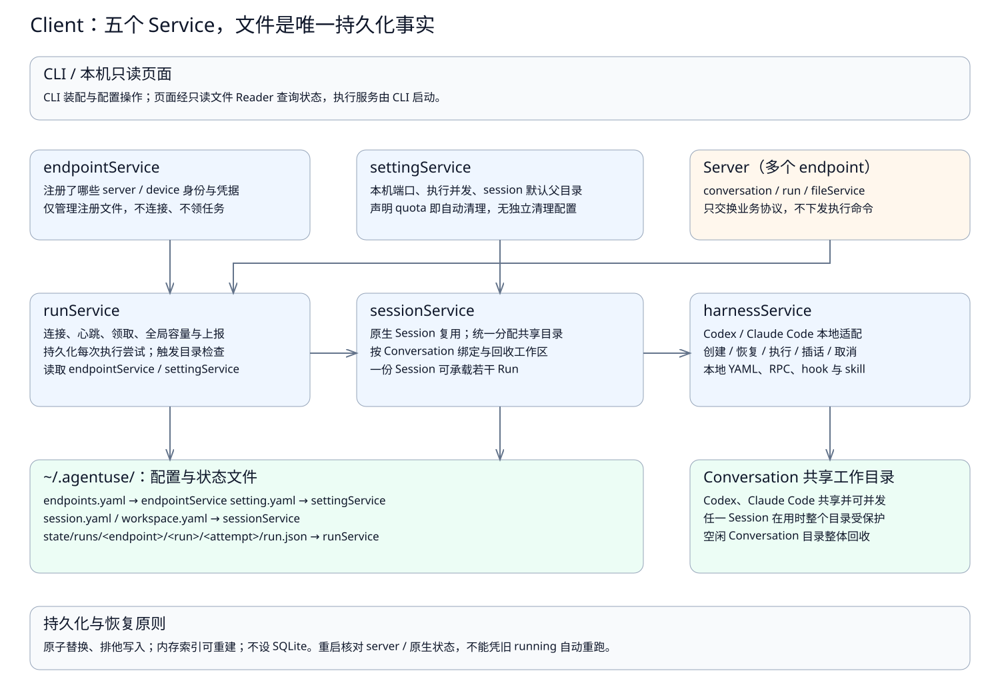

# Client 设计

> 本文定义 v3 client 的目标业务划分，尚未据此完整重构代码。Client 通过多个中心领取 run，并在设备本地 session 中执行。服务端总览见 [server-main.md](server-main.md)。

## 一、整体关系

Client 负责本地连接、领取、原生 session 和执行；server 负责 conversation、任务分配及业务状态。两端都按 controller / service / store 组织，但本机 controller 仅提供只读页面，执行服务由 CLI 启动。



- **CLI**：整体装配、注册中心、配置管理、启动常驻程序、查看状态与本机页面。
- **service**：endpointService、settingService、sessionService、runService、harnessService，各自管理清楚的业务对象。
- **文件读写层**：按 service 归属读写 YAML/JSON，不使用 SQLite、数据库表或持久化索引；内存索引可从文件重建。
- **controller / frontend**：只读查询本机记录，不通过网页启动、取消任务或修改配置。

每个 endpoint 的连接循环属于 runService 的内部连接机制；进程、流、RPC、hook 等原语属于 harnessService 的本地执行机制，不再和业务 service 平铺为另一组顶层服务。

## 二、有哪些 Service

| Service | 负责什么 | 主要拥有的数据 |
|---|---|---|
| [endpointService](client-endpoint.md) | 管已注册 server 的地址、device 身份和凭据 | `~/.agentuse/endpoints.yaml` |
| [settingService](client-setting.md) | 管端口、session 共享工作根目录和容量回收策略 | `~/.agentuse/setting.yaml` |
| [sessionService](client-session.md) | 管理原生会话复用、执行锁、历史位置及空闲工作目录回收 | conversation 下每个原生会话的 `session.yaml` |
| [runService](client-run.md) | 读取 endpoints 和设置，自行领取/执行、上报事件并触发清理 | 每个执行尝试的 `run.json` |
| [harnessService](client-harness.md) | 本地接入包探测、原生 session 操作、启动执行、RPC/hook/skill、输出解释 | `~/.agentuse/harness/` 下的适配器与资源文件 |

Client 共五个 service，全部以各自文件作为唯一持久化事实，不设本机数据库。Server 仍使用自己的业务数据库，不受本次调整影响。

### 2.1 endpointService：注册信息

endpointService 只读写 endpoints.yaml，记录 client 已向哪些 server 注册，以及对应地址、device_id、device_key 和启用状态。CLI 完成注册后保存记录，runService 读取这些记录。

endpointService 不创建中心连接，不领取任务，不管理槽位，也不向 runService 派活。配置变更通知只提示消费者重读数据。

### 2.2 settingService：本地运行配置

settingService 读取 setting.yaml，管理本机 HTTP 端口、sessionService 使用的统一临时工作根目录，以及容量限制和自动清理策略。它提供校验后的配置，不领任务、不直接删目录。

配置容量超限时，由 runService 触发 sessionService 回收空闲受管工作目录；正在执行或等待答案的目录受保护。声明 quota 即启用自动清理，不额外配置 cleanup。根目录容量属于清理/准入策略，不是会强杀进程的硬配额。

### 2.3 sessionService：原生执行上下文

Client session 直接对应原生 harness 的会话：Codex 的 thread、Claude Code 的 session。**一个 session 包含若干个从 server 领取的 run。** 首次创建原生会话，后续任务可以继续使用；run 完成不删除 session。

默认按 endpoint、conversation、agent、harness 找当前可用会话，并检查包版本及恢复条件。同 session 同时只执行一个 run，多个中心或不同 agent 不共用原生上下文。状态写入 session.yaml，目录位置来自 settingService；空闲目录被回收后不能假装原工作区仍可恢复。

### 2.4 runService：一次领来的任务

runService 从 endpointService 读取启用的注册信息，自行连接各 server，维护心跳、重连和对账，并在本机共享容量内轮询领取任务。领取预留与并发调度由 runService 内部管理，不向用户暴露执行数量配置；不同 session 可同时运行，不能向多个 endpoint 同时广播长期 ready。

runService 不在本机另造业务任务。run_id/attempt_id 来自 server，本地用 `(endpoint_id, run_id, attempt_id)` 区分执行，将它绑定到本机 session.yaml 的 id 后执行。

runService 取得 run_prompts、共享历史和文件，调用 sessionService 与 harnessService 完成执行，记录进度、问题、插话确认、用量和终态到 run.json。结果返回原中心，本机状态不代替 server 提交成功。

### 2.5 harnessService：本地原生接入

harnessService 解析本地接入包，执行 create/resume/run/steer/answer/cancel 等原生操作，并将输出解释为标准业务事件。Codex RPC 和 Claude hook 的差异全部留在设备上。

YAML、hook、桥接程序、skill 与指令资源本地管理；server 不下发执行命令、脚本、执行描述或原生协议帧。接入包升级先探测再上报，旧任务不静默换用新版本。

## 三、Conversation、Session 和 Run

| 对象 | 归属 | 关系 |
|---|---|---|
| conversation | server | 共享消息和文件，含多个 agent 的任务 |
| session | client / 原生 harness | 一个持久原生执行上下文，可以先后执行多个 run |
| run | server 分配，client 执行 | 从指定中心领取，在一个本地 session 中完成本次尝试 |

```text
Server Conversation C
  ├─ Agent coder    → R1、R2 → Client Session S1 → Codex Thread T1
  └─ Agent reviewer → R3、R4 → Client Session S2 → Claude Session H1
```

一个 conversation 的多个 agent 共享 server 历史，在 client 各自有原生 session，但使用同一个 conversation 工作目录。一个 server run 的不同 attempt 可以有多条本地执行记录，每条绑定实际使用过的 session。

首次执行准备共享历史；恢复 session 时以历史增量和当前 run_prompts 组织输入，不重复把完整 conversation 灌进已有原生上下文。细节见 sessionService 设计。

## 四、Service 之间怎样协作

| 业务 | 主要调用关系 |
|---|---|
| 保存注册信息 | CLI 注册流程 → endpointService → endpoints.yaml |
| 读取运行设置 | settingService → setting.yaml；CLI/各服务读取配置快照 |
| 连接各 server | runService 读取 endpointService → 各 endpoint 连接循环 |
| 本地探测与能力上报 | runService → harnessService；探测结果由 runService 的各连接上报 |
| 领取并执行任务 | runService 预留容量并领取 → sessionService / harnessService |
| 创建/恢复原生会话 | sessionService → harnessService；保存原生会话 ID 和当前选择 |
| 任务进度/结果 | harnessService → 标准事件回调 → runService → 所属中心连接 |
| 用户答案/补充输入/取消 | 所属中心连接 → runService → 当前 session 内的原生执行 |
| 执行收尾 | runService 结束本次占用，sessionService 保留原生历史，runService 释放槽位 |
| 容量清理 | runService 按设置触发 → sessionService 回收空闲受管目录 |
| 本机只读查询 | controller → 文件 Reader；不调用执行 service |

回调传递标准业务事件，不要求 harnessService 反向管理中心配置或直接访问 server 数据库。Session 的跨 run 生命周期与当前 run 的进程/回调清理分开管理。

## 五、从启动到一个 Run 结束

1. CLI 加载 setting.yaml 和 endpoints.yaml，装配五个 service，按设置启动可选的本机 HTTP。
2. CLI 注册流程将成功注册的信息存入 endpointService；runService 读取 endpoints，独立握手和对账。
3. harnessService 本地探测程序与包版本；runService 向各 server 上报可用性和能力。
4. runService 自行预留槽位并领取任务，校验 endpoint、attempt、版本和本机容量。
5. runService 取得输入与文件，sessionService 选择或创建原生 session，并建立本地运行关联。
6. harnessService 在该 session 中执行；后续 run 恢复同一会话或在既有会话继续，不默认新建。
7. 标准事件原子更新本机 run.json，再回报原中心。文件产物经 fileService 上传，相对路径进入消息 attachments。
8. run 完成后释放会话锁和槽位，按配置检查临时目录容量；session 状态文件保留，未被回收的原生上下文供后续 run 使用。

## 六、文件是唯一持久化事实

```text
~/.agentuse/
├── endpoints.yaml
├── setting.yaml
├── harness/<harness>/<revision>/...
├── tmp/<endpoint_id>/<conversation_id>/
│   ├── workspace/    所有 Codex / Claude Code 的共享启动目录
│   └── sessions/<session_id>/
│       ├── session.yaml
│       └── runs/<run_id>/<attempt_id>/run.json
└── ui.token
```

tmp 是默认父目录，可通过 setting.yaml 的 session.work_root 配置。sessionService 按 endpoint/conversation 推导唯一目录，同一 conversation 的 Codex、Claude Code 等原生 session 都从该目录下的 workspace/ 启动，并允许并行运行；sessions/ 与 workspace/ 同级保存元数据，session.yaml 不保存 work_root。配置和适配器不放入可回收目录；session.yaml、run.json 和执行资源按 conversation/session 层级放入工作目录，随目录一起回收；server fileService 负责上传下载和交付。

| 文件 | 唯一负责写入的 Service |
|---|---|
| endpoints.yaml | endpointService |
| setting.yaml | settingService（CLI 通过它修改） |
| session.yaml | sessionService |
| run.json | runService |
| 接入包和原生资源 | harnessService 与本地包安装流程 |

单个文件采用同目录临时文件、完整写入后原子替换；CLI 修改配置使用文件锁，执行实例和会话选用使用排他保护，避免并发覆盖。同一业务记录不再同时维护 YAML、JSON 和数据库三份状态。

文件通知只用于提醒重读。列表、会话选择和用量统计的内存索引必须能通过扫描状态文件完整重建；不增加落盘数据库或持久化索引作为第二个来源。

多文件更新不等于数据库事务。崩溃后读取状态文件，与 server 租约和原生状态核对；无法确认时记中断或建立新 session，不能仅凭旧 running 标记重跑。

本地 session UUID、原生 session ID、server conversation UUID、server run/attempt 各自独立；路径包含由规范化 server 地址推导的 endpoint_id（如 https---company.example.com），避免多个平台返回相同 ID 时串目录或结果。

## 七、目录容量与清理

settingService 提供 session 的默认父目录及统一容量策略；sessionService 按 conversation 回收带受管标记的空闲共享目录，每个目录只计量一次，按其所有 session 的最近使用时间清理至不超过 quota。任一关联 session 正在运行、等待问题或已被任务锁定时，整个目录不能删。

目录回收会删除其中的 session.yaml、run.json 和执行资源，但保留 server 文件和原生工具的全局历史。后续不得直接恢复旧工作区；有任务时从共享历史和文件重建新会话。没有可清理空间时暂停新启动，不强杀在用任务。

本机执行记录随工作目录保留与回收，不另设固定保留期或归档目录。仍在执行、等待答案或结果尚未获 server 确认的记录保护整个目录。正文默认保留前 200 字，用量未知留空。

## 八、断线、重启和只读页面

网络断开时，runService 只重连对应 endpoint；sessionService 保持仍受控的本地会话状态。失去有效租约则结束旧执行；client 重启先对账，不因文件中有旧 session 或 run 就自行继续工作。

run 取消或进程退出不必删除 session；由本地适配确认是否可恢复。原生历史丢失则标记旧 session 不可用，后续有效任务可建立新会话，旧记录保留。

本机 controller 只使用 session/run 文件的只读 Reader，不访问中心凭据，不调用五个业务 service。Reader 只暴露查询，不提供写文件或清理目录方法；不再依赖 SQLite 只读连接保证权限。

页面的监听地址、端口和开关由 settingService 提供，默认 `127.0.0.1:7801`，仅允许 GET，使用本机令牌与 Host 校验，不开放 CORS。

CLI 负责配置管理和提供页面链接。页面展示执行、所属 session 和用量统计，不提供中心写入或执行控制。

## 九、API 设计

以下是 v3 目标接口，不代表当前代码已实现。Client API 分三层：本机 HTTP 供页面只读查询；进程内 service 接口供 CLI 和执行流程调用；中心通信接口供 runService 领取和回报。配置修改不通过本机 HTTP，原生 hook/RPC 不进入中心业务协议。

### 9.1 公共对象与约定

| 对象 | 字段 / 含义 |
|---|---|
| EndpointRef | endpoint_id，由规范化 server_url 推导；不作为 endpoints.yaml 的输入字段 |
| ConversationRef | endpoint_id、conversation_id；确定 conversation 目录及 workspace/ |
| SessionRef | ConversationRef、session_id；确定 session.yaml |
| RunRef | SessionRef、run_id、attempt_id；确定 run.json；中心执行身份仍是 endpoint/run/attempt |
| HarnessRef | harness、harness_revision；确定本地适配器版本 |
| ExecutionHandle | 当前原生执行的内存句柄，用于插话、回答、取消；不持久化、不跨重启复用 |

所有接口使用结构化对象传递这些标识，不接受任意文件系统路径。实际路径由文件层推导；各路径段校验后使用，拒绝目录穿越及越出受管根目录的符号链接。时间使用 Unix 毫秒，未知用量/费用为 null。

进程内方法均返回结果或结构化错误，并接受可取消的调用上下文。列表使用 `limit`（默认 50，上限 200）和不透明 `cursor`，返回 `items`、`next_cursor`；不承诺跨文件扫描的事务快照。并发更新或容量回收导致记录消失时，详情返回 not_found，列表跳过已消失记录。

### 9.2 本机 HTTP API

默认监听 `127.0.0.1:7801`，API 前缀 `/api`，仅支持 GET。请求使用 `Authorization: Bearer <ui.token>`；CLI 打开页面时使用一次性 URL fragment 引导，页面在内存中读取令牌并移除 fragment，再通过请求头访问 API，不把令牌放入 query、日志或持久化浏览器存储。静态页面可直接打开，读取任何本机数据都必须通过鉴权。维持 Host 校验、无 CORS；其他 HTTP 方法返回 405。

本机 controller 依赖专用只读 Reader，不调用执行 service。Reader 可读取 setting.yaml 的公开配置、适配器清单和 session/run 文件，以及执行进程发布的只读内存快照；不读取 device_key 或提供任意文件下载。配置页面若将来需要写操作，需另行设计，不在本版范围内。

| 方法与路径 | 查询参数 | 返回内容 |
|---|---|---|
| GET /api/status | 无 | client 版本、启动时间、运行中/等待回答的数量、各 endpoint 连接状态、当前资源不足原因 |
| GET /api/settings | 无 | 当前生效的 local_http、session.work_root、quota，以及配置是否需要重启才能生效；不暴露 ui.token |
| GET /api/harnesses | harness（可选） | 已安装 harness/revision、最近探测的程序版本、可用性和能力；无探测结果时为 unknown，不因查询启动程序 |
| GET /api/conversations | endpoint_id（必填）、limit、cursor | 仅列出指定 endpoint 下的 conversation 目录标识，不读取下属 session/run 文件 |
| GET /api/conversations/{endpoint_id}/{conversation_id} | 无 | conversation 标识、workspace 相对位置、session 数、最近一次容量扫描的字节数及扫描时间 |
| GET /api/conversations/{endpoint_id}/{conversation_id}/sessions | harness、status、limit、cursor | 该 conversation 的 session 摘要 |
| GET /api/conversations/{endpoint_id}/{conversation_id}/sessions/{session_id} | 无 | session.yaml 的会话标识、agent、harness/revision、原生 ID、状态、上下文位置和时间 |
| GET /api/conversations/{endpoint_id}/{conversation_id}/sessions/{session_id}/runs | status、limit、cursor | 指定 session 内的执行摘要，只读取该 session 的 runs/ 子树 |
| GET /api/conversations/{endpoint_id}/{conversation_id}/sessions/{session_id}/runs/{run_id}/attempts/{attempt_id} | 无 | 单次执行的状态、摘要、时间、错误、用量、费用及插话/文件计数 |
| GET /api/conversations/{endpoint_id}/{conversation_id}/sessions/{session_id}/usage | since、until | 只汇总指定 session 的已保留 run 文件，返回用量/费用、未知值条数和统计范围 |

查询按 endpoint → conversation → session → run 逐级限定目录，不提供跨 conversation 的 run 列表或全局 usage 汇总。缺少必填 endpoint_id 返回 400。conversation 列表仅枚举指定 endpoint 的直接子目录；session 列表只读指定 conversation 的 sessions/；run 列表和用量只读指定 session 的 runs/。详情直接定位文件，不递归搜索。

run 列表筛选及用量汇总可能读取该 session 内的多个 run.json；分页不是磁盘扫描量的保证，不把 limit 描述为扫描上限。用量时间范围按 received_at 筛选，since 包含、until 不包含。列表以标识字典序稳定排序，cursor 携带父级路径及筛选条件，不能挪作另一查询。

HTTP 路径中的 endpoint_id 是逻辑 ID，按标准 URL 路径段编码一次；例如逻辑 ID `http---localhost%3A8090` 在请求路径中表示为 `http---localhost%253A8090`，服务端解码一次后作为 ID 校验，不能再次 URL 解码成路径。查询参数同样只解码一次。

/api/status 只读当前进程的运行时快照，不为统计活跃任务扫描历史文件。conversation 详情的 session 数只枚举该目录下的 sessions/，不遍历 run 历史。

列表摘要不返回任务全文、原始原生协议帧或完整日志。usage 只汇总指定 session 已保留的本机记录，不代表平台完整历史，不能把未知费用或 token 当作 0。容量扫描由后台执行，页面请求只读最近结果，未扫描时字节数为 null。页面需要更新时轮询 GET，不新增本机 WebSocket/SSE 协议。

成功响应直接返回对象或列表对象。错误统一为 `{"error":{"code":"not_found","message":"记录不存在"}}`；400 表示参数无效，401 表示缺少/错误令牌，403 表示 Host 不允许，404 表示对象不存在或已回收，405 表示方法不允许，500 表示文件损坏或读取失败。损坏文件不静默当作不存在，列表可返回不含正文/凭据的 warnings。

### 9.3 endpointService：注册文件接口

这些是 CLI/运行进程调用的内部方法，不是 HTTP 路径。

| 方法 | 输入 → 输出 | 行为 |
|---|---|---|
| List | 无 → Endpoint[] | 读取 YAML；CLI 展示时移除 device_key |
| Get | server_url → Endpoint | 规范化地址后查询，返回对应注册 |
| SaveRegistration | name、server_url、enabled、device_id、device_key → EndpointRef | 保存成功注册身份；不接受 id，不发起注册网络请求 |
| Update | server_url、name/ enabled → EndpointRef | 仅更新名称、启停；更换地址需新增注册 |
| Remove | server_url → 空 | 删除 YAML 项；CLI 先等待 runService 停领和收尾 |
| Reload | 无 → Endpoint[] | 校验文件并刷新快照，不创建连接 |

注册网络请求属于 CLI 注册流程，通过 server device API 取得凭据后调用 SaveRegistration。凭据只能交给该 endpoint 的连接使用，不出现在 HTTP DTO、日志和配置变更通知中。

### 9.4 settingService：设置接口

| 方法 | 输入 → 输出 | 行为 |
|---|---|---|
| Get | 无 → 生效配置 | 从已校验的快照读取端口、目录、quota |
| Validate | 完整配置 → 校验结果 | 校验地址、端口、路径及 quota，不修改文件 |
| Save | 完整配置 → 应用结果 | CLI 调用，校验后原子替换 setting.yaml，返回已应用/需重启的字段 |
| Reload | 无 → 应用结果 | 用户直接编辑 YAML 后重读；非法内容返回错误，保留当前有效内存配置 |

省略 quota 表示不限容量；声明 quota 即自动清理。没有 cleanup、quota.enabled 或执行并发配置。端口改变只重启本机 HTTP，根目录改变按 settingService 的配置变更规则停任务并重启 client；根目录切换期间不允许把新旧路径混用于执行。

### 9.5 sessionService：会话与工作目录接口

| 方法 | 输入 → 输出 | 行为 |
|---|---|---|
| Acquire | ConversationRef、agent_id、HarnessRef → SessionRef、session 执行锁、workspace 路径 | 选择可恢复的空闲 session，或调用 harnessService 建立原生会话；登记共享目录占用 |
| Get | SessionRef → Session | 读取 session.yaml；缺失不自动创建 |
| List | ConversationRef、筛选/分页 → Session[] | 读取该 conversation 的会话 |
| CommitContext | SessionRef、已确认交付的 context_seq → Session | 在会话锁内更新历史位置，不允许回退或排队时提前推进 |
| Release | SessionRef、可恢复结论 → 空 | 保存 idle/unavailable 等状态，释放单 session 执行锁；仅在 runService 确认可回收后释放目录占用 |
| Close | SessionRef、原因 → 空 | 标记关闭，不删除原生历史；在用 session 不允许直接关闭 |
| ScanUsage | 无 → 受管目录用量与扫描时间 | 扫描配置根目录；同一 conversation 只计量一次 |
| Reclaim | 无 → 已清理目录、释放字节、剩余用量/阻塞原因 | 读取当前 quota 自动回收空闲目录；无 quota 时不删除 |

Acquire 不领取 server 任务、不生成 run_id，且只允许对有效的已领取执行调用。共享目录允许多个不同 session 同时占用；同一原生 session 串行。Reclaim 取得 conversation 目录独占权限后才可删除 workspace/ 和 sessions/；等待答案、待 server 确认及即将启动的执行仍占用该目录。目录路径由服务内部返回给 harnessService，不由 HTTP 用户传入。

### 9.6 runService：任务生命周期接口

| 方法 | 输入 → 输出 | 行为 |
|---|---|---|
| Start / Stop | 调用上下文 / 停止原因 → 空 | 启停中心连接与领取循环；Stop 停领、结束或交还执行，释放占用 |
| ApplyEndpoints | 已校验 Endpoint[] → 空 | 更新内部连接集合，停用项停止新领取，已有执行继续按原身份收尾 |
| DrainEndpoint | EndpointRef → 收尾结果 | 停领并等已有执行完成；未完成时不允许 CLI 删除其凭据 |
| Accept | EndpointRef、server RunAssignment → 执行接收结果 | 校验授权与版本，检查容量，Acquire session 后写 run.json 并启动 |
| Steer | endpoint/run/attempt、run_prompts → 交付结果 | 仅路由到匹配的活跃执行；不能从本机创建新业务消息 |
| Answer | endpoint/run/attempt、question_id、答案 → 处理结果 | 路由到对应原生提问，不以 session 最近问题猜测 |
| Cancel | endpoint/run/attempt、原因 → 处理结果 | 调用 harnessService 取消，等待终态后回报 |
| Reconcile | EndpointRef、server 有效租约 → 对账结果 | 启动/重连核对；无效旧执行结束，不盲目重放 |
| HandleEvent | ExecutionHandle、标准事件 → 空 | 串行更新 run.json、回报原中心；终态确认后释放占用 |

这些执行方法由所属中心连接及本地回调调用，不暴露为本机 HTTP 控制入口。Accept 前的拒绝直接回 server，不创建无归属 run 文件。文件持久化成功不等于 server 接受成功；终态尚未确认时保留目录占用，断线后先对账。

### 9.7 harnessService：本地适配接口

| 方法 | 输入 → 输出 | 行为 |
|---|---|---|
| List | 无 → 本地 HarnessRef[] | 扫描 ~/.agentuse/harness/，不执行程序 |
| Probe | HarnessRef → 程序版本、可用性、能力 | 本地探测，不向 server 传命令或 YAML |
| CreateSession | HarnessRef、workspace 路径 → 原生 session ID | 创建 Codex thread / Claude session；结果交 sessionService 保存 |
| ResumeSession | HarnessRef、原生 session ID、workspace 路径 → 原生会话句柄 | 恢复指定会话，不猜测当前目录最近会话 |
| Run | 原生会话句柄、RunRef、输入、独立资源目录、事件回调 → ExecutionHandle | 从共享 workspace/ 执行，hook/配置在 session/run/attempt 目录内 |
| Steer | ExecutionHandle、run_prompts → 接收确认 | 按探测能力使用 RPC/hook；不支持时明确返回 |
| Answer | ExecutionHandle、原生问题关联、答案 → 处理结果 | 回答原请求，过期或关联不匹配拒绝 |
| Cancel | ExecutionHandle、原因 → 空 | 原生取消，超时终止进程树，终态通过回调确认 |
| Release | 原生句柄 → 空 | 释放进程、连接和回调，不删除全局原生历史 |

标准事件包含 started、progress、plan、prompt_delivery、question、usage、result、error、cancelled。每条带当前执行关联和本机时间；回调按执行串行处理。Create/Resume 失败须释放 Acquire 已登记的目录占用。适配器包安装/升级由本地安装流程完成，不提供从 server 或页面任意下载执行资源的 API。

### 9.8 中心通信与原生回调

以下是 client 端连接接口的业务语义；server HTTP 路径和 wire 消息类型由 server-device/server-run 设计确定，不在 client 文档另造一套同义路由。所有网络交互绑定原 endpoint 的 server_url、device 身份和有效 attempt。

| 方向 | 接口语义 | 主要输入 / 输出 |
|---|---|---|
| client → server | Connect / RegisterCapabilities | device 身份、本地 harness/revision、程序版本和能力 → 连接与授权结果 |
| client → server | Claim | 单次有效领取意愿、可执行能力 → RunAssignment 或 no_task；请求有界，晚到结果重新校验 |
| 双向 | Heartbeat / Reconcile | 活跃 run/attempt、租约 → 续租及有效/失效执行集合 |
| client → server | ReadInputs | run_prompts、conversation 历史位置和文件引用 → 执行输入及历史增量 |
| server → client | DeliverPrompts / Answer / Cancel | 指定 run/attempt 的补充输入、指定 question 的答案或取消 |
| client → server | ReportEvent / Complete | 标准事件、交付确认、结果、用量 → server 接受结果或失效结论 |
| client ↔ server | DownloadFile / UploadFile | conversation 下相对路径和文件内容；结果路径用于 messages.attachments |

runService 负责中心传输与租约，harnessService 不自行连接中心。既有 conversation/work 业务工具仍调用所属 server 的业务 API，不绕过身份和文件相对路径规则。

Codex 原生 RPC 使用本机子进程管道；Claude hook 优先使用本地桥接程序。需要 HTTP 回调的适配器由 harnessService 为当前执行建立独立回调端点和临时能力令牌，不复用只读页面端口；具体原生请求体与应答由适配器包定义，不能变成通用执行命令 API。回调必须关联 ExecutionHandle 及有效原生请求，执行结束立即失效；回调只转成上述标准事件，不把原生协议帧传给中心。

## 相关设计

[settingService](client-setting.md) · [endpointService](client-endpoint.md) · [sessionService](client-session.md) · [runService](client-run.md) · [harnessService](client-harness.md) · [Server 总览](server-main.md)
