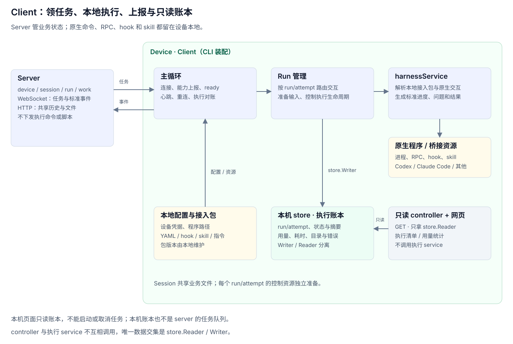

# Client 设计

> 本文定义 v3 client 的整体职责和协作关系，尚未据此完整重构代码。Device 表示执行设备，client 表示设备上运行的程序；服务端设计见 [server-main.md](server-main.md)，本地 harness 接入细节见 [client-harness.md](client-harness.md)。

Client 是设备上的常驻执行程序：登记设备、连接 server、领取 run，调用本地 harnessService 执行，把进度、问题、用量和结果转换为标准事件上报。同时提供本机执行账本和只读页面。

## 一、整体结构



| 组件 | 职责 |
|---|---|
| CLI | 注册设备、管理本地配置、启动主循环、查看状态和本机页面；会话/工作等远端操作通过业务 API 完成 |
| 主循环 | 维护 server 连接、上线登记、能力上报、ready、心跳、重连与执行对账 |
| Run 管理 | 按 run/attempt 跟踪本机执行，准备共享上下文和文件，路由插话/答案/取消，记录执行状态并上报事件 |
| harnessService | 管理本地接入包，探测程序，准备资源，执行原生 harness，处理 RPC/hook/skill 和输出解释 |
| 本机 store | 保存设备实际收到过的执行记录和 token 用量；分成 Writer 和 Reader |
| 本机 controller | 只使用 store.Reader，提供 GET 查询和嵌入网页，不调用执行服务 |
| 本机 frontend | 执行清单、详情和用量统计，不提供启动/取消任务或执行命令入口 |

Run 管理与 harnessService 都属于 client 的 service 层；前者理解 agentuse 的 run，后者理解原生执行方式。主循环负责连接和装配，不复制每种 harness 的协议逻辑。

## 二、与 Server 的边界

| Server 负责 | Client 负责 |
|---|---|
| 用户、device、agent、session、message 和 work | 本机配置、连接、进程、接入包和执行资源 |
| 建立 runs/run_prompts，分配目标设备 | 领取任务并按本地可用版本执行 |
| 保存共享历史和 session 文件空间 | 获取执行所需历史及文件，准备原生输入 |
| 租约、业务状态、结果入对话、工作汇总 | 原生交互、输出解释、结果与用量上报 |
| fileService 本地/S3 的上传下载 | 通过统一文件 API 获取输入和上传产物 |

Client 不直接访问 server 数据库，也不把本机账本当成服务端任务队列。Server 不管理本地 shell 命令、原生 RPC、hook 回调或 harness YAML。

### 网络上传什么

WebSocket 只承载 run 业务协议：

- 上线：device 身份、协议版本、本地探测后的 harness 标识/版本及业务能力。
- 下行：run/attempt、目标 harness 标识/版本、任务输入，以及补充消息、答案、取消。
- 上行：ready、心跳、started/progress/plan、消费确认、question/answered、usage、result/error/cancelled。

共享历史、run_prompts 和文件按业务 API 通过 HTTP 获取；文件产物经 fileService 上传。原生命令、参数、环境、脚本、YAML、RPC 帧和 hook 控制回包在设备内处理，不通过 WebSocket 远程驱动。

## 三、本地配置与数据

| 数据 | 放在哪里 / 谁管理 |
|---|---|
| Server 地址、device_id、设备密钥、本机选项 | client 本地配置，CLI 和主循环读取；设备凭据仅本机保存 |
| Harness 接入包 | 本机安装目录，按名称和 revision 管理；harnessService 读取 |
| 本机可执行程序路径覆盖 | 本地配置，不上传原始启动命令 |
| Session 工作目录 | 按 session UUID 隔离；同 session 的执行共享业务文件和历史来源 |
| 每次执行的 hook/配置/临时资源 | 按 run/attempt 隔离，避免并行执行覆盖彼此控制文件 |
| 执行账本 | 本机 SQLite，保存实际接收和执行信息，默认保留 90 天 |
| 本机页面令牌和监听地址 | 本地文件，供 CLI 打开只读页面 |

配置中的 device_id 对应 server 的设备资源，session UUID 对应共享会话，run/attempt 对应具体任务及当前执行身份。它们不与原生 Codex thread/turn 或 Claude 原生 session 混为同一个 ID。

接入包升级先在本地安装、探测，再上报新版本。正在执行或已经排队指定旧版本的任务继续使用本地保留版本；缺少对应版本明确失败，不从 server 请求 YAML，也不擅自改用新版本。

## 四、启动到执行的主流程

### 4.1 启动与上线

1. CLI 读取本地配置；首次注册用安装令牌交换 device 身份和长期凭据。
2. 打开本机账本，启动可选的只读 HTTP 页面，准备工作目录和本地接入包。
3. harnessService 在本机探测程序、版本与真实功能；主循环把探测结论上报 server，不回传探测命令或原始协议细节。
4. 建立 WebSocket，完成业务协议握手；重连时提交仍活跃的 run/attempt，由 server 确认可继续执行的集合。
5. 具备领取条件时发送 ready，等待 server 分配 run。

### 4.2 收到一个 Run

1. Run 管理检查执行身份、目标包版本和本机能力，登记当前执行并写入账本。
2. 获取 run_prompts、共享 session 历史和 messages.attachments 对应文件。run_prompts 是当前 run 的输入副本，历史按 messages.seq 组织。
3. 准备 session 工作目录与本次 run/attempt 的独立控制资源，将任务输入、共享历史和文件路径交给 harnessService。
4. harnessService 解析本地 YAML、安装本次资源、启动原生进程并管理交互。Codex 和 Claude Code 的具体接法只在本地发生。
5. 原生输出被转换为标准进度、计划、问题、用量和终态；Run 管理校验本地执行身份，更新账本并通过主循环上报。
6. 收尾进程、回调及临时控制资源，释放执行槽位，再发送 ready。Session 业务文件保留。

第一版按 ready 管理领取槽位，不因为一个 session 有多个 run 就假定设备已经并行执行。后续增加并发时显式管理槽位，并继续按 run/attempt 隔离交互。

## 五、执行中的交互

| 输入/事件 | Run 管理 | harnessService |
|---|---|---|
| 补充输入 | 确认所属 run/attempt，关联 run_prompts | 转换为本地原生插话，按真实接入依据确认或拒绝 |
| 原生提问 | 接收标准问题并上报 server，保持当前执行关联 | 保存原生请求关联，等待答案，恢复原生调用 |
| 用户答案 | 只路由到仍有效的执行与问题 | 转换成本地工具/RPC 的回答格式 |
| 取消 | 标记取消并终止对应执行流程 | 原生取消或结束进程树，释放 callback 和等待者 |
| 进度/结果 | 保存本机记录并上报标准事件 | 解释原生输出与终态，生成统一业务结果 |

输入已到 client、已写入原生通道、被原生接入点接受是不同状态。Client 不凭网络回执就报告插话成功；不支持、拒绝或未确认的输入仍由 server runService 处理后续分配。

Agent 上传产物后，以 session 文件空间相对路径填入回复的 attachments。Skill 可以指导文件/工作操作，但不代替运行控制、消费确认和结果上报。

## 六、断线、重启与退出

- **仅连接断开**：当前原生进程仍在本机受 Run 管理控制；主循环重连并对账，不能认为断线等于执行成功。
- **失去有效租约或执行被撤销**：结束对应本地执行；不继续用旧 attempt 上传结果或回答问题。
- **进程重启**：本机账本中未完成记录标记为中断，不据此擅自重新执行；server 根据租约和任务状态决定重排。
- **原生程序异常退出**：生成标准失败结果，清理本地桥接资源，再恢复领取能力。
- **client 正常退出**：停止领活，取消本机受管进程与回调，收尾账本和本机 HTTP；server 的最终状态仍由业务事件及租约机制维护。

任务状态以 server 为业务权威，本地账本说明这台设备实际发生过什么。无法送达或被 server 拒绝的结果不能被本机状态伪装成服务端已提交。

## 七、本机账本和只读页面

账本按 server、run_id、attempt_id 区分执行，记录收到/结束时间、状态、错误、设备/agent/session、harness、工作目录、插话与文件数量、用量和耗时。默认只保存正文前 200 字摘要，不复制完整服务端对话。

执行 service 只拿 store.Writer；本机 controller 只拿 store.Reader，使用独立只读数据库连接。Controller 与执行 service 不互相调用，不通过页面启动任务或修改执行状态。

本机页面默认监听 `127.0.0.1:7801`，可以关闭；校验 Host、使用本机访问令牌，仅允许 GET，不开放 CORS。两页是执行清单与用量统计。CLI 负责给出访问链接，本机网页是账本的视图。

本机 SQLite 中即便使用 runs 这个表名，也只属于本机账本，与 server 的 runs 不是同一份数据；它不能替代 server 的消息/任务分配关系。本文不新增其他本机业务表。

## 八、依赖方向

```text
client CLI ──┬─▶ service 主循环 ─▶ Run 管理 ─▶ harnessService
             │                       │             │
             │                       └──────┬──────┘
             │                              ▼
             │                        store.Writer
             │                              │
             │                         本机账本
             │                              │
             └─▶ controller ─────────▶ store.Reader
                     │
                     └─▶ 本机 frontend
```

本地进程、协议适配、hook 和 skill 属于 client 内部；共享部分只放 run 业务协议、标准事件和必要 DTO。Server 与 client 互不引用对方内部实现。

## 相关设计

[Client harnessService](client-harness.md) · [Server 总览](server-main.md) · [deviceService](server-device.md) · [runService](server-run.md) · [sessionService](server-session.md) · [fileService](server-file.md)
