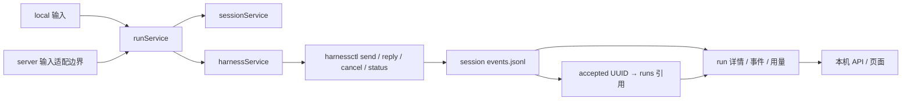

# Client 总览：以 harnessctl 为执行模型

Client 从输入来源接收文本，选择本机 session，调用 harnessctl，并读取该 session 的 events.jsonl。执行身份只有适配器公布的 run_id；client 不预分配 run_id，也没有执行 attempt。Server 的业务编排和调度设计不在本文扩展。

## 五个 service

| Service | 职责 | 文件来源 |
|---|---|---|
| endpointService | 提供输入来源及其身份；内置 local | endpoints.yaml 的启动快照 |
| settingService | 本机监听、工作根目录和 quota | setting.yaml 的启动快照 |
| sessionService | session 选择、占用、共同工作目录和回收 | conversation 下的 session.yaml |
| runService | 接收输入、驱动 session、登记实际 run、查询和控制 | runs/<run_id>.jsonl 引用及 events.jsonl |
| harnessService | 安装和固定适配器，通过四个命令执行和读取公共事件 | ~/.agentuse/harness/ 下的启动快照 |

controller 处理本机 HTTP，通过 sessionService 和 runService 的只读查询接口获取页面数据。各 service 直接管理自己负责的 YAML / JSONL 文件；client 不设 store、repository、Ledger 或统一 Reader / Writer 层。fileutil 只提供路径检查、原子文件写入、YAML 编解码和进程文件锁，不包含业务实体、索引或恢复策略。原生 Codex RPC、Claude stream-json、权限策略和进程生命周期全部属于独立 harnessctl 包，client 不实现另一套原生协议。



## 代码和文件归属

```text
client/internal/
  cli/                    启动、配置装配、进程锁和 HTTP 启停
  controller/             本机 API；分别注入 session / run 的只读查询接口
  fileutil/               通用路径、原子写入、YAML 和文件锁
  service/
    endpoint/             endpoints.yaml、endpoint 身份推导和注册
    setting/              setting.yaml 的配置校验与启动快照
    session/              conversation/session 元数据、目录、占用和 quota
    run/                  原生 run 引用、事件查询、计量、执行和旧中心协议适配
    harness/              独立适配器包的安装、命令调用和公共事件读取
```

sessionService 直接读取 conversation.yaml / session.yaml，并决定 workspace 及目录回收。runService 直接创建 runs/<run_id>.jsonl，从 events.jsonl 形成展示视图；恢复索引和旧 server 交付记录也由 runService 负责。两者没有包级循环依赖。

重启恢复时，runService 先通过 sessionService 查询未完成 session，把其 harness / revision / events 地址交给 harnessService 确认取消，再重建 run 引用及交付状态，最后由 sessionService 恢复元数据。harnessService 不扫描 conversation 目录或解释 session.yaml。

quota 回收由 sessionService 负责；旧中心待确认交付是否保护目录，由 runService 提供判断。sessionService 不解析 .server/ 文件，fileutil 不承担目录保护策略。内存互斥锁协调并发文件操作，不保存另一套持久化事实。

## 身份与生命周期

- endpoint 标识来源；local 永远存在，不需要注册配置。
- conversation 是目录及共同 workspace 的归属，可以包含多个本机 session。
- session 是一个固定 events.jsonl 地址及其原生上下文，client 的 session UUID 仅用于目录定位。
- run 是 events.jsonl 中一个适配器分配的 UUID。一次输入得到哪个 run，由 accepted 决定。
- input_id、request_id 同样由适配器公布。client 不用预先生成的标识替代它们。

send 可能继续当前 run，也可能产生新 run；调用者不选择 steer/queue。结果到来前可以继续 send 或针对 request_id reply。cancel 作用于 session 的当前工作和排队输入，不假装支持只取消某个 run。

local 和远端采用同一个 harnessService、公共事件格式、run 引用、读取和用量模型。差别仅在输入来源与额外的来源通信，不存在 local 专用的 run/attempt 账本。

## 文件布局

```text
~/.agentuse/
  setting.yaml
  endpoints.yaml
  harness/<name>/<revision>/...
  ui.token
  tmp/<endpoint_id>/<conversation_id>/
    conversation.yaml                 # local 标题等命名信息
    workspace/                        # 此 conversation 所有 harness 的共同 cwd
    sessions/<session_id>/
      session.yaml
      events.jsonl                    # 执行事实的唯一来源
      events.jsonl.d/                 # 适配器私有目录，保持不变
      runs/<adapter_run_uuid>.jsonl    # client 的引用，不复制执行正文
      resources/<content>.history.json  # 仅实际需要的非空输入资源
```

不使用 client SQLite，也没有全局 run 扫描接口。列表限定在指定 endpoint/conversation/session。配置及适配器包不属于 quota 回收对象；quota 回收完整的空闲 conversation 目录。

runs 文件名必须来自 accepted.run_id。文件内 reference 记录 session、来源和接入包等定位元数据；完整输入、正文、问题、结果、日志和计量从同一 session 的 events.jsonl 按该 UUID 读取。不保存 client 自建执行 UUID、attempt 或 harness_run_ids 二级映射。

## 启动与退出

1. 加载并校验 setting、endpoints、适配器包，固定为当前进程的快照。
2. 取得 client 单进程锁，初始化受管目录及会话状态。
3. 通过公开 harnessctl 命令确认遗留前台执行已清理；不能确认时拒绝释放目录。
4. 转换旧记录，并扫描公共 accepted 事件重建缺失的 run 引用；不重放输入。
5. 恢复 session 元数据，再开放 HTTP 和来源连接。
6. 运行期间处理输入、结果、重连及固定 quota 的检查，不重新加载配置。

退出时停止接收，取消受管的活动 session 并等待清理。适配器决定其后台进程的空闲回收和原生上下文恢复。

本机 HTTP 关闭时，远端输入和执行不依赖页面端口。enabled=true 时监听失败会明确启动报错；需要不启动页面时设置 local_http.enabled=false 后重启。原生控制连接不借用本机 HTTP。

## 本机 API

所有接口使用本机 token / HttpOnly cookie。配置和平台输入来源在页面中只读；local 入口用来验证相同的 harnessctl 执行链路。文档见 /api/docs，OpenAPI 见 /api/openapi.json。

| 方法 | 路径 | 含义 |
|---|---|---|
| GET | /api/settings | 当前启动配置，只有一份值 |
| GET | /api/endpoints | 固定的来源列表，不含凭据 |
| GET | /api/harnesses | 启动时的适配器及可用性 |
| GET | /api/local/harnesses | 同一份启动探测结果，不重新探测 |
| GET | /api/status | 来源连接与占用 session 数 |
| GET | /api/conversations?endpoint_id=… | 指定来源的 conversation |
| GET | /api/conversations/{endpoint}/{conversation} | conversation 与 workspace 位置 |
| GET | 同上 /sessions | session 列表 |
| GET | 同上 /sessions/{session} | session 元数据 |
| GET | 同上 /sessions/{session}/status | harnessctl 公开的 state、run_id、queued、requests、cwd、model |
| GET | 同上 /sessions/{session}/runs | 实际 adapter run 列表，含完整输入、正文、插话和结果；日志仅详情返回。支持 limit/cursor/status/since/until |
| GET | 同上 /sessions/{session}/runs/{run} | 该 UUID 对应的完整公共事件及结果 |
| GET | 同上 /sessions/{session}/usage | 汇总保留的实际 run 计量 |
| POST | /api/local/conversations | 创建命名空间，body 为 title |
| POST | /api/local/conversations/{conversation}/runs | 输入 harness、prompt 或 input；等待 accepted，返回真实 run |
| POST | /api/local/conversations/{conversation}/sessions/{session}/{action} | action 为 send、reply、cancel |

send body 为 prompt，返回此次 accepted 对应的 run，可能与先前相同；reply body 为 request_id、answer，answer 使用原生公共协议的字符串或 JSON 对象；cancel body 为 {}，确认 session 前台工作停止后返回。空闲 session 可以再次 send。失败发生在 accepted 之前时直接返回错误，不伪造 run。

## 现有 server 的临时边界

现有 server 仍使用自己的派发 run/attempt、租约、历史游标和 event_ack。它们隔离在 run/server_*.go 的协议适配层，持久化于 session/.server/，不进入 client Run DTO、公开 URL、前端或 run 文件名。

该边界只转换来源指令、凭据、输入资源和回报；client 的 run 始终以适配器 UUID 为准。Server 业务指令（包括协调者规则）由 server 生成，client 不据凭据推断角色。本次不改 server 协议，后续可以替换这一边界而不再改变 client run 模型。

配置修改一律重启生效。运行中任务输入、答案、取消和来源重连属于正常运行行为，不是配置热更新。
