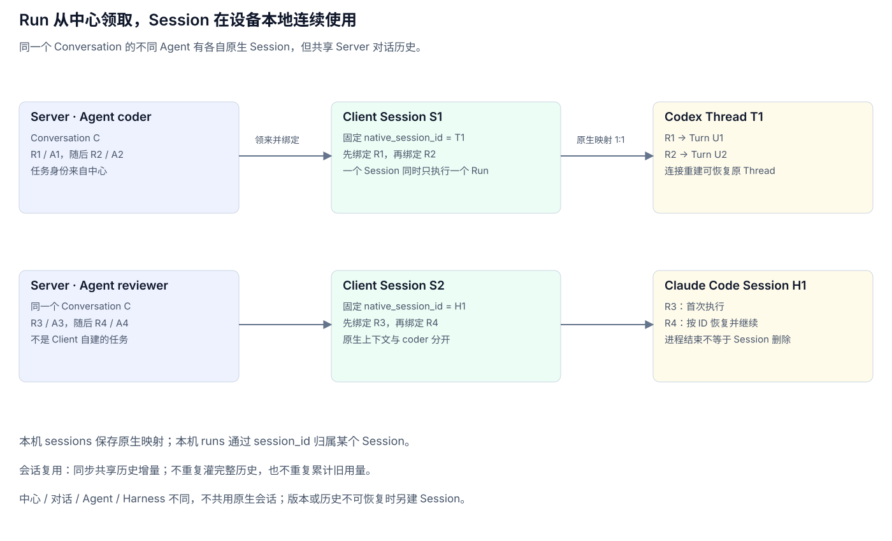

# Client sessionService：原生 Session 与领来的 Run

> v3 目标设计，尚未实现。Session 是 client 本地的原生执行会话记录，直接对应 Codex thread 或 Claude Code session。Conversation 是 server 的共享对话，二者不再混用。Client 不使用 SQLite；本地会话状态由 session.yaml 保存，时间字段使用 Unix 毫秒。

## 一、三个对象的关系

| 对象 | 属于哪里 | 含义 |
|---|---|---|
| conversation | server | 多 agent 共享的消息和文件空间 |
| session | client / 原生 harness | 一个可继续使用的原生执行上下文 |
| run | server 分配，client 领取 | 一次任务；绑定本机 session 后执行 |

一个 session 包含若干个从 server 领取的 run。Client 不创建独立于 server 的业务 run，也不因调用了原生 API 就另造一个 run_id；本机 run.json 文件记录 server run 的执行尝试。

```text
中心 A / Conversation C / Agent coder
  └─ Client Session S1 ↔ Codex Thread T1
       ├─ server Run R1 / Attempt A1 → Turn U1
       └─ server Run R2 / Attempt A2 → Turn U2（沿用 T1）

中心 A / Conversation C / Agent reviewer
  └─ Client Session S2 ↔ Claude Code Session H1
       ├─ server Run R3 / Attempt A3 → 首次执行
       └─ server Run R4 / Attempt A4 → 恢复 H1 执行
```

C 是共享对话，S1/S2 是各自原生上下文。一台设备上的不同 agent 不共用同一个原生 session，但它们仍从 server 读取同一个 conversation 的共享消息，并使用同一工作目录。Codex 与 Claude Code 可以在该目录同时运行；原生历史独立不意味着工作文件隔离。

Session 对应原生历史，不等于操作系统进程。一次 Claude print 进程结束不代表 session 被删除；Codex app-server 连接也可以重新建立后恢复原 thread。



## 二、sessionService 做什么

- 为领取的 run 选择可复用的本地 session，或请求 harnessService 创建新的原生 session。
- 保存本地 session 与原生会话 ID 的一对一映射。
- 按 endpoint/conversation 管理唯一共享工作目录，保证不同 agent/harness 的 session 使用相同 work_root。
- 串行管理同一个 session 的执行，维护上下文同步位置。
- 在 run 结束后保留 session，供后续领来的 run 继续使用。
- 处理 session 恢复、失效、关闭及本地历史查询。

settingService 提供端口、目录和 quota 配置；endpointService 只管已注册 server 的信息；client runService 管连接、领取、本机容量和 run/attempt 生命周期；sessionService 管跨 run 的原生上下文；harnessService 管创建、恢复、输入和原生交互的具体实现。

## 三、收到 Run 后怎样选 Session

默认按 `(endpoint_id, conversation_id, agent_id, harness)` 查找当前 session，并检查 harness_revision 与本地可恢复条件。

1. client runService 从 endpointService 读取注册信息，预留本机槽位并向对应 server 领取 run。
2. client runService登记 `(endpoint_id, run_id, attempt_id)`，交 sessionService 选择会话。
3. 有可恢复、空闲且版本匹配的当前 session，则复用；没有则建立新的本地记录，让 harnessService 创建原生会话并回填 native_session_id。
4. 获得 session 执行锁后绑定本机 run 记录，准备当前输入和上下文，交 harnessService 开始本次执行。
5. 结束 run 后更新账本，释放 session 锁与全局槽位；session 恢复 idle，保留历史，不随 run 完成关闭。

同一个 session 同时最多执行一个 run。已忙碌的 session 不能被另一个任务强行复用，插话则进入当前 run 的输入，不因此创建另一个 session。

中心、conversation、agent 或 harness 不同不能复用；接入包版本变化、原生历史丢失或不可恢复时，将旧 session 标为关闭或不可恢复，再创建新的 session。不得把旧记录的 native_session_id 改成另一个原生会话 ID。

## 四、Codex 与 Claude Code 怎样对应

| 本地操作 | Codex | Claude Code |
|---|---|---|
| 首次建立 session | 建立 thread，保存 thread.id | 首次执行，保存原生返回的 session ID |
| 在 session 中执行 run | 对同一 thread 发起本次 turn | 对同一原生 session 执行本次输入 |
| 进程/连接已退出后继续 | 初始化连接后恢复指定 thread，再开始新 turn | 按保存的 ID 恢复指定 session，继续 print 执行 |
| run 执行中插话 | 关联当前 thread/turn | 关联当前原生执行的 hook/控制请求 |
| run 结束 | 当前 turn 结束，thread 历史保留 | 本次执行/进程结束，session 历史保留 |

Codex 的恢复句柄使用 `thread.id`，不把 `turn.id` 或可能出现的 thread.sessionId 聚合标识当成另一个可互换的恢复 ID。Claude 恢复时使用指定 session ID，不用“当前目录最近一个 session”猜测，也不默认 fork 新 session。

原生接口依据 [Codex App Server](https://learn.chatgpt.com/docs/app-server) 的 thread/start、thread/resume、turn/start，以及 [Claude Code CLI](https://code.claude.com/docs/en/cli-reference) 的指定 session 恢复能力。具体调用与插话/提问细节仍归 [harnessService](client-harness.md)，不交给 server 解释。

## 五、共享历史和原生历史

Server conversation 仍是共享对话的权威来源，本地原生 session 保留自己的执行历史。复用 session 时，不再把整个 conversation 原样重复塞进已有原生上下文。

sessionService 依据 last_context_seq 读取共享历史增量，结合当前 run_prompts 组织本次输入。需跳过原生会话中已存在的任务输入和本机回复：可结合本地执行记录、run_prompts 及 server runs.result_message_id 核对。确认输入交付后更新同步位置，不能在读取或排队时提前推进。

首次创建或原生历史不可恢复时，用共享历史重新准备上下文；复用时追加新的共享消息和本次任务。一个会话的同步位置不更新另一个会话的同步位置。

同一个 session 执行多个 run 时，用量按本次 turn/执行的新增量记录。若原生通知提供累积值，需要按本次基线计算，不能每个 run 都重复累计整个 session 的历史用量。

## 六、会话状态文件

### session.yaml

```text
<session.work_root>/<endpoint_id>/<conversation_id>/sessions/<local_session_id>/session.yaml
```

每个 session 必须属于一个 endpoint/conversation，状态文件直接放在该 conversation 的共享工作目录中。这里 session.work_root 指配置的默认父目录，已有 conversation 以 workspace.yaml 绑定的实际目录为准。每个文件对应一个确定的原生会话。id 是本机 UUID，native_session_id 是原生程序返回的 ID，创建成功后固定；首次创建尚未完成时为空。

```yaml
id: 7877d33b-788f-4f6c-9ff0-987c2128064e
endpoint_id: 66c645f1-f128-4c83-b29a-93bd1f181017
conversation_id: 550e8400-e29b-41d4-a716-446655440000
agent_id: coder
harness: codex
harness_revision: package-revision
native_session_id: thread-1
workspace_id: 512f5703-b9e0-48fc-9a66-8d33883c32db
work_root: ~/.agentuse/tmp/<endpoint_id>/<conversation_id>
status: idle
last_context_seq: 12
created_at: 1793443200000
last_used_at: 1793443205100
updated_at: 1793443205100
```

status 为 creating/idle/running/unavailable/closed，等待问题期间仍是 running。工作目录被回收时 session.yaml、run.json 和执行资源随目录删除，该原生上下文不再作为可恢复候选。

不再保存 sessions 表、原生 ID 唯一索引或单独的 current 指针。sessionService 根据 workspace 映射扫描各 conversation 工作目录内的 session.yaml，构建可重建的内存索引：按 endpoint/conversation/agent/harness 筛选空闲、版本匹配、目录存在的会话，再取最近使用的有效记录。同一 session 的选择、执行与清理共用排他保护。

原生 ID 的一对一映射和单 session 串行执行由 sessionService 校验。新建会话不修改旧文件的 native_session_id；替换/关闭写回对应状态文件。不要靠删除一条数据库记录来表示原生历史已被销毁。

本机 run.json 由 [client runService](client-run.md) 管理，其中 session_id 指向本文件的 id。多个从 server 领来的 run 可以引用同一个会话文件。每个本机 run.json 保存在该 session 目录的 runs/<run_id>/<attempt_id>/ 下，已落盘执行记录必须归属一个确定的 session；未绑定时的领取/拒绝处理由 runService 与 server 协议完成。

### conversation 工作目录映射

sessionService 将目录绑定保存在 `~/.agentuse/state/workspaces/<endpoint_id>/<conversation_id>/workspace.yaml`：

```yaml
id: 512f5703-b9e0-48fc-9a66-8d33883c32db
endpoint_id: 66c645f1-f128-4c83-b29a-93bd1f181017
conversation_id: 550e8400-e29b-41d4-a716-446655440000
work_root: ~/.agentuse/tmp/<endpoint_id>/<conversation_id>
state: present
```

workspace.yaml 是该 conversation 目录绑定及存在状态的唯一持久化来源；session.yaml 的 workspace_id/work_root 是关联信息，加载时以映射和实际目录核对修正。workspace.yaml 保留在工作目录之外以记录目录绑定；session.yaml 随 conversation 工作目录一起管理和回收。

首次按 setting.yaml 的 session.work_root 分配目录，后续相同 endpoint/conversation 的所有 session 复用映射。更换 harness、原生 session 或配置父目录都不能把已有 conversation 拆成不同目录。容量检查遍历已登记映射，因此配置变更后旧根目录仍纳入受管目录统计。目录回收会删除其中所有 session.yaml 并移除对应内存索引；之后在原绑定路径重建工作区时创建新 session 和新 UUID，不能因为同一路径重新出现就恢复旧上下文。

session 的执行锁只保证单个原生 session 串行，不独占整个工作目录。多个 session 在同一目录并发时登记使用占用；清理须确认所有占用均已释放。业务文件直接共享，并发修改同一文件或 Git 状态仍需 agent 协调；不会自动获得文件事务。hook、临时配置和控制资源按 run/attempt 隔离，不能相互覆盖。服务端 fileService 用于文件传输与交付，同机共享工作区不需要通过上传下载模拟同步。

## 七、工作目录怎样组织

```text
<session.work_root>/
  <endpoint_id>/
    <conversation_id>/
      .agentuse-workspace.json
      ...同一 conversation 的所有 agent / harness 共享的业务文件...
      sessions/<local_session_id>/
        session.yaml
        runs/<run_id>/<attempt_id>/
          run.json
          ...本次执行独立的 hook、临时配置和执行资源...
```

sessionService 按 `(endpoint_id, conversation_id)` 分配并持久化唯一工作目录。同一 conversation 的所有原生 session（包括 Codex 和 Claude Code）使用同一个 work_root，可以同时运行；不同 endpoint/conversation 分开。原生上下文仍各自独立，工作文件则直接共享。

setting.yaml 的 session.work_root 是分配新 conversation 目录的默认父目录；实际目录记录在 sessionService 的 workspace.yaml 中，并写入各 session.yaml 的 work_root。已有 conversation 新建或更换 harness/session 时沿用已绑定目录，不重新分配。目录绑定文件的结构见上节。

`.agentuse-workspace.json` 标识 client 创建的受管目录，记录 endpoint/conversation/workspace_id；会话状态文件通过 workspace_id 关联该目录。没有标识的用户目录不作为清理对象。不得把 home、磁盘根目录、原生工具全局用户目录或设置/状态/适配器目录作为可回收工作根目录。

容量只统计这些受管工作目录，包括目录中的 session.yaml、run.json 和执行资源；不统计目录之外的 endpoint 密钥、workspace.yaml、接入包，也不擅自扫描删除 `~/.codex`、`~/.claude` 等原生全局历史。

## 八、恢复和清理

- 网络重连保持仍受控的 session/run；server 确认的 valid_runs 只用于恢复对应中心的执行身份。
- client 重启先对账，不因本地存在 session 就自动恢复执行旧 run；只有领到或确认有效的任务才能开始工作。
- 原生历史缺失或恢复失败则标记不可用；重新建立 session 时保留旧执行关联和失败原因。
- 取消 run 结束当前执行，不必删除原生 session；本地适配确认历史仍可恢复时，后续 run 可以继续使用。
- 本机执行记录随 conversation 工作目录管理。容量超限按 settingService 配置回收整个空闲 conversation 目录；任一关联 session 在用时都受保护，回收后保留 workspace.yaml 映射并标记目录缺失，session.yaml、run.json 和执行资源随目录删除。崩溃恢复时以映射和实际目录核对，不能恢复旧工作区；不删除 server conversation 或文件。

## 九、超过容量后怎样自动清理


1. 声明 quota 后，runService 在启动、领取执行前后及内置周期检查时触发 sessionService 检查。周期由实现内部管理，不暴露 cleanup 配置。
2. sessionService 统计所有受管 conversation 目录，每个共享目录只计算一次；未声明 quota 或未超限则不因容量删除文件。
3. 超限后取 conversation 内所有 session 最近使用时间的最大值，按该时间从旧到新回收**整个空闲 conversation 工作目录**，直到总用量不超过 session.quota.max_bytes。
4. 任一关联 session 正在执行、等待用户答案、结果尚未获 server 确认、持有执行锁，或已分配给即将启动任务时，整个目录都不能删除。目录使用登记允许多个 session 并发，清理必须取得 conversation 工作目录的独占权限，不能边执行边清理。
5. 回收时持有目录独占权限，删除整个目录及其中所有 session.yaml、run.json 和执行资源，并将 workspace.yaml 标记为 missing、移除相关内存索引。若操作中途崩溃，重启以实际目录及标记核对，不能只凭旧内存索引恢复。后续有效任务建立新原生 session，从 server 历史和文件准备输入，不假装旧工作区仍在。

文件应先通过 fileService 上传再作为产物交付；清理只处理本机临时工作副本，不删除 server 文件。未上传的空闲工作目录内容会随回收删除，这就是启用临时目录回收的语义。

如果超限但只有在用目录，暂不再启动需要该工作空间容量的新任务，等待资源释放并重试清理。正在运行的任务可继续，不能为达容量目标杀掉任务或删除其目录。因此这是清理/准入策略，不是文件系统硬配额，执行中的瞬时用量可能超过上限。

## 相关设计

[settingService](client-setting.md) · [client runService](client-run.md) · [Client 总览](client-main.md) · [endpointService](client-endpoint.md) · [harnessService](client-harness.md) · [Server conversation](server-conversation.md) · [Server run](server-run.md)
