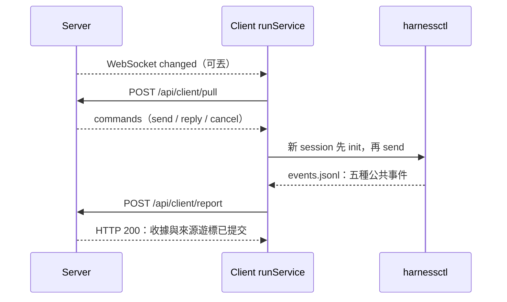

# 通信協議第二稿：HTTP 領取與回報，harnessctl 負責執行

> 設計草案，尚未實作。現行協議仍以 [protocol.md](protocol.md) 為準。本稿重新設計 Server ↔ Client 通信；Client ↔ 本地 Agent 沿用 harnessctl/3，公開介面仍為 init、send、reply、cancel、status，不增加原生執行協議。

## 一、先釐清複雜度來自哪裡

目前五種公共執行事件已經足夠。複雜的是 WebSocket 同時承擔領取、派發、控制、執行事件、確認與重連恢復，於是出現 hello/welcome、claim/no_task/ready、prompt_error/prompt_error_ack、event/event_ack、control_ack 等多組訊息。

Client 還需要管理 WebSocket 請求配對、事件確認、輸入失敗確認及控制回執；一次 send 的受理與真正的 run 結果又有不同含義。單純把所有 type 改成一個通用 RPC，雖然型別變少，這些責任仍然存在。

這一稿把通信收斂為：**HTTP 領取指令、HTTP 批次回報、WebSocket 喚醒提示。** 執行事實繼續只有 accepted、message、request、result、log。

## 二、參考 Multica 的哪些部分

此處將「mutica」理解為 [multica-ai/multica](https://github.com/multica-ai/multica)。參考版本固定為 `282f48eed2531f467ed4e6febc2a59b590d3e711`，避免把持續變動的 main 當作規範。

從該版本的原始碼可見：

- [messages.go](https://github.com/multica-ai/multica/blob/282f48eed2531f467ed4e6febc2a59b590d3e711/server/pkg/protocol/messages.go) 定義 type/payload 信封、通用 RPC 請求與回應，以及不攜帶任務正文的喚醒提示。
- [client.go](https://github.com/multica-ai/multica/blob/282f48eed2531f467ed4e6febc2a59b590d3e711/server/internal/daemon/client.go) 提供 HTTP 任務領取與補充輸入領取方法。
- [task_supplement.go](https://github.com/multica-ai/multica/blob/282f48eed2531f467ed4e6febc2a59b590d3e711/server/internal/daemon/task_supplement.go) 將補充輸入的喚醒、可靠領取和原生提交分開處理。

Multica 本身包含 RPC、相容能力與補充輸入等更多機制，不能概括成「只有 HTTP 輪詢」。這裡借用的是**提示可丟、資料另行可靠領取**的分工；下列介面是 AgentUse 的提案，不是 Multica 的原協議。

AgentUse 已經有 harnessctl，因此執行層不再增加專用 steer/supplement 介面、原生能力協商或 Server 產生的 run 身份。

## 三、整體關係



| 邊界 | 職責 |
|---|---|
| Server | 保存 conversation/message、固定 Agent 與 Skill 版本、建立輸入分配、接收實際 run 與結果 |
| Client runService | 領取、選擇 session、準備固定資源、呼叫本地 harnessService、同步公共事件 |
| Client harnessService | 封裝 harnessctl 的五個公開介面 |
| 適配器 | 原生進程、上下文恢復、插話或排隊、權限處理及 run UUID |

Server 不傳 shell、argv、原生 RPC 或 harness YAML。Prompt 正文與 ZIP 內容經 HTTP 傳輸；WebSocket 僅傳提示，減少在其中攜帶執行內容的必要。HTTP 仍須正常處理 WAF 規則，換傳輸不代表正文不會被檢查。

## 四、連接只保留一個簡單約定

所有請求使用目前 endpoint 的 device key：`Authorization: Bearer <device_key>`，並帶 `AgentUse-Protocol: agentuse-client/2`。Server 回應同一協議標識；不支援時返回 HTTP 426，Client 明確提示升級，不自動切回舊協議。

`agentuse-client/2` 是本稿的網路契約，與現有 `harnessctl-events-v2` 不相容；本地仍為 harnessctl/3。Device 註冊、使用者登入與前端 API 不在此重新定義。

核心通信只有兩個 HTTP 操作：

| 操作 | 用途 |
|---|---|
| POST /api/client/pull | 報告設備與可用容量，領取有限批次的指令 |
| POST /api/client/report | 提交指令回執和 session 事件批次 |

WebSocket `/api/client/ws` 使用相同認證，只允許一種業務提示：

```json
{"type":"changed"}
```

它不攜帶任務，不需要業務 ACK。重複、合併或丟失都安全；Client 收到後觸發 pull。連線保活使用標準 WebSocket ping/pong，不再定義 heartbeat 訊息。

Client 啟動時立即 pull，之後在提示、容量釋放、指令處理完成時再次 pull，並以約 30 秒的低頻輪詢兜底。提示合併，一個 endpoint 同時最多一個 pull。沒有 WebSocket 時仍能正常工作，隻影響新輸入的發現延遲。

pull 同時更新設備最近活動時間，攜帶啟動時探測並凍結的 harness 清單。HTTP 活躍時間也是在線判斷依據；不能僅因提示連線斷開，就將 HTTP 仍正常的 Client 判成不可用。

## 五、pull：只領取三種指令

請求示意：

```json
{
  "harnesses": [{"name":"codex","version":"installed-version","revision":"package-revision"}],
  "free_sessions": 1,
  "active": [{"conversation_id":"c1","agent_id":"reviewer","agent_version_id":"av1"}],
  "limit": 8
}
```

`free_sessions` 是 Client 內部容量資訊，不增加使用者設定。`active` 表示仍可接收輸入的固定版本綁定；它不表示能插話到哪個 run。容量為零時，只領取對 active 綁定的 send，以及已有 session 的 reply/cancel。跨 endpoint 的總容量由 Client 自己協調，不要求多個 Server 共同排程。

Server 優先返回 reply/cancel，再返回可接收的 send。同一綁定的 send 保留輸入分配順序；一次 HTTP 回應不是執行完成順序。無任務時統一返回 `{"commands":[]}`，不再有 no_task。

send 範例：

```json
{
  "commands": [{
    "id": "p:17",
    "method": "send",
    "target": {"conversation_id":"c1","agent_id":"reviewer","agent_version_id":"av1"},
    "params": {
      "content": "Server 已組織完成的輸入正文",
      "config": {"harness":"codex","model":"固定模型","agent_instructions":"固定指令","skills":[]}
    }
  }]
}
```

範例中的 c1、av1、s1 是縮寫；實際使用既有 conversation、版本與本地 session ID。

- `id` 是既有輸入分配或控制記錄的穩定傳輸標識。`p:17` 可直接對應 run_prompts.id；控制可使用 `c:<既有控制記錄 ID>`，不新增一個任務身份。
- Server 在保存使用者訊息時固定 agent_version_id。首次交付時保存完整指令快照；重送同一 id 時內容不變。
- `content` 已包含本次任務、共享歷史和 Server 業務說明。Client 不再同時接收一份 context/instructions 並判斷如何重組。
- `config` 是固定 Agent 版本的業務資料，skills 每項沿用 skill_id、skill_version_id、name、sha256、size_bytes、download_path。附件沿用既有 HTTP 檔案描述；ZIP 與附件位元組不放入指令回應。下載只使用目前 endpoint 的相對 API，授權限定為該設備已分配輸入引用的固定版本，不向外域轉送 device key。
- 每次 send 都可以帶完整 config，避免額外的配置同步或快取協商。它不允許修改既有 session；版本不同就建立新綁定。

reply/cancel 使用同一指令信封：

```json
{"id":"c:reply-1","method":"reply","target":{"session_id":"s1","run_id":"550e8400-e29b-41d4-a716-446655440000"},"params":{"request_id":"req-1","answer":"allow"}}
```

```json
{"id":"c:cancel-1","method":"cancel","target":{"session_id":"s1","run_id":"550e8400-e29b-41d4-a716-446655440000"},"params":{}}
```

run_id 是適配器已公佈的身份。取消前須確認該 run 尚未結束；延遲抵達的取消不能作用到同一 session 的下一次交互。已結束時可回報「已處理、無需再取消」，不能改寫原生結果。reply 同樣核對 session、run 和 request 歸屬。

Server 在交付時記錄設備歸屬。HTTP 回應丟失時，下次 pull 重送同一批尚無確定回執的指令；不產生新 id、不建立 attempt、不因逾時把不確定輸入改派另一臺設備。

## 六、與 harnessctl 五個介面的對應

| harnessctl 介面 | Client 如何使用 | 網路上是否另有同名指令 |
|---|---|---|
| init | 新版本綁定首次執行前，準備 cwd、模型、指令和 skills，再初始化新的 events 地址 | 無；是處理 send 的本地準備步驟 |
| send | 將 content 經 stdin 傳入；首次、空閒續接、中途補充都相同 | send |
| reply | 按公共 request 的類型，把答案經 stdin 交給適配器 | reply |
| cancel | 核對目標 run 後，取消 session 當前工作 | cancel |
| status | 啟動恢復、執行檢查、確認綁定或診斷時查詢 | 無；不輪詢它來替代事件結果 |

本地 session 按 endpoint/conversation/agent/agent_version/harness revision 選擇。新綁定的資源仍放在 workspace 之外；校驗 ZIP 摘要、大小和清單後 init，成功即刪除準備目錄。後續使用適配器自己的固定快照。

同一 session 同時最多一條正在呼叫 harnessctl send 的輸入，以便把 accepted 對應回輸入分配；send 返回受理後即可處理下一條，**不用等 result**。reply/cancel、來源事件讀取和網路同步持續獨立運作，不能被等待中的 send 擋住。

例如兩條訊息都 @ reviewer：Client 兩次呼叫 send。第二次 accepted 的 run_id 與第一次相同，Server 才知道它們屬於同一 run；若適配器排到下一次交互，就按新的 UUID 保存。通信層沒有 steer 或 queue 選項。

Local 模式使用相同的本地執行路徑，只省去遠端 pull/report；遠端傳輸收據不成為另一套執行模型。

## 七、report：一份回報，一個 HTTP 確認

report 可以只帶 receipts、只帶 streams，或兩者都帶。兩部分的到達順序沒有業務先後保證。關鍵事件及早觸發回報，一般可在約 250 ms 內合併批次；回報迴圈不等待 pull 或原生執行結束。

```json
{
  "receipts": [{"command_id":"p:17","status":"applied"}],
  "streams": [{
    "session_id":"s1",
    "binding":{"conversation_id":"c1","agent_id":"reviewer","agent_version_id":"av1","harness":"codex","revision":"package-revision"},
    "after":0,
    "next":192,
    "events":[{
      "pos":192,
      "command_id":"p:17",
      "event":{"type":"accepted","ts":"2026-11-06T00:00:00Z","run_id":"550e8400-e29b-41d4-a716-446655440000","input_id":"in-1","text":"Server 已組織完成的輸入正文"}
    }]
  }]
}
```

192 僅示意來源位移，實際須使用原始 JSONL 完整行結束位置。

### 指令回執與執行結果分開

| receipt.status | 含義 | Server 行為 |
|---|---|---|
| applied | 本地呼叫成功受理，或受保護的控制目標已結束而無需再操作 | 停止重送；執行投影仍等待公共事件 |
| rejected | 能證明尚未受理，例如資源準備失敗、未呼叫 send | 保存輸入或控制失敗，不虛構 run/result |
| unknown | 可能已受理，但暫無足夠證據；附 error 說明 | 暫停該指令自動投遞，等待來源事件或人工處理 |

rejected/unknown 必須帶 error；applied 可帶說明。send 逾時、連線中斷或一般非零退出碼，不能直接推定為 rejected。先檢查公共事件；已有 accepted 就按它關聯，否則無法證明未受理時回報 unknown。

applied 不表示模型已完成；reply applied 不表示問題已變為 replied；cancel applied 不表示 run 已 cancelled。這些狀態只能從 request/result 得知。若 accepted 先到，Server 已知輸入受理，較晚抵達的回執不得倒退這個事實。每份回執的 command_id 都必須屬於已交付該設備的指令。

### 事件仍使用原始五種類型

`event` 原樣保留 harnessctl 公共物件，不轉成 task.running/task.completed 等另一套事件。只有 accepted 的外層附 command_id，用來對應原始輸入；其他事件靠既有 run_id/input_id/request_id 關聯。

每個 stream 的 binding 一經建立就固定。Server 核對設備、輸入分配、Agent 版本和 session 歸屬，不能把舊 session 改綁新版本。Server 的 run 只由 accepted 建立，訊息與 run 的 N:M 關係也以 accepted 為準。

after 是已確認的來源位移，next 是本批掃描完成的最後完整行位移，pos 是某條上報事件的行結束位置；皆為 UTF-8 位元組位置，不是行號。每個來源只允許一批未確認資料。

accepted/message/request/result 必須可靠重傳。log 可以在 Client 端合併、限流或完全不傳；next 仍跨過掃描到的日誌行，不能因丟日誌而卡住關鍵事件。末尾半行不推進位移。

Server 驗證整份回報並在同一資料庫交易中提交事件、業務投影、回執和遊標，成功後回應：

```json
{"streams":[{"session_id":"s1","ack":192}]}
```

HTTP 200 表示本次全部 receipts 已保存，並返回各來源的已提交位移；不再逐條發 event_ack 或 control_ack。回應丟失就重送原批，Server 依來源位置與既有指令標識處理重複，不重複建立 run 或最終回覆。相同位置但內容不同時返回 409，不覆蓋歷史。

已確認的批次重送，核對已有事件內容一致後回目前 ACK；有新資料時，after 必須等於 Server 遊標，不能跳過尚未提交的區段。格式或授權錯誤使整批不提交，並指出來源/位置；不能把錯誤當確認。批次須有大小上限；單條關鍵事件超限時明確保留未同步狀態並報錯，不截斷或丟棄。

## 八、恢復只處理兩個問題

**指令有沒有提交過？** Client 在 conversation 範圍的傳輸目錄中，以既有 command_id 保存處理收據，因此尚未建立 session 的準備失敗也能記錄；send 前先記錄準備提交的狀態及來源起點。重複領到同一指令時回報原收據，不再呼叫 send。恢復時只在能唯一對應 accepted 的情況下補回關聯；同文輸入不能靠 text 比對，沒有 accepted 也不能證明未提交。不確定便保持 unknown，暫停該 session 的後續 send；reply/cancel/status 與事件同步仍可進行。只有原指令的受理歸屬得到確認，或經明確人工處理後才繼續，不盲目重放。

**事件同步到哪裡？** 每個 session 只保存一個已確認來源位移，events.jsonl 是唯一事件 outbox，不另外複製執行輸出。報告中斷後從該位移重送。Client 資料遺失則明確顯示不可恢復，Server 不能把「沒收到結果」當作「沒有執行過」。

這些是傳輸恢復資訊，不增加使用者訊息的冪等鍵，也不承諾模型副作用恰好一次。尚未確認的資料及 unknown 指令會保護 conversation 目錄，不因 quota 自動清除。

網路離線時，本地已受理的工作繼續執行。上報或 pull 失敗採退避重試；401/403 停止使用失效憑據，426 要求升級。設備離線本身不產生 failed/cancelled 的原生結果。

## 九、實作時刪除什麼、保留什麼

| 現行項目 | 第二稿 |
|---|---|
| hello/welcome、業務 heartbeat | HTTP 協議標頭、pull 上報與最近活動時間 |
| claim/prompt/no_task | pull 的有限 commands 批次 |
| ready | 可丟的 changed 提示 |
| prompt_error、control_ack 及各自的確認 | 同一 report.receipts |
| event/event_ack 的逐行往返 | report.streams 批次與每來源 ACK |
| Client 的多個 WebSocket 業務分派分支 | 提示處理、pull 迴圈及 report 迴圈 |
| 五種公共事件、固定版本、適配器決定 run UUID | 全部保留 |

不保留舊協議相容分支，不增加 attempt、租約、Server 原生 harnessService 或專用插話介面。Server/client 需要配套升級；資料遷移或清空須另按部署指令處理，不能由啟動流程自行刪除。

驗收重點：沒有 WebSocket 仍可領取；重複提示不重複執行；pull/report 回應丟失後可恢復；send 不確定時不重放；等待中的 send 不阻塞 reply/cancel；所有 log 丟失仍可還原正文、問題及結果；新 Agent 版本使用新 session；同一來源不能改綁或改寫已提交事件。

[現行通信協議](protocol.md) · [harnessctl 介面](../../../harnessctl/README.md) · [公共事件](../../../harnessctl/EVENT.md) · [Client runService](client-run.md) · [Client sessionService](client-session.md) · [Server runService](server-run.md)
