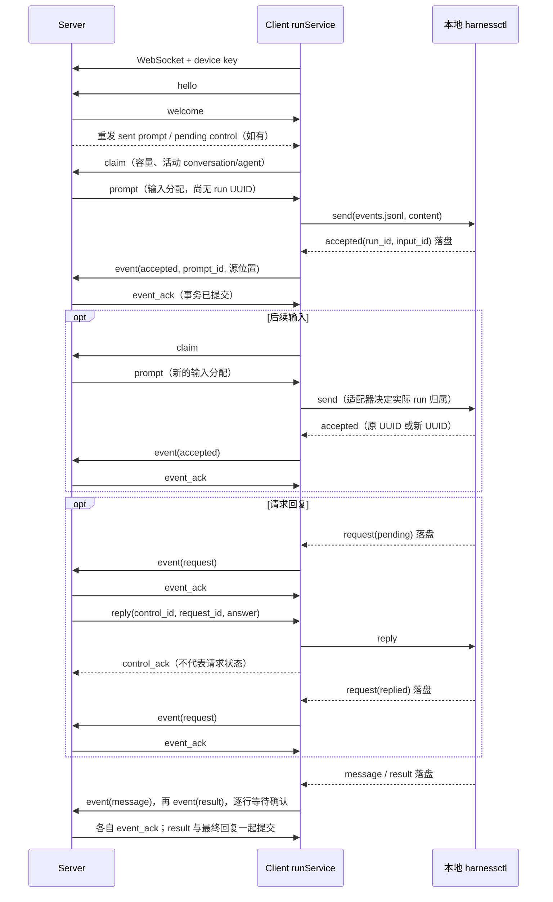

# Server 与 Client 的 WebSocket 协议

本文记录**当前实现**的 `harnessctl-events-v2`，覆盖连接、领取输入、上报执行事实、回复请求、取消和断线恢复。它与适配器本地的 `harnessctl/3` 是两层协议：WebSocket 负责 server/client 通信，harnessctl 负责 client/适配器交互。公共执行事件复用 [harnessctl/EVENT.md](../../../harnessctl/EVENT.md)，不再另定义一套事件格式。

Server 分配消息输入、准备业务上下文，client 调用本地适配器执行。**实际 run UUID、输入归属和执行结果由适配器决定，经 client 上报。** Server 负责身份、关联和一致性校验，不解释 Codex/Claude Code 的原生交互。

## 连接与编码

| 项目 | 当前约定 |
|---|---|
| 地址 | `{server_url}/api/daemon/ws`；HTTP 对应 ws，HTTPS 对应 wss |
| 认证 | 升级请求头 `Authorization: Bearer <device_key>` |
| 密钥来源 | 事先通过 HTTP `POST /api/daemon/register` 用 setup token 换取，不在 WebSocket 中注册 |
| 认证失败 | 升级前返回 HTTP 401；当前 client 将 401/403 视为凭据失效，不继续自动重连 |
| 编码 | UTF-8 JSON；一个应用消息是一个 WebSocket 文本消息中的 JSON 对象 |
| 大小限制 | 两端当前均设置 8 MiB 的单条接收消息上限 |
| 版本协商 | 首个 JSON 消息的 protocol 字段；不是 Sec-WebSocket-Protocol 子协议头 |
| 连接归属 | 一条连接对应本 server 注册的一台 device；同一 device 的新连接替换旧连接 |

所有消息都有 `type`。其余字段按消息类型使用，可选字段允许省略；Go 序列化会省略零值的可选字段。例如 `free_sessions: 0` 可省略，server 按零处理。JSON 字符串内的换行使用转义；WebSocket 不直接传一批 JSONL 文本行。

多中心分别建立连接，各自使用对应 device key。endpoint_id 是 client 的本地来源标识，不需要放入每条线上消息，server 也不管理其他中心的 endpoint。

## 标识与消息总表

| 标识 | 产生方 | 含义 |
|---|---|---|
| daemon_id | Server | 现有线上字段名，业务上指 device；连接身份以认证密钥为准 |
| conversation_id | Server | 共享对话 UUID |
| message_id | Server | 触发输入的共享消息；当前实现为整数，与目标元数据设计中的 UUID 区分 |
| prompt.id / prompt_id | Server | run_prompts 的整数主键；一条消息对一个目标 agent 的输入分配，不是执行 ID |
| session_id | Client | 本地 session；同一个 session 对应一个规范 events.jsonl 地址，可包含多个实际 run |
| event.run_id / control.run_id | 适配器 | 一次交互的 UUID；server 不预分配 |
| input_id | 适配器 | 一条已受理输入；通过 accepted 与 prompt_id 关联 |
| request_id | 适配器 | 一次公共请求，供 reply 定位 |
| control.id | Server | 一条回答或取消命令的 UUID，供传输去重 |
| claim_id | Client | 一次领取请求的关联字符串，server 原样回传；当前 client 每次使用 next，同时最多一个未响应领取请求 |
| client_event.seq / ack_seq | Client 源文件 | 完整 JSONL 行结束位置的字节偏移，不是行号、时间戳或 run 内序号 |

下文 C 表示 client，S 表示 server。

| type | 方向 | 作用 | 对应响应 |
|---|---|---|---|
| hello | C → S | 声明协议版本、client 版本和本地可用 harness | welcome |
| welcome | S → C | 确认协议和设备身份 | 无 |
| claim | C → S | 按可用容量领取一条输入 | prompt 或 no_task |
| prompt | S → C | 首次交付或重发输入分配 | accepted 包装在 event 中，或 prompt_error |
| no_task | S → C | 本次领取没有合适输入 | 无 |
| ready | S → C | 提示输入队列可能有变化 | Client 后续自行 claim |
| event | C → S | 上报一条原始公共执行事件 | event_ack 或 error |
| event_ack | S → C | 已提交该源位置的事件 | 无 |
| prompt_error | C → S | 输入在受理前失败 | prompt_error_ack |
| prompt_error_ack | S → C | 已提交输入失败 | 无 |
| reply | S → C | 向公共 request 提交答案 | control_ack；业务状态另由 event 上报 |
| cancel | S → C | 取消指定 client session 的当前工作 | control_ack；业务终态另由 event 上报 |
| control_ack | C → S | 控制命令处理收据，可带错误 | 无单独 ACK |
| heartbeat | C → S | 更新设备最近活动时间 | 无 |
| error | S → C | 拒绝一条执行事件 | 不推进事件确认位置 |

## 握手与设备上报

Client 连接后必须先发送 hello。harnesses 只包含本地探测可用且未禁用的条目；server 不要求它们预先存在于某个全局适配器目录。

```json
{
  "type": "hello",
  "protocol": "harnessctl-events-v2",
  "version": "client-build-version",
  "capabilities": ["harnessctl-events-v2", "session-attachments-v1"],
  "harnesses": [
    {"name": "codex", "version": "installed-cli-version", "revision": "adapter-package-revision"},
    {"name": "claude", "version": "installed-cli-version", "revision": "adapter-package-revision"}
  ]
}
```

| 字段 | 含义 |
|---|---|
| protocol | 必须为 harnessctl-events-v2；不匹配直接结束连接，不降级 |
| version | Client 程序构建版本，不是原生 CLI 版本 |
| capabilities | 连接的业务协议能力；session-attachments-v1 表示当前附件接入能力 |
| harnesses[].name | Client 对外报告的标签，也允许自定义名称 |
| harnesses[].version | 本地 CLI/适配器探测结果中的版本字符串 |
| harnesses[].revision | 本地适配器包的版本标识；server 不通过它下发安装包或执行配置 |

Server 更新设备在线状态、能力和 harness 报告。available 来自本次上报，enabled 是 server 上用户的开关，二者都满足才可分配输入。

```json
{
  "type": "welcome",
  "protocol": "harnessctl-events-v2",
  "daemon_id": "dm_example",
  "name": "my-device"
}
```

Welcome 后，server 先重发这台设备尚未确认受理的 sent 输入，以及 pending 控制命令；这些重发消息不需要 claim_id。Client 同时恢复源事件同步和正常领取。

## 领取与输入交付

### claim、no_task 和 ready

Client 报告新 session 容量，以及仍可以接收后续输入的活动 conversation/agent：

```json
{
  "type": "claim",
  "claim_id": "next",
  "free_sessions": 1,
  "active_streams": [
    {"conversation_id": "550e8400-e29b-41d4-a716-446655440000", "agent_id": "coder"}
  ]
}
```

- free_sessions 大于零时，server 可以返回该设备的一条可用 pending 输入。
- free_sessions 为零或省略时，只返回 active_streams 中 conversation/agent 匹配的输入；空列表表示没有可接收输入的执行位置。
- active_streams 不含原生 thread/session ID，也不要求 server 判断这条输入是插话还是排队。
- 当前 server 按输入 ID 顺序选择一条，检查设备的 harness 可用且 enabled；领取事务保存完整 dispatch 快照，并将输入从 pending 改为 sent，此时仍不创建 run。

没有合适输入时：

```json
{"type":"no_task","claim_id":"next"}
```

队列变化时 server 可以提示：

```json
{"type":"ready"}
```

ready 不携带任务，也不是要求 client 直接执行的指令。当前 client 依靠约 100 ms 的轮询检查容量和发起 claim；ready 只是提示，不承载可靠业务数据。

### prompt

```json
{
  "type": "prompt",
  "claim_id": "next",
  "prompt": {
    "id": 17,
    "conversation_id": "550e8400-e29b-41d4-a716-446655440000",
    "message_id": 42,
    "agent_id": "coder",
    "agent_version_id": "dcfa65a0-00fb-4e71-a0a8-4fad5ed6ec72",
    "harness": "codex",
    "agent_instructions": "",
    "skills": [],
    "content": "Server 已准备好的完整输入文本",
    "instructions": "Server 准备的工作说明和业务指令",
    "context": [],
    "context_seq": 42
  }
}
```

| prompt 字段 | 类型 | 含义 |
|---|---|---|
| id | integer | 输入分配 ID，首次交付和重发保持不变 |
| conversation_id、agent_id | string | 对话与目标 agent；client 用于选择本地执行会话 |
| agent_version_id | string | 入队时固定的不可变 agent 版本 UUID |
| model、agent_instructions、skills | string / array | 固定 init 资源；model 可省略，其余为空时分别为字符串和数组 |
| message_id | integer | 原始共享消息 ID |
| harness | string | 目标执行标签；没有原生命令或 YAML |
| content | string | 已合并业务指令、共享历史和本次任务的最终文本，client 原样交给 harnessctl send |
| instructions | string，可选 | Server 组织的业务说明；当前已经合并进 content，client 不重复拼接 |
| context | JSON，可选 | 本次共享历史快照；当前已经合并进 content，client 不自行重建 |
| context_seq | integer，可选 | 该快照的消息顺序上界，不是执行事件 ACK 游标 |
| attachments | object[]，可选 | 附件元数据及相对 workspace 的 path；文件内容走 HTTP |
| work_id、work_token | string，可选 | 工作范围和授权；client 透传给业务 CLI，不据此生成协调者规则 |

attachments 中每项是现有附件 DTO，加上 path：包含 id、session_id、filename、content_type、size_bytes、sha256、created_by、source、created_at、download_path，以及可选 daemon_id、created_by_run_id、created_by_agent_key。这里附件的 session_id 是现有 HTTP API 对 server conversation 的命名，**不是 client_event.session_id**。当前 path 形如 `.agentuse/attachments/<attachment_id>/<filename>`。

完整 content、附件和凭据快照在首次领取时持久化；重连不重新组织历史或重新签发 Work 令牌。Client 在本机记录输入收据后调用 send，不向上层暴露 start/steer/queue。后续输入仍用 prompt，不增加专用插话消息。

## 公共执行事件与确认

### event

Client 从 session 的 events.jsonl 按源顺序读取完整行，把该行 JSON 对象放入 client_event.event；它是**对象，不是 JSON 字符串**。

```json
{
  "type": "event",
  "client_event": {
    "conversation_id": "550e8400-e29b-41d4-a716-446655440000",
    "agent_id": "coder",
    "agent_version_id": "dcfa65a0-00fb-4e71-a0a8-4fad5ed6ec72",
    "session_id": "c2e50b80-79cd-4bdb-92ab-5a2ab40783db",
    "harness": "codex",
    "revision": "adapter-package-revision",
    "seq": 512,
    "prompt_id": 17,
    "event": {
      "type": "accepted",
      "ts": "2026-11-04T10:00:00Z",
      "run_id": "66dc05ac-b858-49d6-86ee-e72dd6d65b42",
      "input_id": "in-1",
      "text": "Server 已准备好的完整输入文本"
    }
  }
}
```

| client_event 字段 | 含义 |
|---|---|
| conversation_id、agent_id | 输入所属业务范围，server 根据已交付输入校验设备权限 |
| agent_version_id | 本地 session 固定的版本 UUID，必须与 prompt 和 run 一致 |
| session_id | Client 本地会话 ID；同一设备上不能改绑到另一个 conversation/agent/version |
| harness、revision | 本次实际执行报告；作为历史事实保存，不由 server 推测 |
| seq | 对应完整源行结束后的字节位置，包含该行换行；示例中的数字仅示意位置 |
| prompt_id | accepted 必须关联原始输入分配；其余类型不需要 |
| event | 原始公共事件，保留正文、用量、费用和诊断等字段，不翻译成另一套事件 |

外层 session_id 与内层 run_id 不同：一个本地 session 可以依次执行多个 run；同一个 run 可以有多条 accepted。

| event.type | 关键关联与处理 |
|---|---|
| accepted | run_id、input_id、text；创建实际 run 或绑定补充输入，绑定公布后不改变 |
| message | run_id、message_id、text；完整 agent 正文快照，message_id 是适配器消息标识，不是 server 消息 ID |
| request | run_id、request_id、state、kind、message；保存完整请求快照及 pending/replied/expired 状态 |
| result | run_id、input_ids、status、output、usage、cost_usd、error；真实交互终态，status 为 completed/failed/cancelled |
| log | run_id 可为 null，携带 topic、level、message、data；诊断用途，不推导执行终态 |

完整必填字段和 answer 格式以 [公共事件规范](../../../harnessctl/EVENT.md) 为准。前四类是关键消息；log 在源端可以丢弃或限流。**已经写入源文件的行，当前 WebSocket 同步按顺序逐行发送，不自行跳过。** Log 允许先于相应 accepted 出现，不能据此提前创建 run。

例如结束事件仍使用同一 event 信封，只替换内层事件和源位置：

```json
{
  "type": "event",
  "client_event": {
    "conversation_id": "550e8400-e29b-41d4-a716-446655440000",
    "agent_id": "coder",
    "agent_version_id": "dcfa65a0-00fb-4e71-a0a8-4fad5ed6ec72",
    "session_id": "c2e50b80-79cd-4bdb-92ab-5a2ab40783db",
    "harness": "codex",
    "revision": "adapter-package-revision",
    "seq": 1024,
    "event": {
      "type": "result",
      "ts": "2026-11-04T10:00:10Z",
      "run_id": "66dc05ac-b858-49d6-86ee-e72dd6d65b42",
      "input_ids": ["in-1"],
      "status": "completed",
      "output": "已完成",
      "usage": null,
      "cost_usd": null,
      "error": null
    }
  }
}
```

Server 要求 result.input_ids 无重复且覆盖该 run 已接受的全部输入。它在同一事务中保存事件、执行状态、输入状态，以及需要生成的最终 conversation 回复；cancelled 不新增最终回复。重复源记录不会重复生成回复。

### event_ack 与 error

提交成功后确认源位置：

```json
{"type":"event_ack","session_id":"c2e50b80-79cd-4bdb-92ab-5a2ab40783db","ack_seq":512}
```

每个 session 的事件流当前最多一条在等待 ACK；不同 session 可以并行。Client 只接受与本次发送相匹配的 session_id/ack_seq，原子保存确认位置后继续读下一行。ACK 表示 server 已持久化该事件，不表示整个 run 已结束。

Server 以 `(认证设备, client session, 源字节位置)` 去重。重复上报同一原始事件及相同路由时再次确认；相同位置的内容或路由冲突则拒绝。Client 重传时必须保留源事件内容和位置，不重排、删改或重新编码源文件来生成新的位置。

事件校验失败时：

```json
{"type":"error","session_id":"c2e50b80-79cd-4bdb-92ab-5a2ab40783db","ack_seq":512,"error":"event sequence conflict"}
```

error 中的 ack_seq 仅标识被拒绝的位置，**不是成功确认**。Server 不提交该事件；当前 client 将错误交给连接恢复流程，保留原游标，不自动跳过错误行。未知消息类型、缺少必要信封或握手版本错误则直接结束连接，不保证先发 error。

## 输入未受理的失败

send 在适配器 accepted 之前失败，client 报告 prompt_error；不得为此生成一个假的执行 UUID 或 result。

```json
{
  "type": "prompt_error",
  "prompt_id": 17,
  "prompt": {
    "id": 17,
    "conversation_id": "550e8400-e29b-41d4-a716-446655440000",
    "message_id": 42,
    "agent_id": "coder",
    "agent_version_id": "dcfa65a0-00fb-4e71-a0a8-4fad5ed6ec72",
    "harness": "codex",
    "content": "Server 已准备好的完整输入文本"
  },
  "error": "adapter unavailable"
}
```

prompt 携带该次下发的原输入快照，上例省略了可选字段；实际重发保留原快照。Server 校验 prompt_id 的设备归属，持久化输入失败；已 accepted 或 completed 的输入不能通过这个通道改为失败。

```json
{
  "type": "prompt_error_ack",
  "prompt_id": 17,
  "prompt": {
    "id": 17,
    "conversation_id": "550e8400-e29b-41d4-a716-446655440000",
    "message_id": 42,
    "agent_id": "coder",
    "agent_version_id": "dcfa65a0-00fb-4e71-a0a8-4fad5ed6ec72",
    "harness": "codex",
    "content": "Server 已准备好的完整输入文本"
  }
}
```

Server 回传 prompt_id 和收到的 prompt。Client 用它定位本地失败收据并标为已报告；确认前持续保留并重发失败通知，同时保护所属目录。prompt_error_ack 也不是执行结果。

## 回答、取消与控制收据

### reply

用户通过 server HTTP API 提交 answer 后，server 持久化控制命令，再通过 WebSocket 转发：

```json
{
  "type": "reply",
  "control": {
    "id": "b7f4d860-dd70-4d96-a0d8-e91dca009270",
    "conversation_id": "550e8400-e29b-41d4-a716-446655440000",
    "session_id": "c2e50b80-79cd-4bdb-92ab-5a2ab40783db",
    "run_id": "66dc05ac-b858-49d6-86ee-e72dd6d65b42",
    "request_id": "req-1",
    "answer": "allow"
  }
}
```

control.id 是这条传输命令的身份，request_id 才是适配器请求的身份。answer 是公共协议的 JSON 值：权限请求通常为 allow/deny 字符串，问题通常为以问题 ID 为键的答案对象。Server 只校验 JSON 和业务范围，不转换原生权限工具或 question 结构。

### cancel

```json
{
  "type": "cancel",
  "control": {
    "id": "40bc572a-e850-4a23-a39f-ae76dac86a3a",
    "conversation_id": "550e8400-e29b-41d4-a716-446655440000",
    "session_id": "c2e50b80-79cd-4bdb-92ab-5a2ab40783db",
    "run_id": "66dc05ac-b858-49d6-86ee-e72dd6d65b42"
  }
}
```

Cancel 调用本地 harnessctl cancel，实际作用范围是 session 当前工作及排队输入，不是按 run 精确中断。携带 run_id 用于防止延迟或重放的取消误伤后续交互：目标 run 已终态时 client 直接返回收据，不取消新交互。

### control_ack

Client 处理命令并保存本地控制收据后，回传同一个 control 对象；成功时不带 error：

```json
{
  "type": "control_ack",
  "control": {
    "id": "b7f4d860-dd70-4d96-a0d8-e91dca009270",
    "conversation_id": "550e8400-e29b-41d4-a716-446655440000",
    "session_id": "c2e50b80-79cd-4bdb-92ab-5a2ab40783db",
    "run_id": "66dc05ac-b858-49d6-86ee-e72dd6d65b42",
    "request_id": "req-1",
    "answer": "allow"
  }
}
```

失败时增加非空 error，例如 `"error":"adapter rejected answer"`，server 将控制命令记为 failed；用户可修正答案后创建新的控制命令。Server 以 control.id 和认证设备定位记录，重复确认不会重复改变执行事实。

control_ack 只更新控制命令的 delivered/failed，不把 request 改为 replied，也不把 run 改为 cancelled。实际变化必须由 client 后续的公共 request/result 事件确认；这些事件和 control_ack 之间没有业务先后顺序保证。目标已经终态而不再执行控制命令时，也可以成功返回控制收据。

Client 收到同一 control.id 时，已有本地收据则只重发收据，不再次调用适配器；server 重连时重发仍 pending 的控制命令。原生副作用与收据落盘不构成跨进程事务，不能由此宣称所有崩溃窗口都恰好执行一次。

## 心跳、重连与持久化边界

```json
{"type":"heartbeat"}
```

当前 client 约每 10 秒发一次 heartbeat，server 更新 last_seen_at，不回复应用层 pong，不续某个 run 的租约。当前实现没有独立的应用层心跳超时回收任务规则。

普通连接错误后，client 当前等待约 1 秒重连；凭据失效则停止对应连接工作。Server/网络短暂断开不取消已经在本地执行的工作，server 只更新设备在线状态，不生成执行终态。

| 数据 | Server 持久化 | Client 持久化 | 重连行为 |
|---|---|---|---|
| 输入 | run_prompts、首次领取的 dispatch 快照 | session/.server/inputs/<prompt_id>.json | Server 重发 sent 输入；client 读取收据，不因重发再次 send |
| 公共事件 | run_events、runs、run_requests 等投影 | session/events.jsonl | 从已确认源字节位置重传；server 按来源位置去重 |
| 事件游标 | 接收事件的来源位置唯一键 | session/.server/stream.json | ACK 丢失只重传事件，不重新执行输入 |
| 控制命令 | run_controls | session/.server/controls/<control_id>.json | 未收到确认的命令重发同一 ID；client 已有收据则回放收据 |
| 受理前失败 | run_prompts 的失败状态 | 输入失败收据及 reported 标记 | 失败通知重发到 prompt_error_ack 为止 |

Client 重启恢复与 socket 重连不同：先确认遗留前台工作停止，再从提交前保存的源位置读取 accepted，恢复 prompt 到真实 run/input 的关联。归属不确定或冲突时不盲目重发；源消费只接受完整行，半行不作为受理证据。详情见 [client-run.md](client-run.md)。

Server 不发送 YAML、shell/argv、原生 RPC 控制请求或 hook 调用；本地适配器处理这些细节。共享历史、附件元数据和 Work 授权是业务载荷；附件文件本体仍走 HTTP，log.data 中的原生片段只作诊断数据，server 不据此驱动执行。

## 完整时序



[Server 总览](server-main.md) · [Client 总览](client-main.md) · [Server runService](server-run.md) · [Client runService](client-run.md) · [公共事件格式](../../../harnessctl/EVENT.md)

<a id="agent-versioning"></a>

## Agent 与 Skill 的固定版本资源

本节补充 [Agent/Skill 版本化](server-agent.md) 的资源准备和版本校验规则。全文协议均为 **harnessctl-events-v2**；server/client 必须同步升级，严格握手，不向旧协议降级。

### 输入与实际执行的版本关联

| 信封 | 新增/扩展字段 | 作用 |
|---|---|---|
| hello、welcome | protocol 与 capabilities 使用 harnessctl-events-v2 | 确认双方支持不可变资源版本，不沿用 v1 降级执行 |
| prompt | agent_version_id | 输入入队时固定的 agent_versions UUID，后续重发不变 |
| prompt | model | 固定模型；省略或空字符串表示原生默认选择 |
| prompt | agent_instructions | 固定版本指令，用于准备 init 的外部指令文件，不混进每次 send 的正文 |
| prompt | skills | 有序的固定 skill 版本及 ZIP 下载清单；空数组表示无技能 |
| claim.active_streams[] | agent_version_id | 只有同 conversation/agent/version 的活动流可以继续接收输入 |
| client_event | agent_version_id | 由本地 session 的固定元数据提供；与被分配 prompt、原生 run 的版本关联一致 |

完整资源 prompt 示例：

```json
{
  "type": "prompt",
  "claim_id": "next",
  "prompt": {
    "id": 17,
    "conversation_id": "550e8400-e29b-41d4-a716-446655440000",
    "message_id": 42,
    "agent_id": "reviewer",
    "agent_version_id": "dcfa65a0-00fb-4e71-a0a8-4fad5ed6ec72",
    "harness": "codex",
    "model": "固定模型",
    "agent_instructions": "你负责代码评审。先验证事实，再给出结论。",
    "skills": [
      {
        "skill_id": "9f4aa676-990d-4e2a-9846-35c47846511a",
        "skill_version_id": "2e85ce35-008a-48da-b30e-0cda862352ea",
        "name": "review",
        "sha256": "0123456789abcdef0123456789abcdef0123456789abcdef0123456789abcdef",
        "size_bytes": 4096,
        "download_path": "/api/skills/9f4aa676-990d-4e2a-9846-35c47846511a/versions/2e85ce35-008a-48da-b30e-0cda862352ea/package"
      }
    ],
    "content": "Server 准备的共享历史、业务说明与本次评审任务"
  }
}
```

Agent 版本由 agentService 发布，Skill 版本由 [skillService](server-skill.md) 独立发布；agent_version_skills 只关联具体版本。version_id 引用不可变配置，不使用 latest。Skill 下载接口由 skillService 授权并复用 fileService 的 skills 命名空间。skill name 必须与 ZIP 内 SKILL.md 一致；skill_version_id 必须属于给定 skill_id，大小和摘要必须与下载内容一致。下载使用当前 endpoint 的相对 API 路径，文件本体不走 WebSocket。

现有 prompt.instructions 继续表示 Work/本次输入的业务说明，已包含在 content 中；新增 agent_instructions 才是固定版本的初始化资源。两者不能互相覆盖或由 client 重新推断角色。

### Client 初始化与容量匹配

Client 首次收到某个 endpoint/conversation/agent/agent_version/harness_revision 组合时，创建新的本地 session/events 地址，准备 ZIP 和指令文件，再调用 init。之后使用同一绑定 send；即使 cwd 相同，agent_version_id 不同也不能复用旧事件地址。

free_sessions 为零时，active_streams 的版本必须与待领取输入相同。只有旧版本在运行不代表 client 能接收新版输入；server 不能据此把新版当成旧 run 的插话。旧版实际执行继续按原版本上报，不因 agent head 变化而失败。

Server 收到 accepted 时，从对应 prompt 固定 runs.agent_version_id，后续同 run 只能接收相同 agent 版本的输入；报文声称的版本必须与其业务归属一致。run UUID 仍完全由适配器决定，公共五种事件的 Schema 不增加 server 版本字段。

Skill 包下载、校验、解包或 init 失败时，上报 prompt_error，不生成执行 UUID。重连重发完整原 dispatch，client 仍按同一版本收据去重；不会因为新版发布而重写旧收据或重复发送旧输入。
