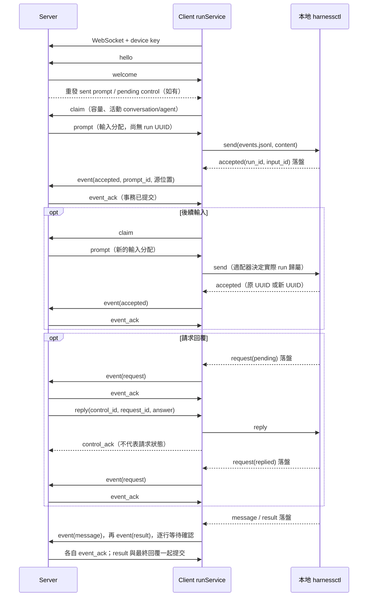

# Server 與 Client 的 WebSocket 協議

本文記錄**當前實現**的 `harnessctl-events-v2`，覆蓋連接、領取輸入、上報執行事實、回覆請求、取消和斷線恢復。它與適配器本地的 `harnessctl/3` 是兩層協議：WebSocket 負責 server/client 通信，harnessctl 負責 client/適配器交互。公共執行事件複用 [harnessctl/EVENT.md](../../../harnessctl/EVENT.md)，不再另定義一套事件格式。

Server 分配消息輸入、準備業務上下文，client 調用本地適配器執行。**實際 run UUID、輸入歸屬和執行結果由適配器決定，經 client 上報。** Server 負責身份、關聯和一致性校驗，不解釋 Codex/Claude Code 的原生交互。

## 連接與編碼

| 項目 | 當前約定 |
|---|---|
| 地址 | `{server_url}/api/daemon/ws`；HTTP 對應 ws，HTTPS 對應 wss |
| 認證 | 升級請求頭 `Authorization: Bearer <device_key>` |
| 密鑰來源 | 事先通過 HTTP `POST /api/daemon/register` 用 setup token 換取，不在 WebSocket 中註冊 |
| 認證失敗 | 升級前返回 HTTP 401；當前 client 將 401/403 視爲憑據失效，不繼續自動重連 |
| 編碼 | UTF-8 JSON；一個應用消息是一個 WebSocket 文本消息中的 JSON 對象 |
| 大小限制 | 兩端當前均設置 8 MiB 的單條接收消息上限 |
| 版本協商 | 首個 JSON 消息的 protocol 字段；不是 Sec-WebSocket-Protocol 子協議頭 |
| 連接歸屬 | 一條連接對應本 server 註冊的一臺 device；同一 device 的新連接替換舊連接 |

所有消息都有 `type`。其餘字段按消息類型使用，可選字段允許省略；Go 序列化會省略零值的可選字段。例如 `free_sessions: 0` 可省略，server 按零處理。JSON 字符串內的換行使用轉義；WebSocket 不直接傳一批 JSONL 文本行。

多中心分別建立連接，各自使用對應 device key。endpoint_id 是 client 的本地來源標識，不需要放入每條線上消息，server 也不管理其他中心的 endpoint。

## 標識與消息總表

| 標識 | 產生方 | 含義 |
|---|---|---|
| daemon_id | Server | 現有線上字段名，業務上指 device；連接身份以認證密鑰爲準 |
| conversation_id | Server | 共享對話 UUID |
| message_id | Server | 觸發輸入的共享消息；當前實現爲整數，與目標元數據設計中的 UUID 區分 |
| prompt.id / prompt_id | Server | run_prompts 的整數主鍵；一條消息對一個目標 agent 的輸入分配，不是執行 ID |
| session_id | Client | 本地 session；同一個 session 對應一個規範 events.jsonl 地址，可包含多個實際 run |
| event.run_id / control.run_id | 適配器 | 一次交互的 UUID；server 不預分配 |
| input_id | 適配器 | 一條已受理輸入；通過 accepted 與 prompt_id 關聯 |
| request_id | 適配器 | 一次公共請求，供 reply 定位 |
| control.id | Server | 一條回答或取消命令的 UUID，供傳輸去重 |
| claim_id | Client | 一次領取請求的關聯字符串，server 原樣回傳；當前 client 每次使用 next，同時最多一個未響應領取請求 |
| client_event.seq / ack_seq | Client 源文件 | 完整 JSONL 行結束位置的字節偏移，不是行號、時間戳或 run 內序號 |

下文 C 表示 client，S 表示 server。

| type | 方向 | 作用 | 對應響應 |
|---|---|---|---|
| hello | C → S | 聲明協議版本、client 版本和本地可用 harness | welcome |
| welcome | S → C | 確認協議和設備身份 | 無 |
| claim | C → S | 按可用容量領取一條輸入 | prompt 或 no_task |
| prompt | S → C | 首次交付或重發輸入分配 | accepted 包裝在 event 中，或 prompt_error |
| no_task | S → C | 本次領取沒有合適輸入 | 無 |
| ready | S → C | 提示輸入隊列可能有變化 | Client 後續自行 claim |
| event | C → S | 上報一條原始公共執行事件 | event_ack 或 error |
| event_ack | S → C | 已提交該源位置的事件 | 無 |
| prompt_error | C → S | 輸入在受理前失敗 | prompt_error_ack |
| prompt_error_ack | S → C | 已提交輸入失敗 | 無 |
| reply | S → C | 向公共 request 提交答案 | control_ack；業務狀態另由 event 上報 |
| cancel | S → C | 取消指定 client session 的當前工作 | control_ack；業務終態另由 event 上報 |
| control_ack | C → S | 控制命令處理收據，可帶錯誤 | 無單獨 ACK |
| heartbeat | C → S | 更新設備最近活動時間 | 無 |
| error | S → C | 拒絕一條執行事件 | 不推進事件確認位置 |

## 握手與設備上報

Client 連接後必須先發送 hello。harnesses 只包含本地探測可用且未禁用的條目；server 不要求它們預先存在於某個全局適配器目錄。

```json
{
  "type": "hello",
  "protocol": "harnessctl-events-v2",
  "version": "client-build-version",
  "capabilities": ["harnessctl-events-v2", "session-attachments-v1"],
  "harnesses": [
    {"name": "codex", "version": "installed-cli-version", "revision": "adapter-package-revision"},
    {"name": "claude", "version": "installed-cli-version", "revision": "adapter-package-revision"}
  ]
}
```

| 字段 | 含義 |
|---|---|
| protocol | 必須爲 harnessctl-events-v2；不匹配直接結束連接，不降級 |
| version | Client 程序構建版本，不是原生 CLI 版本 |
| capabilities | 連接的業務協議能力；session-attachments-v1 表示當前附件接入能力 |
| harnesses[].name | Client 對外報告的標籤，也允許自定義名稱 |
| harnesses[].version | 本地 CLI/適配器探測結果中的版本字符串 |
| harnesses[].revision | 本地適配器包的版本標識；server 不通過它下發安裝包或執行配置 |

Server 更新設備在線狀態、能力和 harness 報告。available 來自本次上報，enabled 是 server 上用戶的開關，二者都滿足纔可分配輸入。

```json
{
  "type": "welcome",
  "protocol": "harnessctl-events-v2",
  "daemon_id": "dm_example",
  "name": "my-device"
}
```

Welcome 後，server 先重發這臺設備尚未確認受理的 sent 輸入，以及 pending 控制命令；這些重發消息不需要 claim_id。Client 同時恢復源事件同步和正常領取。

## 領取與輸入交付

### claim、no_task 和 ready

Client 報告新 session 容量，以及仍可以接收後續輸入的活動 conversation/agent：

```json
{
  "type": "claim",
  "claim_id": "next",
  "free_sessions": 1,
  "active_streams": [
    {"conversation_id": "550e8400-e29b-41d4-a716-446655440000", "agent_id": "coder"}
  ]
}
```

- free_sessions 大於零時，server 可以返回該設備的一條可用 pending 輸入。
- free_sessions 爲零或省略時，只返回 active_streams 中 conversation/agent 匹配的輸入；空列表表示沒有可接收輸入的執行位置。
- active_streams 不含原生 thread/session ID，也不要求 server 判斷這條輸入是插話還是排隊。
- 當前 server 按輸入 ID 順序選擇一條，檢查設備的 harness 可用且 enabled；領取事務保存完整 dispatch 快照，並將輸入從 pending 改爲 sent，此時仍不創建 run。

沒有合適輸入時：

```json
{"type":"no_task","claim_id":"next"}
```

隊列變化時 server 可以提示：

```json
{"type":"ready"}
```

ready 不攜帶任務，也不是要求 client 直接執行的指令。當前 client 依靠約 100 ms 的輪詢檢查容量和發起 claim；ready 只是提示，不承載可靠業務數據。

### prompt

```json
{
  "type": "prompt",
  "claim_id": "next",
  "prompt": {
    "id": 17,
    "conversation_id": "550e8400-e29b-41d4-a716-446655440000",
    "message_id": 42,
    "agent_id": "coder",
    "agent_version_id": "dcfa65a0-00fb-4e71-a0a8-4fad5ed6ec72",
    "harness": "codex",
    "agent_instructions": "",
    "skills": [],
    "content": "Server 已準備好的完整輸入文本",
    "instructions": "Server 準備的工作說明和業務指令",
    "context": [],
    "context_seq": 42
  }
}
```

| prompt 字段 | 類型 | 含義 |
|---|---|---|
| id | integer | 輸入分配 ID，首次交付和重發保持不變 |
| conversation_id、agent_id | string | 對話與目標 agent；client 用於選擇本地執行會話 |
| agent_version_id | string | 入隊時固定的不可變 agent 版本 UUID |
| model、agent_instructions、skills | string / array | 固定 init 資源；model 可省略，其餘爲空時分別爲字符串和數組 |
| message_id | integer | 原始共享消息 ID |
| harness | string | 目標執行標籤；沒有原生命令或 YAML |
| content | string | 已合併業務指令、共享歷史和本次任務的最終文本，client 原樣交給 harnessctl send |
| instructions | string，可選 | Server 組織的業務說明；當前已經合併進 content，client 不重複拼接 |
| context | JSON，可選 | 本次共享歷史快照；當前已經合併進 content，client 不自行重建 |
| context_seq | integer，可選 | 該快照的消息順序上界，不是執行事件 ACK 遊標 |
| attachments | object[]，可選 | 附件元數據及相對 workspace 的 path；文件內容走 HTTP |
| work_id、work_token | string，可選 | 工作範圍和授權；client 透傳給業務 CLI，不據此生成協調者規則 |

attachments 中每項是現有附件 DTO，加上 path：包含 id、session_id、filename、content_type、size_bytes、sha256、created_by、source、created_at、download_path，以及可選 daemon_id、created_by_run_id、created_by_agent_key。這裏附件的 session_id 是現有 HTTP API 對 server conversation 的命名，**不是 client_event.session_id**。當前 path 形如 `.agentuse/attachments/<attachment_id>/<filename>`。

完整 content、附件和憑據快照在首次領取時持久化；重連不重新組織歷史或重新簽發 Work 令牌。Client 在本機記錄輸入收據後調用 send，不向上層暴露 start/steer/queue。後續輸入仍用 prompt，不增加專用插話消息。

## 公共執行事件與確認

### event

Client 從 session 的 events.jsonl 按源順序讀取完整行，把該行 JSON 對象放入 client_event.event；它是**對象，不是 JSON 字符串**。

```json
{
  "type": "event",
  "client_event": {
    "conversation_id": "550e8400-e29b-41d4-a716-446655440000",
    "agent_id": "coder",
    "agent_version_id": "dcfa65a0-00fb-4e71-a0a8-4fad5ed6ec72",
    "session_id": "c2e50b80-79cd-4bdb-92ab-5a2ab40783db",
    "harness": "codex",
    "revision": "adapter-package-revision",
    "seq": 512,
    "prompt_id": 17,
    "event": {
      "type": "accepted",
      "ts": "2026-11-04T10:00:00Z",
      "run_id": "66dc05ac-b858-49d6-86ee-e72dd6d65b42",
      "input_id": "in-1",
      "text": "Server 已準備好的完整輸入文本"
    }
  }
}
```

| client_event 字段 | 含義 |
|---|---|
| conversation_id、agent_id | 輸入所屬業務範圍，server 根據已交付輸入校驗設備權限 |
| agent_version_id | 本地 session 固定的版本 UUID，必須與 prompt 和 run 一致 |
| session_id | Client 本地會話 ID；同一設備上不能改綁到另一個 conversation/agent/version |
| harness、revision | 本次實際執行報告；作爲歷史事實保存，不由 server 推測 |
| seq | 對應完整源行結束後的字節位置，包含該行換行；示例中的數字僅示意位置 |
| prompt_id | accepted 必須關聯原始輸入分配；其餘類型不需要 |
| event | 原始公共事件，保留正文、用量、費用和診斷等字段，不翻譯成另一套事件 |

外層 session_id 與內層 run_id 不同：一個本地 session 可以依次執行多個 run；同一個 run 可以有多條 accepted。

| event.type | 關鍵關聯與處理 |
|---|---|
| accepted | run_id、input_id、text；創建實際 run 或綁定補充輸入，綁定公佈後不改變 |
| message | run_id、message_id、text；完整 agent 正文快照，message_id 是適配器消息標識，不是 server 消息 ID |
| request | run_id、request_id、state、kind、message；保存完整請求快照及 pending/replied/expired 狀態 |
| result | run_id、input_ids、status、output、usage、cost_usd、error；真實交互終態，status 爲 completed/failed/cancelled |
| log | run_id 可爲 null，攜帶 topic、level、message、data；診斷用途，不推導執行終態 |

完整必填字段和 answer 格式以 [公共事件規範](../../../harnessctl/EVENT.md) 爲準。前四類是關鍵消息；log 在源端可以丟棄或限流。**已經寫入源文件的行，當前 WebSocket 同步按順序逐行發送，不自行跳過。** Log 允許先於相應 accepted 出現，不能據此提前創建 run。

例如結束事件仍使用同一 event 信封，只替換內層事件和源位置：

```json
{
  "type": "event",
  "client_event": {
    "conversation_id": "550e8400-e29b-41d4-a716-446655440000",
    "agent_id": "coder",
    "agent_version_id": "dcfa65a0-00fb-4e71-a0a8-4fad5ed6ec72",
    "session_id": "c2e50b80-79cd-4bdb-92ab-5a2ab40783db",
    "harness": "codex",
    "revision": "adapter-package-revision",
    "seq": 1024,
    "event": {
      "type": "result",
      "ts": "2026-11-04T10:00:10Z",
      "run_id": "66dc05ac-b858-49d6-86ee-e72dd6d65b42",
      "input_ids": ["in-1"],
      "status": "completed",
      "output": "已完成",
      "usage": null,
      "cost_usd": null,
      "error": null
    }
  }
}
```

Server 要求 result.input_ids 無重複且覆蓋該 run 已接受的全部輸入。它在同一事務中保存事件、執行狀態、輸入狀態，以及需要生成的最終 conversation 回覆；cancelled 不新增最終回覆。重複源記錄不會重複生成回覆。

### event_ack 與 error

提交成功後確認源位置：

```json
{"type":"event_ack","session_id":"c2e50b80-79cd-4bdb-92ab-5a2ab40783db","ack_seq":512}
```

每個 session 的事件流當前最多一條在等待 ACK；不同 session 可以並行。Client 只接受與本次發送相匹配的 session_id/ack_seq，原子保存確認位置後繼續讀下一行。ACK 表示 server 已持久化該事件，不表示整個 run 已結束。

Server 以 `(認證設備, client session, 源字節位置)` 去重。重複上報同一原始事件及相同路由時再次確認；相同位置的內容或路由衝突則拒絕。Client 重傳時必須保留源事件內容和位置，不重排、刪改或重新編碼源文件來生成新的位置。

事件校驗失敗時：

```json
{"type":"error","session_id":"c2e50b80-79cd-4bdb-92ab-5a2ab40783db","ack_seq":512,"error":"event sequence conflict"}
```

error 中的 ack_seq 僅標識被拒絕的位置，**不是成功確認**。Server 不提交該事件；當前 client 將錯誤交給連接恢復流程，保留原遊標，不自動跳過錯誤行。未知消息類型、缺少必要信封或握手版本錯誤則直接結束連接，不保證先發 error。

## 輸入未受理的失敗

send 在適配器 accepted 之前失敗，client 報告 prompt_error；不得爲此生成一個假的執行 UUID 或 result。

```json
{
  "type": "prompt_error",
  "prompt_id": 17,
  "prompt": {
    "id": 17,
    "conversation_id": "550e8400-e29b-41d4-a716-446655440000",
    "message_id": 42,
    "agent_id": "coder",
    "agent_version_id": "dcfa65a0-00fb-4e71-a0a8-4fad5ed6ec72",
    "harness": "codex",
    "content": "Server 已準備好的完整輸入文本"
  },
  "error": "adapter unavailable"
}
```

prompt 攜帶該次下發的原輸入快照，上例省略了可選字段；實際重發保留原快照。Server 校驗 prompt_id 的設備歸屬，持久化輸入失敗；已 accepted 或 completed 的輸入不能通過這個通道改爲失敗。

```json
{
  "type": "prompt_error_ack",
  "prompt_id": 17,
  "prompt": {
    "id": 17,
    "conversation_id": "550e8400-e29b-41d4-a716-446655440000",
    "message_id": 42,
    "agent_id": "coder",
    "agent_version_id": "dcfa65a0-00fb-4e71-a0a8-4fad5ed6ec72",
    "harness": "codex",
    "content": "Server 已準備好的完整輸入文本"
  }
}
```

Server 回傳 prompt_id 和收到的 prompt。Client 用它定位本地失敗收據並標爲已報告；確認前持續保留並重發失敗通知，同時保護所屬目錄。prompt_error_ack 也不是執行結果。

## 回答、取消與控制收據

### reply

用戶通過 server HTTP API 提交 answer 後，server 持久化控制命令，再通過 WebSocket 轉發：

```json
{
  "type": "reply",
  "control": {
    "id": "b7f4d860-dd70-4d96-a0d8-e91dca009270",
    "conversation_id": "550e8400-e29b-41d4-a716-446655440000",
    "session_id": "c2e50b80-79cd-4bdb-92ab-5a2ab40783db",
    "run_id": "66dc05ac-b858-49d6-86ee-e72dd6d65b42",
    "request_id": "req-1",
    "answer": "allow"
  }
}
```

control.id 是這條傳輸命令的身份，request_id 纔是適配器請求的身份。answer 是公共協議的 JSON 值：權限請求通常爲 allow/deny 字符串，問題通常爲以問題 ID 爲鍵的答案對象。Server 只校驗 JSON 和業務範圍，不轉換原生權限工具或 question 結構。

### cancel

```json
{
  "type": "cancel",
  "control": {
    "id": "40bc572a-e850-4a23-a39f-ae76dac86a3a",
    "conversation_id": "550e8400-e29b-41d4-a716-446655440000",
    "session_id": "c2e50b80-79cd-4bdb-92ab-5a2ab40783db",
    "run_id": "66dc05ac-b858-49d6-86ee-e72dd6d65b42"
  }
}
```

Cancel 調用本地 harnessctl cancel，實際作用範圍是 session 當前工作及排隊輸入，不是按 run 精確中斷。攜帶 run_id 用於防止延遲或重放的取消誤傷後續交互：目標 run 已終態時 client 直接返回收據，不取消新交互。

### control_ack

Client 處理命令並保存本地控制收據後，回傳同一個 control 對象；成功時不帶 error：

```json
{
  "type": "control_ack",
  "control": {
    "id": "b7f4d860-dd70-4d96-a0d8-e91dca009270",
    "conversation_id": "550e8400-e29b-41d4-a716-446655440000",
    "session_id": "c2e50b80-79cd-4bdb-92ab-5a2ab40783db",
    "run_id": "66dc05ac-b858-49d6-86ee-e72dd6d65b42",
    "request_id": "req-1",
    "answer": "allow"
  }
}
```

失敗時增加非空 error，例如 `"error":"adapter rejected answer"`，server 將控制命令記爲 failed；用戶可修正答案後創建新的控制命令。Server 以 control.id 和認證設備定位記錄，重複確認不會重複改變執行事實。

control_ack 只更新控制命令的 delivered/failed，不把 request 改爲 replied，也不把 run 改爲 cancelled。實際變化必須由 client 後續的公共 request/result 事件確認；這些事件和 control_ack 之間沒有業務先後順序保證。目標已經終態而不再執行控制命令時，也可以成功返回控制收據。

Client 收到同一 control.id 時，已有本地收據則只重發收據，不再次調用適配器；server 重連時重發仍 pending 的控制命令。原生副作用與收據落盤不構成跨進程事務，不能由此宣稱所有崩潰窗口都恰好執行一次。

## 心跳、重連與持久化邊界

```json
{"type":"heartbeat"}
```

當前 client 約每 10 秒發一次 heartbeat，server 更新 last_seen_at，不回覆應用層 pong，不續某個 run 的租約。當前實現沒有獨立的應用層心跳超時回收任務規則。

普通連接錯誤後，client 當前等待約 1 秒重連；憑據失效則停止對應連接工作。Server/網絡短暫斷開不取消已經在本地執行的工作，server 只更新設備在線狀態，不生成執行終態。

| 數據 | Server 持久化 | Client 持久化 | 重連行爲 |
|---|---|---|---|
| 輸入 | run_prompts、首次領取的 dispatch 快照 | session/.server/inputs/<prompt_id>.json | Server 重發 sent 輸入；client 讀取收據，不因重發再次 send |
| 公共事件 | run_events、runs、run_requests 等投影 | session/events.jsonl | 從已確認源字節位置重傳；server 按來源位置去重 |
| 事件遊標 | 接收事件的來源位置唯一鍵 | session/.server/stream.json | ACK 丟失只重傳事件，不重新執行輸入 |
| 控制命令 | run_controls | session/.server/controls/<control_id>.json | 未收到確認的命令重發同一 ID；client 已有收據則回放收據 |
| 受理前失敗 | run_prompts 的失敗狀態 | 輸入失敗收據及 reported 標記 | 失敗通知重發到 prompt_error_ack 爲止 |

Client 重啓恢復與 socket 重連不同：先確認遺留前臺工作停止，再從提交前保存的源位置讀取 accepted，恢復 prompt 到真實 run/input 的關聯。歸屬不確定或衝突時不盲目重發；源消費只接受完整行，半行不作爲受理證據。詳情見 [client-run.md](client-run.md)。

Server 不發送 YAML、shell/argv、原生 RPC 控制請求或 hook 調用；本地適配器處理這些細節。共享歷史、附件元數據和 Work 授權是業務載荷；附件文件本體仍走 HTTP，log.data 中的原生片段只作診斷數據，server 不據此驅動執行。

## 完整時序



[Server 總覽](server-main.md) · [Client 總覽](client-main.md) · [Server runService](server-run.md) · [Client runService](client-run.md) · [公共事件格式](../../../harnessctl/EVENT.md)

<a id="agent-versioning"></a>

## Agent 與 Skill 的固定版本資源

本節補充 [Agent/Skill 版本化](server-agent.md) 的資源準備和版本校驗規則。全文協議均爲 **harnessctl-events-v2**；server/client 必須同步升級，嚴格握手，不向舊協議降級。

### 輸入與實際執行的版本關聯

| 信封 | 新增/擴展字段 | 作用 |
|---|---|---|
| hello、welcome | protocol 與 capabilities 使用 harnessctl-events-v2 | 確認雙方支持不可變資源版本，不沿用 v1 降級執行 |
| prompt | agent_version_id | 輸入入隊時固定的 agent_versions UUID，後續重發不變 |
| prompt | model | 固定模型；省略或空字符串表示原生默認選擇 |
| prompt | agent_instructions | 固定版本指令，用於準備 init 的外部指令文件，不混進每次 send 的正文 |
| prompt | skills | 有序的固定 skill 版本及 ZIP 下載清單；空數組表示無技能 |
| claim.active_streams[] | agent_version_id | 只有同 conversation/agent/version 的活動流可以繼續接收輸入 |
| client_event | agent_version_id | 由本地 session 的固定元數據提供；與被分配 prompt、原生 run 的版本關聯一致 |

完整資源 prompt 示例：

```json
{
  "type": "prompt",
  "claim_id": "next",
  "prompt": {
    "id": 17,
    "conversation_id": "550e8400-e29b-41d4-a716-446655440000",
    "message_id": 42,
    "agent_id": "reviewer",
    "agent_version_id": "dcfa65a0-00fb-4e71-a0a8-4fad5ed6ec72",
    "harness": "codex",
    "model": "固定模型",
    "agent_instructions": "你負責代碼評審。先驗證事實，再給出結論。",
    "skills": [
      {
        "skill_id": "9f4aa676-990d-4e2a-9846-35c47846511a",
        "skill_version_id": "2e85ce35-008a-48da-b30e-0cda862352ea",
        "name": "review",
        "sha256": "0123456789abcdef0123456789abcdef0123456789abcdef0123456789abcdef",
        "size_bytes": 4096,
        "download_path": "/api/skills/9f4aa676-990d-4e2a-9846-35c47846511a/versions/2e85ce35-008a-48da-b30e-0cda862352ea/package"
      }
    ],
    "content": "Server 準備的共享歷史、業務說明與本次評審任務"
  }
}
```

Agent 版本由 agentService 發佈，Skill 版本由 [skillService](server-skill.md) 獨立發佈；agent_version_skills 只關聯具體版本。version_id 引用不可變配置，不使用 latest。Skill 下載接口由 skillService 授權並複用 fileService 的 skills 命名空間。skill name 必須與 ZIP 內 SKILL.md 一致；skill_version_id 必須屬於給定 skill_id，大小和摘要必須與下載內容一致。下載使用當前 endpoint 的相對 API 路徑，文件本體不走 WebSocket。

現有 prompt.instructions 繼續表示 Work/本次輸入的業務說明，已包含在 content 中；新增 agent_instructions 纔是固定版本的初始化資源。兩者不能互相覆蓋或由 client 重新推斷角色。

### Client 初始化與容量匹配

Client 首次收到某個 endpoint/conversation/agent/agent_version/harness_revision 組合時，創建新的本地 session/events 地址，準備 ZIP 和指令文件，再調用 init。之後使用同一綁定 send；即使 cwd 相同，agent_version_id 不同也不能複用舊事件地址。

free_sessions 爲零時，active_streams 的版本必須與待領取輸入相同。只有舊版本在運行不代表 client 能接收新版輸入；server 不能據此把新版當成舊 run 的插話。舊版實際執行繼續按原版本上報，不因 agent head 變化而失敗。

Server 收到 accepted 時，從對應 prompt 固定 runs.agent_version_id，後續同 run 只能接收相同 agent 版本的輸入；報文聲稱的版本必須與其業務歸屬一致。run UUID 仍完全由適配器決定，公共五種事件的 Schema 不增加 server 版本字段。

Skill 包下載、校驗、解包或 init 失敗時，上報 prompt_error，不生成執行 UUID。重連重發完整原 dispatch，client 仍按同一版本收據去重；不會因爲新版發佈而重寫舊收據或重複發送舊輸入。
