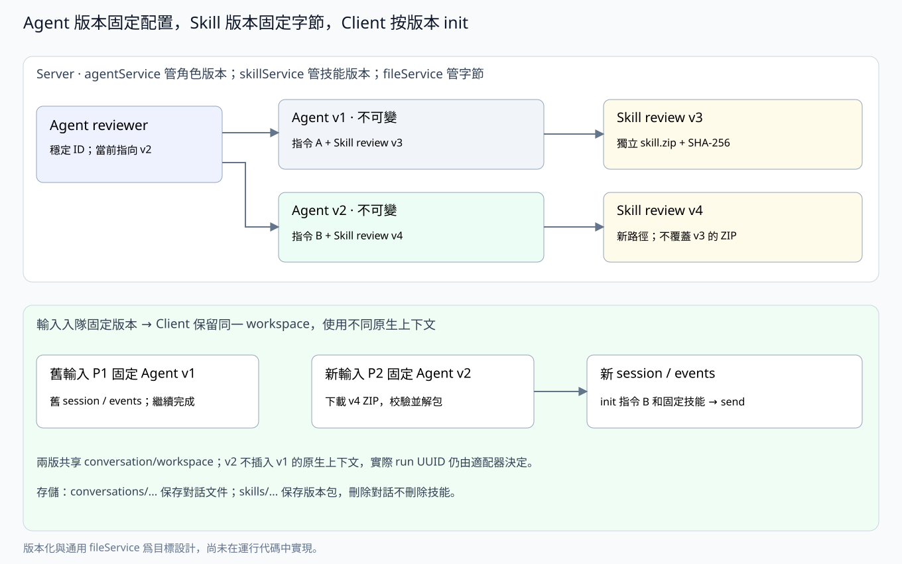

# agentService：Agent 与 Skill 的不可变版本

> 本文是新增版本化能力的目标设计，尚未修改代码或数据库。当前部署仍允许直接修改 agent，也尚未把 server 的资源版本交给 client init。所有下列 SQL 都是目标结构，不是线上迁移脚本；表之间不声明数据库外键。

## 职责与对象关系

agentService 管 agent 身份、版本化配置，以及 agent 使用的 skill 压缩包和版本。文件字节复用 [fileService](server-file.md)，不在 agentService 另做本地/S3 存储实现，也不新增独立的 skillService。

| 对象 | 含义 |
|---|---|
| agent | 稳定的角色 ID、所有者和当前版本指针，供消息 @ 选择 |
| agent_version | 一份不可变的完整配置：名称、说明、device、harness、model、指令与固定的 skill 版本列表 |
| skill | 稳定的技能 ID、所有者和当前版本指针 |
| skill_version | 一个不可变压缩包及其名称、描述、摘要和大小 |
| agent_version_skills | 某一 agent 版本具体使用哪些 skill 版本，及其顺序 |

**改 agent 就产生新版本；改 skill 包也产生新版本。发布新 skill 版本不会改变已有 agent 版本。** Agent 不拥有独立的 server 对话历史；原生上下文仍由 client session 承载。



## Agent 的版本规则

创建 agent 时同时创建 v1。后续每次保存有效配置变更，都新增一份完整 agent_version，并在同一 SQLite 事务中推进 agents.current_version_id；不 UPDATE 已发布版本。名称、说明、设备、harness、模型、指令及 skill 集合/顺序都属于版本内容。完全相同的配置不新增版本。

更新请求带 base_version_id，必须等于当前版本；并发编辑冲突返回 409，避免后保存的内容覆盖别人刚发布的配置。它是版本冲突检查，不是消息发送的幂等键。版本号在事务中递增；UUID 用于稳定引用，数字 version 用于显示 v1、v2 等。

每份配置必须引用具体 skill_version_id，不能保存 latest。回退也复制旧配置形成新的 vN+1，不修改旧版本、不把当前版本指针退回去。已发布版本始终可用于解释历史任务。

agent 的用户归属和稳定 ID 不变；删除是身份的软删除，停止未来选择和输入分配，不修改历史版本。已经固定版本的排队输入和实际执行继续按原版本处理，取消须走显式控制链路。被历史引用的版本和 skill 包不因软删除而移除。

## Skill 包与版本规则

每个 skill 版本就是**一个 ZIP 压缩包，包含一个 skill**。包根直接包含 SKILL.md，脚本和参考资料放在同一根下：

```text
skill.zip
  SKILL.md
  scripts/...
  references/...
  assets/...
```

AgentUse 初版只接收 ZIP，不同时支持多种归档格式。SKILL.md 的 name、description 是该版本的技能元数据；server 校验包结构、必需元数据和路径，不解释其中的原生执行策略。包内不携带插件安装器或 harness 配置；Claude 的技能插件容器由本地适配器生成。

上传到相同 skill ID 的新内容创建新的 skill_version。压缩包、名称、描述、sha256 和 size_bytes 一经发布就不可变；旧下载地址永远对应旧字节。已有 agent 版本继续引用旧 skill_version_id；用户显式升级依赖时，才创建新的 agent 版本。

同一个 agent_version 对同一个 skill 只能选择一个版本。不同 skill 的原生名称不能冲突，名称比较规则与 harnessctl init 一致；冲突在发布 agent 版本时拒绝，client 解包时再次检查。不能等到原生加载后悄悄覆盖。

包校验和解压拒绝绝对路径、..、重复归档路径、链接和特殊文件，并限制归档大小、解压总量与条目数；超限明确失败。只恢复普通文件和必要的用户执行位，不恢复其他用户权限。Server 不执行包内脚本。

## fileService 的复用边界

agentService 拥有 skill 的业务身份、版本与引用；fileService 只保存对象字节。存储命名空间分开：

```text
<file_root>/
  conversations/<conversation_id>/<relative_path>
  agent-skills/<skill_id>/<skill_version_id>/skill.zip
```

S3 使用相同的相对 key，前面可加部署配置的 prefix。Agent skill 包不属于任何 conversation；删除某个 conversation 不删除 skill 包。SHA-256、包大小和 package_path 保存在 skill_versions，是业务版本的一部分；fileService 仍无 files/attachments 元数据表。

发布顺序是：校验压缩包 → 通过 fileService 写入本次新版本的独立路径并确认完整落盘 → 事务写入 skill_versions、推进 skill 当前指针 → 对外返回版本。对象写入失败不发布版本；事务失败删除本次未发布对象。SQLite 与本地/S3 存储不是分布式事务，异常遗留对象由清理流程处理。

版本路径不提供覆盖上传 API。清理必须检查**所有历史版本**的引用，不能只看当前版本，也不能按 conversation 的生命周期回收。

## 从输入分配到 harnessctl init

1. 用户消息 @ agent，conversationService/runService 在保存消息和输入分配的同一事务内，读取并固定该 agent 的当前 agent_version_id。
2. 已入队输入不跟随之后的 agent 更新。领取时按固定版本读取执行选择、指令和 skill 依赖，组织完整 dispatch 快照。
3. Prompt 携带 agent_version_id、model、agent_instructions 和具体 skill 版本的下载清单。Server 不发送原生命令、argv 或 YAML。
4. Client 按 endpoint/conversation/agent/version/适配器 revision 选择 session。同版本可复用；新版本必须创建新的 session 目录和 events.jsonl，不能对旧事件地址重配 init。
5. Client 下载清单中的 ZIP，校验版本、大小与 SHA-256，在 workspace 之外解包并写指令文件，调用 harnessctl init --cwd ... --model ... --agents-md ... --skills-dir ...。未指定模型时省略 --model。
6. init 成功后提交本次输入；后续同版本输入走 send，是否插话由适配器决定。accepted 决定实际 run UUID，server 再将 run 关联到该输入固定的 agent 版本。

“每次变更做一次 init”是**下一次使用该新版本时建立新的初始化绑定**，不是每编辑一次就向所有 client 推配置。旧版本 run 可继续完成；新版本消息不进入旧版本的原生上下文。两者仍使用同一 conversation 的 workspace 和共享消息历史。

Agent 指令是版本固定的 init 资源。Work 说明、协调者规则、共享历史和本次任务仍由 server 按业务输入组织到 prompt.content，不因持有 WorkToken 就由 client 推断角色，也不随每次 send 重写 agent 的指令快照。

## API 设计

| 方法 | 接口 | 行为 |
|---|---|---|
| POST | /api/agents | 创建稳定身份和完整 v1 |
| GET | /api/agents、/api/agents/{id} | 返回身份及当前版本；默认不列软删除身份 |
| POST | /api/agents/{id}/versions | 提交完整配置和 base_version_id，创建下一版本 |
| GET | /api/agents/{id}/versions | 列出历史版本 |
| GET | /api/agents/{id}/versions/{version_id} | 读取不可变配置和固定 skill 清单 |
| DELETE | /api/agents/{id} | 软删除身份，保留版本和历史引用 |
| POST | /api/skills | multipart 上传一个 ZIP，创建 skill 和 v1 |
| POST | /api/skills/{id}/versions | multipart 上传新 ZIP，带 base_version_id，发布下一版本 |
| GET | /api/skills、/api/skills/{id} | 查看技能及当前版本 |
| GET | /api/skills/{id}/versions、/api/skills/{id}/versions/{version_id} | 查看不可变版本 |
| GET | /api/skills/{id}/versions/{version_id}/package | 下载该版本 ZIP |
| DELETE | /api/skills/{id} | 软删除技能，不删除已有版本或破坏已发布 agent |

原来的直接 PATCH agent 配置模式在目标 API 中移除。Owner/admin 可创建版本；设备只能下载已分配 prompt 的 agent 版本所引用的 skill 包，不能凭 device key 枚举整个技能库。Work 凭据也只在对应输入和工作范围内授权。download_path 使用本 server 的相对 API 路径，不向 client 下发存储密钥或要求给任意外域 URL 附带 device key。

## 表结构

时间为 Unix 秒，指令为 UTF-8 TEXT。关联均由 service 在事务内检查，不声明 REFERENCES。设备删除不能把历史 agent_versions.device_id 改空；该版本后续不可执行，用户需选择新设备并发布新版本。

### agents 与 agent_versions

```sql
CREATE TABLE agents (
    id TEXT PRIMARY KEY,
    user_id TEXT NOT NULL,
    current_version_id TEXT NOT NULL,
    created_at INTEGER NOT NULL,
    updated_at INTEGER NOT NULL,
    deleted_at INTEGER
);
CREATE INDEX agents_user ON agents(user_id, updated_at);

CREATE TABLE agent_versions (
    id TEXT PRIMARY KEY,
    agent_id TEXT NOT NULL,
    version INTEGER NOT NULL CHECK(version > 0),
    name TEXT NOT NULL,
    description TEXT NOT NULL DEFAULT '',
    device_id TEXT NOT NULL,
    harness TEXT NOT NULL,
    model TEXT,
    instructions TEXT NOT NULL DEFAULT '',
    created_at INTEGER NOT NULL,
    UNIQUE(agent_id, version)
);
CREATE INDEX agent_versions_agent ON agent_versions(agent_id, version);
```

model 为 NULL 时固定的是“采用原生默认配置”这一选择；需要锁定具体模型时必须显式填写 model，不把外部默认配置视为被冻结。

名称只存在版本配置中，读取当前名称通过 agents.current_version_id 关联。活动 agent 的当前名称仍要求在同一用户下唯一，由 agentService 在发布事务中检查。历史配置中的同名快照不妨碍当前角色改名。

### skills 与 skill_versions

```sql
CREATE TABLE skills (
    id TEXT PRIMARY KEY,
    user_id TEXT NOT NULL,
    current_version_id TEXT NOT NULL,
    created_at INTEGER NOT NULL,
    updated_at INTEGER NOT NULL,
    deleted_at INTEGER
);
CREATE INDEX skills_user ON skills(user_id, updated_at);

CREATE TABLE skill_versions (
    id TEXT PRIMARY KEY,
    skill_id TEXT NOT NULL,
    version INTEGER NOT NULL CHECK(version > 0),
    name TEXT NOT NULL,
    description TEXT NOT NULL,
    package_path TEXT NOT NULL UNIQUE,
    sha256 TEXT NOT NULL,
    size_bytes INTEGER NOT NULL CHECK(size_bytes > 0),
    created_at INTEGER NOT NULL,
    UNIQUE(skill_id, version)
);
CREATE INDEX skill_versions_skill ON skill_versions(skill_id, version);
```

package_path 是 agent-skills 命名空间内的相对路径，如 `<skill_id>/<skill_version_id>/skill.zip`，不存本地根目录、bucket 或 endpoint。切换文件后端不改版本的业务引用。

### agent_version_skills

```sql
CREATE TABLE agent_version_skills (
    agent_version_id TEXT NOT NULL,
    skill_id TEXT NOT NULL,
    skill_version_id TEXT NOT NULL,
    position INTEGER NOT NULL CHECK(position >= 0),
    PRIMARY KEY(agent_version_id, skill_id),
    UNIQUE(agent_version_id, position)
);
CREATE INDEX agent_version_skills_version ON agent_version_skills(skill_version_id);
```

agentService 检查 skill_version_id 确实属于 skill_id、用户有权使用、包已发布且可读取。软删除的 skill 不再用于发布新的 agent 版本，但已有 agent 版本的固定引用仍可读取。更改依赖必须发布完整的新 agent_version 及新的关系行，旧关系不更新。

## 其他 Service 的关系

- conversationService 保存稳定的 @ agent_id；runService 在输入分配上固定 agent_version_id，不让名字或 latest 参与执行归属判断。
- deviceService 维护设备可用性；版本里的 device/harness 是固定选择，不随设备记录被删除而改写。
- fileService 提供 agent-skills 空间的上传、下载及清理原语，不理解发布、版本和依赖。
- client sessionService 固定 agent_version_id 与事件地址；harnessService 只接收已准备好的资源路径并调用 init。

[Server 总览](server-main.md) · [fileService](server-file.md) · [runService](server-run.md) · [Client sessionService](client-session.md) · [通信协议](protocol.md)
