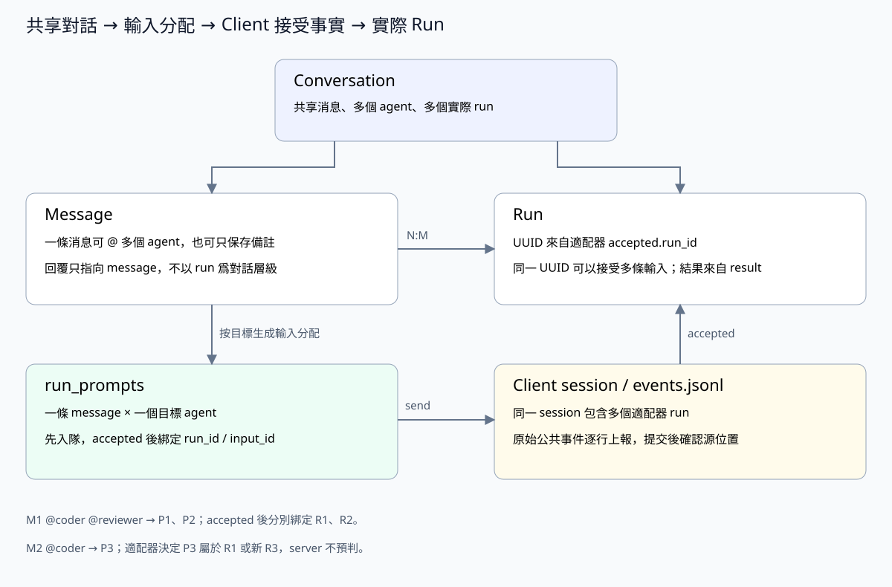

# conversationService：共享对话与消息编排

> 执行关系已采用 client 公共事件协议。本文的 conversation/device 是业务名称，后面的元数据 SQL 仍为目标结构，不是当前数据库迁移脚本；实际命名及尚未落地的字段在“目标元数据与当前实现”中单独说明。目标表不声明数据库外键，关联校验和清理由 service 完成。

## 职责

Conversation 是原共享对话概念的新名称，不新增另一层 conversationService；原有消息、任务和文件归属随之统一改名。session 是 client 本地的原生执行会话，见 [client-session.md](client-session.md)。

conversationService 管理 conversation、message 和共享历史，并编排消息分配。一个 conversation 包含若干 message 和若干 run；message 与 run 的任务输入关系是 **N:M**，由 runService 的 run_prompts 连接。

- 创建/读取/删除对话，维护标题、归属和共享历史。
- 接收消息，调用 runService 为目标 agent 分配任务；对话原文只保存一次，每个目标 agent 另存一份 run_prompts，等待 accepted 关联实际 run。
- 消费执行结果事件，把最终回复写为 agent message，并记录作者和被回复的 message。
- 读取对话时组合对话、run、run_prompts、事件和问题的统一快照。



## 发送和回复

发送链路是 `controller → conversationService → runService`：先检查权限，在一个事务中写一条 message 和每个目标 agent 的 run_prompts，提交后通知 client 领取。任一目标失败则整体回滚。空目标只保存备注。

此时只分配输入，run_id 为空。新增 Agent 版本设计要求在这一事务内为每条 run_prompts 固定 agent_version_id，后续领取不追随 latest；此版本关联尚未实现。Server 不能根据某个 agent 仍在执行，就认定新消息一定属于它当前的 run。

```text
M1 @coder @reviewer → P1(coder)、P2(reviewer)
client accepted P1：run_id=R1，input_id=I1
client accepted P2：run_id=R2，input_id=I2
M2 @coder → P3(coder)
client accepted P3：
  run_id=R1 → 同一次交互的补充输入
  run_id=R3 → 后续一次交互
```

P3 最终关联哪个 run，由适配器决定，并通过 accepted 上报。message 与 run 的 N:M 关系由此建立，输入分配 ID 只用于关联消息，不是执行身份。conversation 不绑定 agent，不设置参与者表或每个 agent 独立的共享历史。

收到 client result 后，在**同一事务**保存原始事件、更新 run 与输入状态、写入 agent message、绑定 runs.result_message_id，并重算对话状态。最终回复的 reply_to_message_id 指向 first_message_id；messages 不保存 run_id。事务提交后才确认源事件位置，重复上报直接确认已有记录，不重复写回复或触发 Work 汇总。

message、request、log 是执行记录，不能都变成普通聊天消息。cancel 入队和送达只表示控制传输，断线也只改变设备连接状态；这些操作都不生成执行结果。只有 client result 决定 completed/failed/cancelled，cancelled 可以没有最终回复。

## 状态和删除

Conversation 状态是实际 run 与未完成输入的聚合投影，优先 waiting、running、pending，再到 idle；resolved 是用户的完成标记。投影由 conversationService 通过 runService 查询当前状态后更新，run 状态变化和最终结果事件都触发重算；重算读取当前实际 run 和未完成输入集合，不用旧事件直接覆盖投影。idle 不表示历史任务全部成功。

有活跃 run 或待领取/待受理输入时拒绝删除，检查与删除共用事务；回复消费前也要重新检查对话是否存在，已删除的对话不恢复创建。删除对话由 conversationService 协调相关 service，在同一事务内清理消息、run、run_prompts、事件、问题及辅助记录；本地目录或 S3 对象前缀由 fileService 清理。Work 的协调对话和线程归属由 workService 决定。

## 标识和消息顺序

conversations.id 和 messages.id 均为 server 生成的 UUID，SQLite 中使用 TEXT 保存。所有 conversation_id、message_id、reply_to_message_id 等关联字段使用相同的 UUID 字符串。

UUID 只用于标识，不承担消息排序。目标结构用 messages.seq 保存 conversation 内的递增顺序号。领取时 server 将共享历史和顺序边界放入 prompt，并保存完整 dispatch 快照；重连重发同一快照，不使用 run 的历史游标或重新组织上下文。

发送请求不做去重：每次成功发送创建新的 message UUID，不需要请求 key 或内容摘要字段。

## 目标元数据与当前实现

本文下列 SQL 定义元数据的目标命名和字段。当前已实现的执行关系以本文发送链路和 [server-run.md](server-run.md) 为准；物理对话表仍名为 sessions，HTTP 入口仍为 /api/sessions。当前 conversation ID 为 UUID，messages.id 与 reply_to_message_id 仍为 INTEGER，messages.seq 由 ID 投影。消息 UUID、author_role、独立 attachments 列以及目录/S3 fileService 仍是目标设计，不表示已部署。执行表的实际 SQL 见 server-run.md。

## 表结构

### conversations

共享对话主表。`user_id` 是资源所有者，`created_by` 是创建者；可归属一个 work，不绑定 agent。所有 conversation 都支持多 agent，不设 mode 字段。状态是聚合投影，不替代 run 明细。

```sql
CREATE TABLE conversations (
    id TEXT NOT NULL PRIMARY KEY,
    user_id TEXT NOT NULL,
    created_by TEXT NOT NULL,
    work_id TEXT,
    title TEXT NOT NULL DEFAULT '',
    status TEXT NOT NULL DEFAULT 'idle',
    created_at INTEGER NOT NULL,
    updated_at INTEGER NOT NULL
);
CREATE INDEX conversations_work
    ON conversations(work_id,updated_at);
CREATE INDEX conversations_status
    ON conversations(status, updated_at);
CREATE INDEX conversations_user
    ON conversations(user_id, updated_at);
CREATE INDEX conversations_created_by
    ON conversations(created_by, updated_at);
```

### messages

共享对话的原始消息。`content` 统一保存对话正文；`author_role` 为 user/agent；`author_user_id`、`author_agent_id` 按作者类型二选一。Agent 回复还记录 `author_agent_version_id`，关联具体不可变版本读取当时名称；用户名称关联 users，不保存 agent_key、agent_name 字符串快照。`run_agent_ids` 保存原始 @ 目标数组，即使执行分配变化，对话仍能显示当时 @ 了谁。

`attachments` 是 JSON 字符串数组，保存相对于当前 conversation 文件空间的路径，用户消息和 agent 回复都可以携带。例如：

```json
{"content":"请查看这两个文件","attachments":["inputs/data.csv","reports/result.pdf"]}
```

文件先通过 fileService 上传，再在消息中引用；没有附件时为 `[]`。不保存绝对路径、URL、bucket 或本地根目录。service 校验数组元素为合法相对路径，读取时由 fileService 按 conversation 和路径定位文件。这只是消息上的文件引用，不新增文件元数据表。

service 写入时保证 user 消息只填 author_user_id，agent 消息填写 author_agent_id 和 author_agent_version_id，并检查版本属于该 agent。读取作者用 LEFT JOIN；角色选择器展示当前版本名称，历史 agent 回复按作者版本展示，不受后来改名影响。软删除不清空消息作者或已发布版本。

message 永远回复另一条 message，不回复 run。`reply_to_message_id` 表示被回复的消息，字段保存被回复消息的 UUID，开头的根消息为空；后续用户消息、agent 回复都可以引用同 conversation 中已有的消息。messages 不保存 run_id，也不以 run 为对话层级。

```text
M1：@coder @reviewer 修复并评审
  ├─ M2：coder 的回复，reply_to_message_id=M1
  ├─ M3：reviewer 的回复，reply_to_message_id=M1
  └─ M4：用户追问，reply_to_message_id=M1 或选中的具体回复
```

一个 run 消费多条输入时，最终回复默认指向其主任务 message；补充输入仍通过 run_prompts 记录。service 检查父消息已存在、属于同一 conversation，避免跨对话引用和循环回复。

执行结果的内部关联留在 runs.result_message_id，允许 runService 追踪及去重，但不会出现在 messages 的字段或回复语义中。conversationService 在同一事务调用 runService 检查结果是否已绑定，未绑定才新增回复并绑定；重复结果直接返回已有回复。取消可以没有回复。

```sql
CREATE TABLE messages (
    id TEXT NOT NULL PRIMARY KEY,
    conversation_id TEXT NOT NULL,
    seq INTEGER NOT NULL,
    author_role TEXT NOT NULL CHECK(author_role IN ('user','agent')),
    content TEXT NOT NULL,
    attachments TEXT NOT NULL DEFAULT '[]',
    author_user_id TEXT,
    author_agent_id TEXT,
    author_agent_version_id TEXT,
    run_agent_ids TEXT NOT NULL DEFAULT '[]',
    reply_to_message_id TEXT,
    created_at INTEGER NOT NULL
);
CREATE UNIQUE INDEX messages_conversation_seq ON messages(conversation_id,seq);
CREATE INDEX messages_replies ON messages(conversation_id,reply_to_message_id,seq);
```

### 合并掉的辅助表

| 原表 | v3 处理 |
|---|---|
| message_formats | 不再建表，也不保留 format 字段；消息与执行副本均保存正文 |
| message_authors | 不再建表，作者保存在 messages.author_role、author_user_id、author_agent_id、author_agent_version_id；名称关联用户或固定 agent 版本读取；回复关系使用 reply_to_message_id，执行关联留在 runs |

这些信息仍有作用，但都是一条消息自身的属性，不需要再各拆一张 1:1 的表。

## 相关设计

[Server 总览](server-main.md) · [userService](server-user.md) · [deviceService](server-device.md) · [agentService](server-agent.md) · [Client harnessService](client-harness.md) · [runService](server-run.md) · [fileService](server-file.md) · [workService](server-work.md)
