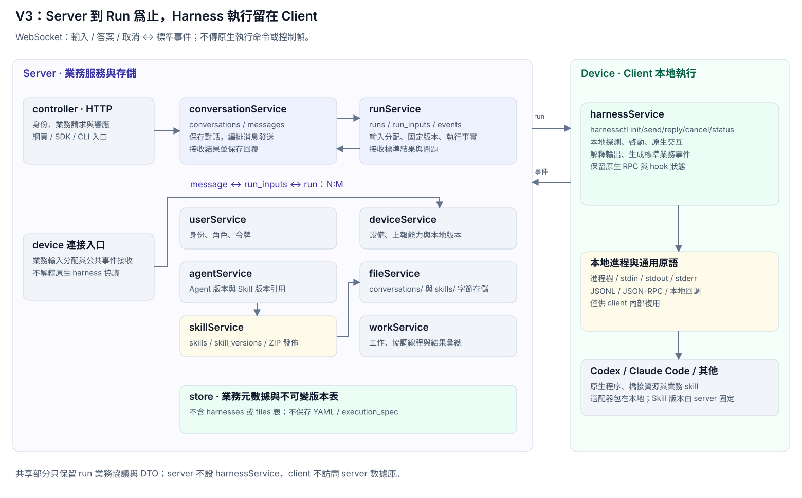
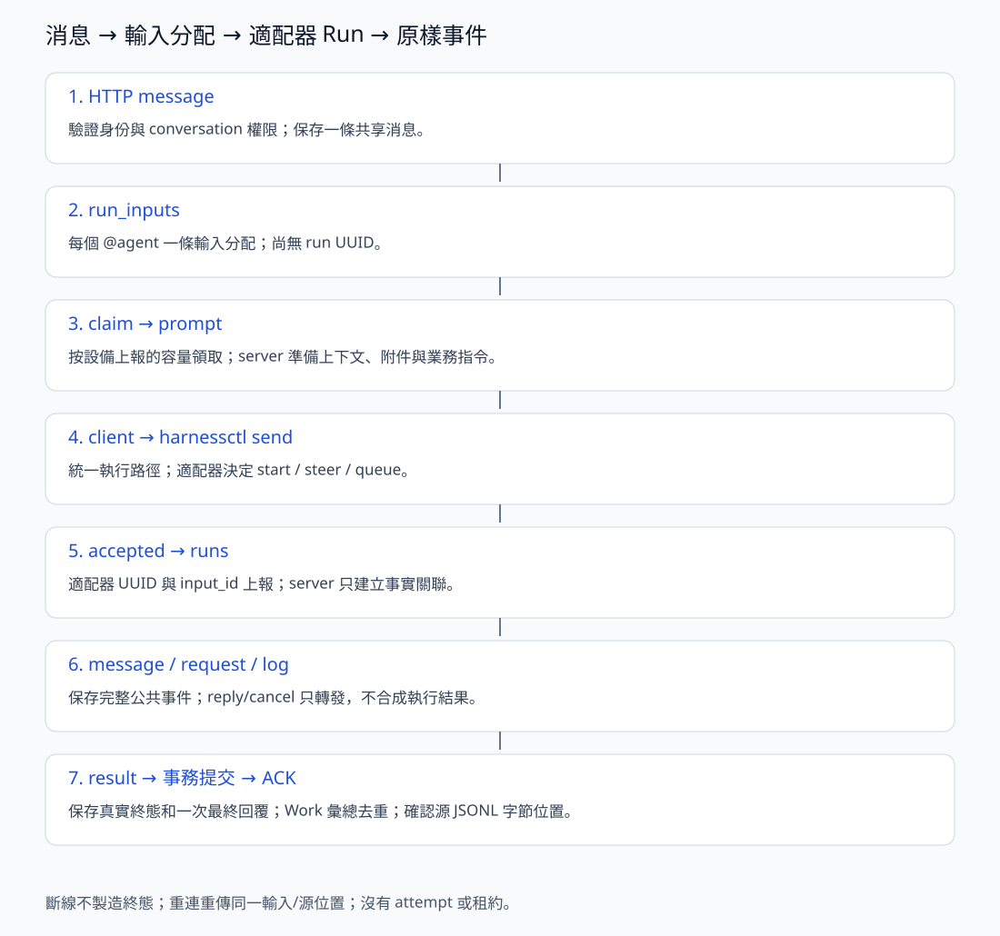

# Server 设计

> 本文定义 v3 的目标业务划分。service 名称和 device 命名是设计约定，现有源码、表和接口尚未全部按此调整。本稿先说明业务关系，不逐文件展开实现。Client 整体职责见 [client-main.md](client-main.md)。

Conversation 表示共享对话，由 conversationService 管理；原 session 业务整体改用此名称，session 专指 client 对应 Codex/Claude Code 的原生执行会话，见 [client-session.md](client-session.md)；server 不增加 sessionService 或 sessions 表。

Server 保存对话、组织任务并跟踪执行。用户的一台执行设备称为 **device**，设备上运行的程序称为 **client**。Client 从 server 领取输入分配，由本地 harnessService 解析 YAML、准备资源、执行 harness 并处理交互。Server 保存输入分配与 client 上报的 run 事实，不理解原生 harness 协议。

一台 client 可以向多个独立 server 注册，由本地 [endpointService](client-endpoint.md) 保存注册信息，[client runService](client-run.md) 负责连接和领取任务；每个 server 只看到本中心注册的 device，不共享其他中心的任务或凭据。

## 当前实现与目标命名

执行协议已采用 harnessctl-events-v1：server 不预创建 run，只有 client 的 accepted 创建实际 UUID；五种公共事件原样入库，没有 attempt、租约、原生能力分支或 server harnessService。详细协议、实际 SQL、重连规则及 schema 2 升级约束见 [server-run.md](server-run.md)。

其他章节中的 conversation/device 为业务目标名称。现有 HTTP /sessions、/daemons 和部分元数据物理表仍保留原名；消息 UUID、文件目录/S3 等目标不能视作本次执行改造已经实现。

## 一、整体关系

Server 分为三层：

- **controller**：HTTP / WebSocket 入口，处理身份、请求和响应，把业务交给 service。
- **service**：按业务对象划分职责，决定如何保存对话、分配任务、管理设备和业务状态。
- **store**：表、查询和事务；各 service 通过它保存自己的业务数据。

设备的在线连接由连接管理组件维护。Service 通过通知接口让它派活、推送输入、取消或答案；连接本身不承担 conversation/run 的业务规则。

## 二、有哪些 Service

| Service | 负责什么 | 主要拥有的表或数据 |
|---|---|---|
| [userService](server-user.md) | 用户、角色、访问令牌和身份校验 | `users` |
| [deviceService](server-device.md) | 执行设备的登记、凭据、在线状态、可用 harness 和执行能力 | `devices`、`device_harnesses`、`device_capabilities` |
| [agentService](server-agent.md) | Agent 的名称、说明、归属，以及选择哪台 device、哪种 harness 执行 | `agents` |
| [conversationService](server-conversation.md) | 清晰、持续的对话：创建对话、保存消息、读取共享历史；调用 runService 分配任务，接收结果事件并保存回复 | `conversations`、`messages` |
| [runService](server-run.md) | 分配消息输入、接收实际 run、原样保存公共事件、转发回答和取消 | `runs`、`run_prompts`、`run_events`、`run_requests`、`run_controls` |
| [fileService](server-file.md) | 按 conversation 隔离文件空间，支持本地和 S3 的上传、下载 | 本地目录或 S3 对象前缀，无数据库表 |
| [workService](server-work.md) | 把多个 conversation 组织成一项工作，管理协调 agent、线程关系和结果汇总 | `works`、`work_run_tokens`、`run_notifications` |

这里的“拥有”指主要维护职责，不表示其他 service 不能读取。跨业务修改通过所属 service 完成；由编排操作统一事务，不能把各次调用做成互不相关的独立提交。

各 service 的详细职责和表结构见上表。runService 文档给出已实现的执行层结构；其他元数据表和 fileService 仍包含目标设计。device 等元数据命名仍是目标设计；输入分配、client 执行身份和原样事件上报已实现。

所有表不声明数据库外键，只保存关联 ID。创建/修改时由 service 检查目标存在、归属和状态；删除时协调相关 service 显式清理或清空关联字段，并在同一事务提交。数据库保留主键、唯一索引和必要的 CHECK 约束，不依赖自动级联。

conversationService 负责发送消息的业务编排，调用 runService 建立任务分配。runService 完成任务后发出结果事件，由 conversationService 接收并保存回复；runService 不反向调用 conversationService。

### 2.1 userService、deviceService、agentService

这三个对象分别回答“谁使用系统”“在哪里执行”“由哪个 agent 承担任务”。

- 一个用户可以有多台 device 和多个 agent。
- 一台 device 可以运行多种 harness；可用与是否允许使用由 deviceService 维护。
- 一个 agent 选择 device 和 harness，形成默认执行配置。
- run 创建时记录本次执行选择；修改 agent 的配置，不应改写已经存在的 run 的历史。

**Device 是执行位置，agent 是任务角色，harness 是执行方式。** 三者不能合并成一个概念。

### 2.2 Client 的 harnessService

harnessService 放在 client，不属于 server service。YAML、hook、skill、指令资源和原生交互都由 client 本地管理，详情见 [Client harness 设计](client-harness.md)。

| Server 负责 | Client 的 harnessService 负责 |
|---|---|
| 保存消息、建立输入分配并接收实际 run | 读取本地 YAML、hook、skill 与指令资源 |
| 按 device 和上报能力分配任务 | 本地探测 harness，报告可用性和业务能力 |
| 下发输入、答案、取消 | 启动进程，进行原生 RPC、hook 与工具交互 |
| 接收 accepted/message/request/result/log 公共事件 | 本地解释原始输出，转换为标准业务事件 |

WebSocket 只传 run 业务协议，不传 shell 命令、argv/env、YAML、执行脚本、原生 RPC 帧或 hook 请求。原生交互在设备上闭环，减少代理/WAF 对执行类消息的误判；这不保证任意业务正文都不会触发 WAF。

Server 只认识设备上报的 harness 标识、版本和能力，不设 harnessService 或 harnesses 配置表，也不维护接入包分发服务。

### 2.3 conversationService 与 runService

- **conversationService 管对话与消息编排**：保存用户消息，调用 runService 分配任务；接收结果事件，把最终回复追加到同一 conversation。
- **runService 管任务执行**：哪些消息交给哪个 agent，在哪个 device 上执行，目前执行到哪一步。

发送消息时，conversationService 统一事务，消息与任务分配一并提交。收到 client result 时，原始事件、执行状态、最终回复、runs.result_message_id 和对话状态在同一事务提交；重复上报不会重复追加回复。messages 不保存 run_id。

进度、计划、问题和插话确认属于 run 的执行记录；需要作为最终回复展示的结果进入 messages。读取对话时可以组合这些数据，但不能把执行事件全当作普通聊天消息。

### 2.4 fileService、workService

每个 conversation 对应一个文件目录或 S3 对象前缀，同一对话里的执行共享其中的文件。fileService 只管上传、下载和文件空间，不写文件数据库记录；conversationService 管对话，client 在执行时使用这些文件。

Work 是多个 conversation 的组织方式。workService 维护协调 conversation、工作线程和协调 agent，在线程任务完成后汇总结果，再经 conversationService 给协调 conversation 发消息。它复用同一套消息与 run 机制，不另建一种执行模型。

## 三、每次消息进入 Server

1. controller 验证用户和 conversation 权限。
2. conversationService 在事务内保存消息，runService 为每个目标写一条 run_prompts。此时不创建 run。
3. 提交后通知已连接 client 领取；client 报告可用容量，领取输入及 server 准备的共享历史、附件和业务说明。
4. client 通过 harnessctl send 执行。accepted 决定实际 run UUID，可能与上次相同，也可能不同。
5. Server 验证并保存五类公共事件，提交后确认源位置；只从这些事件投影执行状态。
6. result 与最终 conversation 回复一起提交；Work 在线程消息全部目标处理结束后只汇报一次。

原生执行与权限处理都在 client。HTTP 取消或回答只入传输队列，断线不制造执行结果。完整规则以 server-run.md 为准。

