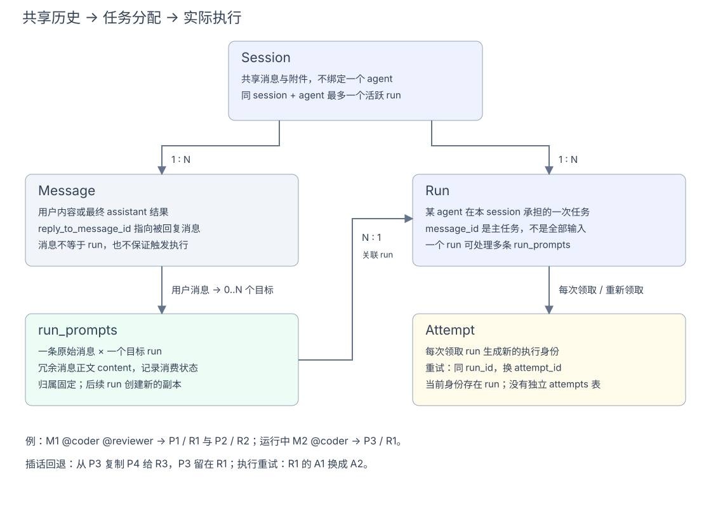

# sessionService：共享对话与消息编排

> v3 目标设计，尚未据此修改代码或数据库。统一使用 device 命名；本文 SQL 表示目标结构，不是线上迁移脚本。时间字段除另行说明外，均为 Unix 秒，布尔值用 SQLite INTEGER（0/1），JSON 用 TEXT 保存。表之间只保留关联字段，不声明数据库外键；引用校验和关联清理由 service 在事务内完成。

## 职责

sessionService 管理 session、message 和共享历史，并编排消息分配。一个 session 包含若干 message 和若干 run；message 与 run 的任务输入关系是 **N:M**，由 runService 的 run_prompts 连接。

- 创建/读取/删除会话，维护标题、归属和共享历史。
- 接收消息，调用 runService 为目标 agent 分配任务；对话原文只保存一次，每个目标 run 另存一份 run_prompts。
- 消费执行结果事件，把最终回复写为 agent message，并记录作者和被回复的 message。
- 读取会话时组合对话、run、run_prompts、事件和问题的统一快照。



## 发送和回复

发送链路是 `controller → sessionService → runService`：先检查权限，在一个事务中写一条 message 和全部目标 run 的 run_prompts，最后提交并通知设备。任一目标失败则整体回滚。空目标允许只保存一条备注。

```text
M1 @coder @reviewer → P1 / R1，P2 / R2
M2 @coder          → P3 / R1（R1 仍活跃，补充输入）
```

M1 对应两个 run，R1 处理两条消息；session 不绑定 agent，没有 session_participant 或每个 agent 独立的上下文。

runService 先持久化终态与结果事件；sessionService 消费后，在同一事务写带作者和 reply_to_message_id 的 agent message、更新 runs.result_message_id 和会话状态投影。runService 根据结果关联去重，messages 不保存 run_id。设备进度不直接变成普通聊天消息；取消可以只更新状态，不生成回复。

结果关联由 runService 提供事务内绑定操作完成，不要求 sessionService 直接改 runs。结果事件未消费时，run 可以已经结束、最终回复尚未写入；快照必须明确保留这个区别。恢复时可扫描终态 run 的持久化终态事件，由 runService 检查 runs.result_message_id 判断是否需要补写，不依赖一次性的内存通知。

## 状态和删除

Session 状态是 run 的聚合投影，优先 waiting、running、pending，再到 idle；resolved 是用户的完成标记。投影由 sessionService 通过 runService 查询当前状态后更新，run 状态变化和最终结果事件都触发重算；重算读取当前 run 集合，不用旧事件直接覆盖投影。idle 不表示历史任务全部成功。

有活跃 run 时拒绝删除，检查与删除共用事务；回复消费前也要重新检查会话是否存在，已删除的会话不恢复创建。删除会话由 sessionService 协调相关 service，在同一事务内清理消息、run、run_prompts、事件、问题及辅助记录；本地目录或 S3 对象前缀由 fileService 清理。Work 的协调会话和线程归属由 workService 决定。

## 标识和消息顺序

sessions.id 和 messages.id 均为 server 生成的 UUID，SQLite 中使用 TEXT 保存。所有 session_id、message_id、reply_to_message_id 等关联字段使用相同的 UUID 字符串。

UUID 只用于标识，不承担消息排序。messages.seq 是 session 内的递增顺序号，由 sessionService 在写消息的同一事务中分配；历史按 seq 读取，run.context_seq 表示已经读取到的消息顺序上界。

发送请求不做去重：每次成功发送创建新的 message UUID，不需要请求 key 或内容摘要字段。

## 表结构

### sessions

共享会话主表。`user_id` 是资源所有者，`created_by` 是创建者；可归属一个 work，不绑定 agent。所有 session 都支持多 agent，不设 mode 字段。状态是聚合投影，不替代 run 明细。

```sql
CREATE TABLE sessions (
    id TEXT NOT NULL PRIMARY KEY,
    user_id TEXT NOT NULL,
    created_by TEXT NOT NULL,
    work_id TEXT,
    title TEXT NOT NULL DEFAULT '',
    status TEXT NOT NULL DEFAULT 'idle',
    created_at INTEGER NOT NULL,
    updated_at INTEGER NOT NULL
);
CREATE INDEX sessions_work
    ON sessions(work_id,updated_at);
CREATE INDEX sessions_status
    ON sessions(status, updated_at);
CREATE INDEX sessions_user
    ON sessions(user_id, updated_at);
CREATE INDEX sessions_created_by
    ON sessions(created_by, updated_at);
```

### messages

共享对话的原始消息。`content` 统一保存对话正文；`author_role` 为 user/agent；`author_user_id`、`author_agent_id` 按作者类型二选一。作者名称分别实时关联 users/agents 读取，不保存 agent_key、agent_name 快照。`run_agent_ids` 保存原始 @ 目标数组，即使执行分配变化，对话仍能显示当时 @ 了谁。

`attachments` 是 JSON 字符串数组，保存相对于当前 session 文件空间的路径，用户消息和 agent 回复都可以携带。例如：

```json
{"content":"请查看这两个文件","attachments":["inputs/data.csv","reports/result.pdf"]}
```

文件先通过 fileService 上传，再在消息中引用；没有附件时为 `[]`。不保存绝对路径、URL、bucket 或本地根目录。service 校验数组元素为合法相对路径，读取时由 fileService 按 session 和路径定位文件。这只是消息上的文件引用，不新增文件元数据表。

service 写入时保证 user 消息只填 author_user_id，agent 消息只填 author_agent_id。读取作者用 LEFT JOIN；agent 改名后历史消息展示当前名称，已删除的作者保留原 ID 并显示已删除状态，不清空消息中的作者 ID。

message 永远回复另一条 message，不回复 run。`reply_to_message_id` 表示被回复的消息，字段保存被回复消息的 UUID，开头的根消息为空；后续用户消息、agent 回复都可以引用同 session 中已有的消息。messages 不保存 run_id，也不以 run 为对话层级。

```text
M1：@coder @reviewer 修复并评审
  ├─ M2：coder 的回复，reply_to_message_id=M1
  ├─ M3：reviewer 的回复，reply_to_message_id=M1
  └─ M4：用户追问，reply_to_message_id=M1 或选中的具体回复
```

一个 run 消费多条输入时，最终回复默认指向其主任务 message；补充输入仍通过 run_prompts 记录。service 检查父消息已存在、属于同一 session，避免跨会话引用和循环回复。

执行结果的内部关联留在 runs.result_message_id，允许 runService 追踪及去重，但不会出现在 messages 的字段或回复语义中。sessionService 在同一事务调用 runService 检查结果是否已绑定，未绑定才新增回复并绑定；重复结果直接返回已有回复。取消可以没有回复。

```sql
CREATE TABLE messages (
    id TEXT NOT NULL PRIMARY KEY,
    session_id TEXT NOT NULL,
    seq INTEGER NOT NULL,
    author_role TEXT NOT NULL CHECK(author_role IN ('user','agent')),
    content TEXT NOT NULL,
    attachments TEXT NOT NULL DEFAULT '[]',
    author_user_id TEXT,
    author_agent_id TEXT,
    run_agent_ids TEXT NOT NULL DEFAULT '[]',
    reply_to_message_id TEXT,
    created_at INTEGER NOT NULL
);
CREATE UNIQUE INDEX messages_session_seq ON messages(session_id,seq);
CREATE INDEX messages_replies ON messages(session_id,reply_to_message_id,seq);
```

### 合并掉的辅助表

| 原表 | v3 处理 |
|---|---|
| message_formats | 不再建表，也不保留 format 字段；消息与执行副本均保存正文 |
| message_authors | 不再建表，作者只保存在 messages.author_role、author_user_id、author_agent_id；名称实时关联读取；回复关系使用 reply_to_message_id，执行关联留在 runs |

这些信息仍有作用，但都是一条消息自身的属性，不需要再各拆一张 1:1 的表。

## 相关设计

[Server 总览](server-main.md) · [userService](server-user.md) · [deviceService](server-device.md) · [agentService](server-agent.md) · [Client harnessService](client-harness.md) · [runService](server-run.md) · [fileService](server-file.md) · [workService](server-work.md)
