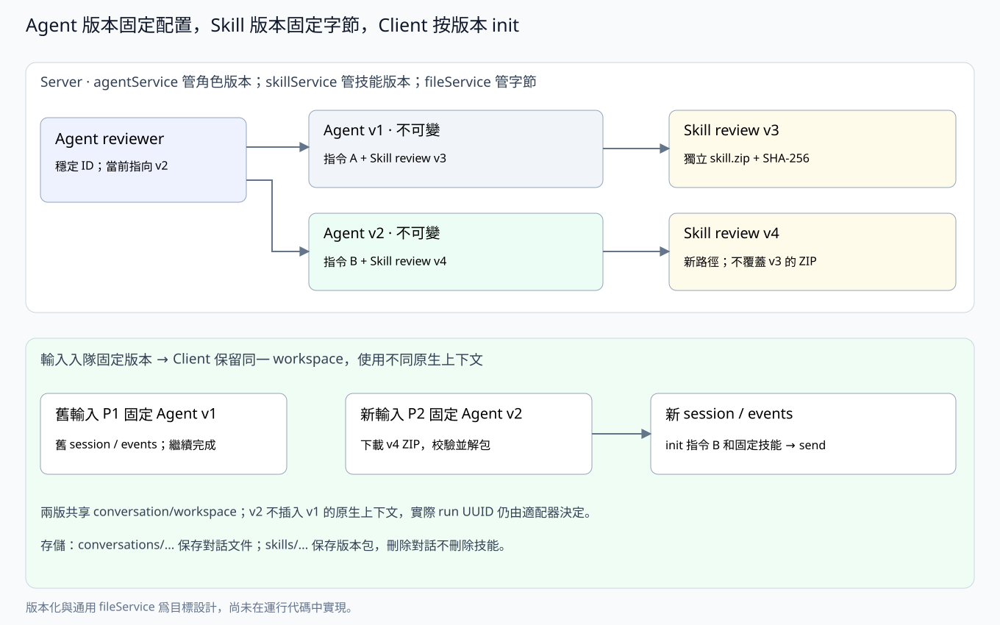

# skillService：共享 Skill 与不可变包版本

> 本文为独立 skillService 的目标设计，尚未修改运行代码或数据库。SQL 表示目标结构，表之间不声明数据库外键。

## 职责与关系

skillService 管理可被多个 agent 复用的技能身份、版本、ZIP 上传、包校验、发布、访问权限及下载。它拥有 skills 和 skill_versions；文件字节委托给 [fileService](server-file.md) 的 skills 命名空间，不自建存储后端。

agentService 负责 agent 和 agent_version，以及 agent_version_skills 关联。它通过本 service 校验指定 skill_version_id；本 service 不向 agent 自动推送最新版本，不修改 agent 配置，也不调用原生 harness。

| 对象 | 拥有者 | 作用 |
|---|---|---|
| skills | skillService | 稳定技能身份、所有者和当前版本指针 |
| skill_versions | skillService | 不可变压缩包及名称、描述、路径、摘要和大小 |
| agent_version_skills | agentService | 将某个 agent 版本关联到指定 skill 版本，并保存顺序 |
| skills 命名空间的文件字节 | fileService 提供存储能力，skillService 决定生命周期 | 本地/S3 的独立版本 ZIP，不属于任何 conversation 或 agent |



## 包与不可变版本

每个 skill 版本就是**一个 ZIP 压缩包，包含一个 skill**。包根直接包含 SKILL.md，脚本和参考资料放在同一根下：

```text
skill.zip
  SKILL.md
  scripts/...
  references/...
  assets/...
```

AgentUse 初版只接收 ZIP，不同时支持多种归档格式。SKILL.md 的 name、description 是该版本的技能元数据；server 校验包结构、必需元数据和路径，不解释其中的原生执行策略。包内不携带插件安装器或 harness 配置；Claude 的技能插件容器由本地适配器生成。

上传到相同 skill ID 的新内容创建新的 skill_version。压缩包、名称、描述、sha256 和 size_bytes 一经发布就不可变；旧下载地址永远对应旧字节。已有 agent 版本继续引用旧 skill_version_id；用户显式升级依赖时，才创建新的 agent 版本。

创建 skill 时发布 v1；后续发布带 base_version_id，在版本提交事务内检查仍是当前版本，并分配递增 version。并发冲突返回 409。版本 UUID 用于稳定引用，数字版本用于展示。回退也复制旧包内容发布新版本，不重写历史。

Skill 的共享范围沿用用户归属和管理权限，同一用户的多个 agent 可以引用同一个已发布版本。SKILL.md 的 name 是该版本的原生名称；agentService 根据所选版本的名称检查一个 agent 配置内的冲突。

包校验和解压拒绝绝对路径、..、重复归档路径、链接和特殊文件，并限制归档大小、解压总量与条目数；超限明确失败。只恢复普通文件和必要的用户执行位，不恢复其他用户权限。Server 不执行包内脚本。

## fileService 的复用与发布流程

skillService 拥有 skill 的业务身份、版本与包生命周期；agentService 只保存固定引用。fileService 只保存对象字节。存储命名空间分开：

```text
<file_root>/
  conversations/<conversation_id>/<relative_path>
  skills/<skill_id>/<skill_version_id>/skill.zip
```

S3 使用相同的相对 key，前面可加部署配置的 prefix。Skill 包不属于任何 conversation；删除某个 conversation 不删除 skill 包。SHA-256、包大小和 package_path 保存在 skill_versions，是业务版本的一部分；fileService 仍无 files/attachments 元数据表。

发布顺序是：校验压缩包 → 通过 fileService 写入本次新版本的独立路径并确认完整落盘 → 事务写入 skill_versions、推进 skill 当前指针 → 对外返回版本。对象写入失败不发布版本；事务失败删除本次未发布对象。SQLite 与本地/S3 存储不是分布式事务，异常遗留对象由清理流程处理。

版本路径不提供覆盖上传 API。清理必须检查**所有历史版本**的引用，不能只看当前版本，也不能按 conversation 的生命周期回收。

## 对外接口与权限

| 方法 | 接口 | 行为 |
|---|---|---|
| POST | /api/skills | multipart 上传一个 ZIP，创建 skill 和 v1 |
| POST | /api/skills/{id}/versions | multipart 上传新 ZIP，带 base_version_id，发布下一版本 |
| GET | /api/skills、/api/skills/{id} | 查看技能及当前版本，默认隐藏软删除身份 |
| GET | /api/skills/{id}/versions | 列出历史版本 |
| GET | /api/skills/{id}/versions/{version_id} | 查看不可变版本描述 |
| GET | /api/skills/{id}/versions/{version_id}/package | 流式下载固定版本 ZIP |
| DELETE | /api/skills/{id} | 软删除技能，不删除版本、不破坏已有引用 |

Owner/admin 可上传和发布。设备只能下载本设备已分配 prompt 的固定 agent 版本所引用的 skill 包，不能凭 device key 枚举整个技能库。Work 凭据也只能在对应输入和工作范围内授权。

download_path 是当前 server 的相对 API 路径。skillService 校验业务范围后调用 fileService 读取，不向 client 下发本地路径、存储密钥，也不要求向任意外域 URL 附带 device key。Client 校验下载包的大小、SHA-256 和 SKILL.md 元数据，再安全解包给 harnessctl init。

## 提供给其他 Service 的能力

- agentService 发布版本时，在同一业务事务上下文调用版本校验读取接口，取得固定版本元数据，自己保存关联；skillService 不自行提交调用方事务。
- runService 根据输入固定的 agent_version_id 获取其依赖；本 service 提供那些具体 skill 版本的包描述和下载授权，不在领取时解析 latest。
- fileService 提供 skills 空间的完整写入、读取和删除原语，不理解版本发布或 agent 依赖。

不引入跨 service 的互相发布：agentService → skillService → fileService。Skill 新版发布只推进 skills.current_version_id，不修改 agent_version_skills。

## 删除与历史保留

软删除的 skill 不可用于发布新的 agent 版本，但已有配置、已入队输入和执行历史仍能按固定版本读取。删除 agent 只删除/隐藏角色选择，不删除共享 skill；删除 conversation 只回收该对话的文件，不回收 skills 空间。

当前目标保留全部已发布 skill_versions 及其 ZIP，不提供覆盖或删除单个已发布版本的 API。没有显式版本淘汰设计前，只清理确认未发布、无 skill_versions 记录引用且不在上传中的孤立对象，不把“没有当前 agent 引用”当成删除旧包的理由。清理由 skillService 编排，fileService 执行字节删除。

## 表结构

时间为 Unix 秒；skill 归属和当前指针是身份元数据，包内容和描述位于不可变版本中。发布时由 skillService 在事务内保持指针和版本一致，不声明 REFERENCES。

### skills 与 skill_versions

```sql
CREATE TABLE skills (
    id TEXT PRIMARY KEY,
    user_id TEXT NOT NULL,
    current_version_id TEXT NOT NULL,
    created_at INTEGER NOT NULL,
    updated_at INTEGER NOT NULL,
    deleted_at INTEGER
);
CREATE INDEX skills_user ON skills(user_id, updated_at);

CREATE TABLE skill_versions (
    id TEXT PRIMARY KEY,
    skill_id TEXT NOT NULL,
    version INTEGER NOT NULL CHECK(version > 0),
    name TEXT NOT NULL,
    description TEXT NOT NULL,
    package_path TEXT NOT NULL UNIQUE,
    sha256 TEXT NOT NULL,
    size_bytes INTEGER NOT NULL CHECK(size_bytes > 0),
    created_at INTEGER NOT NULL,
    UNIQUE(skill_id, version)
);
CREATE INDEX skill_versions_skill ON skill_versions(skill_id, version);
```

package_path 是 skills 命名空间内的相对路径，如 `<skill_id>/<skill_version_id>/skill.zip`，不存本地根目录、bucket 或 endpoint。切换文件后端不改版本的业务引用。

agent_version_skills 不在本 service 重复定义或写入，其完整 SQL 见 [server-agent.md](server-agent.md)。

[Server 总览](server-main.md) · [agentService](server-agent.md) · [fileService](server-file.md) · [runService](server-run.md) · [通信协议](protocol.md)
