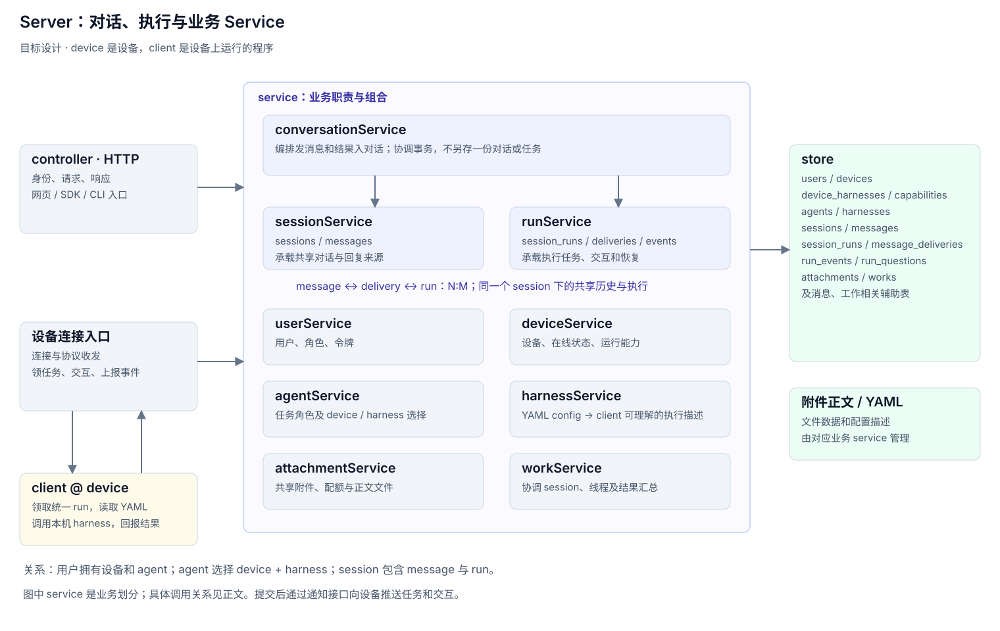

# Server 设计

> 本文定义 v3 的目标业务划分。service 名称和 device 命名是设计约定，现有源码、表和接口尚未全部按此调整。本稿先说明业务关系，不逐文件展开实现。

Server 保存对话、组织任务并跟踪执行。用户的一台执行设备称为 **device**，设备上运行的程序称为 **client**。Client 从 server 领取 run，再在设备上调用具体 harness 执行。

## 一、整体关系



Server 分为三层：

- **controller**：HTTP / WebSocket 入口，处理身份、请求和响应，把业务交给 service。
- **service**：按业务对象划分职责，决定如何保存对话、分配任务、管理设备和执行配置。
- **store**：表、查询和事务；各 service 通过它保存自己的业务数据。

设备的在线连接由连接管理组件维护。Service 通过通知接口让它派活、推送插话、取消或答案；连接本身不承担 session/run 的业务规则。

## 二、有哪些 Service

| Service | 负责什么 | 主要拥有的表或数据 |
|---|---|---|
| **userService** | 用户、角色、访问令牌和身份校验 | `users` |
| **deviceService** | 执行设备的登记、凭据、在线状态、可用 harness 和执行能力 | `devices`、`device_harnesses`、`device_capabilities` |
| **agentService** | Agent 的名称、说明、归属，以及选择哪台 device、哪种 harness 执行 | `agents` |
| **harnessService** | 用统一 YAML config 描述不同 harness，使 client 能把任务转为认识的执行方式 | `harnesses` 和 harness YAML 配置 |
| **sessionService** | 清晰、持续的对话：创建会话、保存消息、读取共享历史，记录回复的作者和来源 | `sessions`、`messages`、`message_formats`、`message_authors` |
| **runService** | 建立任务、关联任务消息、派发与领取、跟踪执行、插话、提问、取消和执行恢复 | `session_runs`、`message_deliveries`、`run_events`、`run_questions` |
| **attachmentService** | 会话附件的上传、下载、访问权限、配额、元数据和文件生命周期 | `attachments` 与附件正文 |
| **workService** | 把多个 session 组织成一项工作，管理协调 agent、线程关系和结果汇总 | `works`、`work_run_tokens`、`run_notifications` |
| **conversationService** | 编排“用户发消息”和“执行结果进入对话”：协调 sessionService 与 runService，保证消息和任务分配一致 | 不单独拥有主表，复用上述 service 的事务操作 |

这里的“拥有”指主要维护职责，不表示其他 service 不能读取。跨业务修改通过所属 service 完成；由编排操作统一事务，不能把各次调用做成互不相关的独立提交。

`conversationService` 负责组合业务。这样 sessionService 可以专注对话，runService 可以专注执行，两者不需要为了发消息和写回复而互相调用。

### 2.1 userService、deviceService、agentService

这三个对象分别回答“谁使用系统”“在哪里执行”“由哪个 agent 承担任务”。

- 一个用户可以有多台 device 和多个 agent。
- 一台 device 可以运行多种 harness；可用与是否允许使用由 deviceService 维护。
- 一个 agent 选择 device 和 harness，形成默认执行配置。
- run 创建时记录本次执行选择；修改 agent 的配置，不应改写已经存在的 run 的历史。

**Device 是执行位置，agent 是任务角色，harness 是执行方式。** 三者不能合并成一个概念。

### 2.2 harnessService

不同 harness 的启动命令、参数、输入输出、插话和提问方式各不相同。harnessService 用 YAML config 将这些差异收敛为统一描述。

| YAML 描述 | client 用它做什么 |
|---|---|
| 命令、版本探测 | 找到本机程序，判断是否可用 |
| 参数、环境变量、工作目录规则 | 准备执行环境，启动命令 |
| 输入格式 | 把任务及共享上下文交给 harness |
| 输出规则 | 把原始输出转换为进度、结果、错误和用量 |
| transport、插话和提问能力 | 选择对应适配器，处理执行中的交互 |

runService 交给 client 的是统一任务：run 身份、agent、harness 配置标识、任务消息和上下文信息。Client 取得对应 YAML 后，由本机适配器把任务转换成可执行命令或协议调用，再把结果转换为统一事件上报。

YAML 收敛配置差异；复杂协议仍由适配器实现。Server 不直接启动用户设备上的命令，runService 也不为每一种 harness 复制一套任务生命周期。

### 2.3 sessionService、runService、conversationService

- **sessionService 管对话内容**：用户说了什么，agent 回了什么，这些内容属于哪个 session。
- **runService 管任务执行**：哪些消息交给哪个 agent，在哪个 device 上执行，目前执行到哪一步。
- **conversationService 连接两者**：发送时保存消息并建立执行分配；结束时保存执行状态并把最终回复追加到对话。

进度、计划、问题和插话确认属于 run 的执行记录；需要作为最终回复展示的结果进入 messages。读取会话时可以组合这些数据，但不能把执行事件全当作普通聊天消息。

### 2.4 attachmentService、workService

附件属于 session，由同一会话里的执行共享，不为每个 agent 或 run 复制一份。attachmentService 管文件，sessionService 管对话，runService 在执行时引用附件。

Work 是多个 session 的组织方式。workService 维护协调 session、工作线程和协调 agent，在线程任务完成后汇总结果，再经 conversationService 给协调 session 发消息。它复用同一套消息与 run 机制，不另建一种执行模型。

## 三、Session、Message 和 Run 的关系

**一个 session 包含若干个 message 和若干个 run；message 与 run 是 N:M。**

| 关系 | 含义 |
|---|---|
| session → messages：1:N | 一段会话保存多条共享消息 |
| session → runs：1:N | 一段会话可以先后或同时存在多个执行任务 |
| message ↔ run：N:M | 一条消息可以交给多个 agent 的 run；一个 run 也可以处理多条任务消息 |
| message → delivery → run | `message_deliveries` 记录每个目标 agent 的任务分配，连接消息和执行 |

这个 N:M 指的是**任务输入关系**。Run 的最终结果可以成为一条 assistant message，再通过作者/来源信息关联回 run。

例子：

```text
Session S
  M1：@coder @reviewer 修复并评审登录问题
    → D1 → R1（coder）
    → D2 → R2（reviewer）

  M2：@coder 注意移动端兼容
    → D3 → R1（coder 仍在执行，作为补充消息）
```

这里 M1 对应 R1、R2；R1 同时处理 M1、M2。Session 不绑定某个 agent，每条消息的目标决定任务分配。

`session_runs.message_id` 即使保留，也只表示主任务，不能拿它表达完整 N:M；完整输入关系由 message_deliveries 承载。没有目标的消息可以只进入对话，不创建 run。

Run 是一次业务执行任务。设备故障导致重试时，用 attempt 区分同一个 run 的不同执行尝试；尚未消费的补充任务转入后续执行时，可以建立新的 run。具体恢复规则不在本篇展开。

## 四、Service 之间怎么协作

| 业务 | 主要调用关系 |
|---|---|
| 登录和身份检查 | controller → userService |
| 登记设备、上报在线能力 | controller / 连接入口 → deviceService；deviceService 核对 harnessService 的定义 |
| 配置 agent | controller → agentService；agentService 核对用户、device 和 harness |
| 发送会话消息 | controller → conversationService → sessionService + runService |
| 建立 run | runService 读取 agentService 的执行选择，核对 deviceService 的能力和 harnessService 的配置 |
| client 领取任务 | 连接入口 → runService；返回统一任务与可解析的 harness 配置引用 |
| client 上报执行事件 | 连接入口 → conversationService → runService；最终结果再交 sessionService 保存 |
| 上传和读取附件 | controller → attachmentService；结合 user/session/run 的访问范围检查权限 |
| 组织工作、汇总线程结果 | controller 或任务完成通知 → workService → conversationService |

调用方使用的是 service 提供的业务操作，不直接修改其他 service 所属的表。需要发送给 device 的网络通知发生在业务提交之后，避免 client 收到数据库里尚不存在的任务。

## 五、用户消息进来以后

1. **controller 接收。** 校验身份，解析消息、session 和目标 agent，交给 conversationService。
2. **sessionService 保存对话。** 检查会话权限，保存一条 user message；多目标不复制消息内容。
3. **runService 建立分配。** 对每个目标 agent，创建 run 或把消息加入已有活跃 run，写入 delivery；读取 agent/device/harness 的执行配置。
4. **统一提交。** 消息和任务分配一并成功或失败。提交后通知在线 device 有任务或插话，HTTP 返回保存结果。
5. **client 领取并执行。** runService 确定当前执行身份；client 读取共享消息、附件和 YAML 配置，转换为本机命令或协议调用。
6. **上报与呈现。** client 上报进度、问题和结果；runService 更新执行记录，conversationService 通过 sessionService 追加最终回复；workService 按需汇总线程结果。

对话是否已保存、任务是否已领取、补充消息是否已接收、执行是否已完成是不同的状态。页面可以把它们放在同一会话里展示，数据模型仍各自清楚。

## 六、Device 命名约定

v3 统一使用 device，不再使用 daemon 表示用户机器。

| 名称 | 含义 |
|---|---|
| device | 一台登记在系统中的用户执行设备 |
| client | 运行在设备上的程序，连接 server、领任务、调用 harness |
| deviceService | Server 侧的设备业务管理 |
| devices | 设备身份、归属、凭据和状态 |
| device_harnesses | 每台设备上各 harness 的可用情况 |
| device_capabilities | 每台设备支持的协议与执行能力 |

代码、API、配置和协议字段在实现 v3 时按此统一命名。概念上始终区分设备这个资源和设备上运行的 client 程序。
