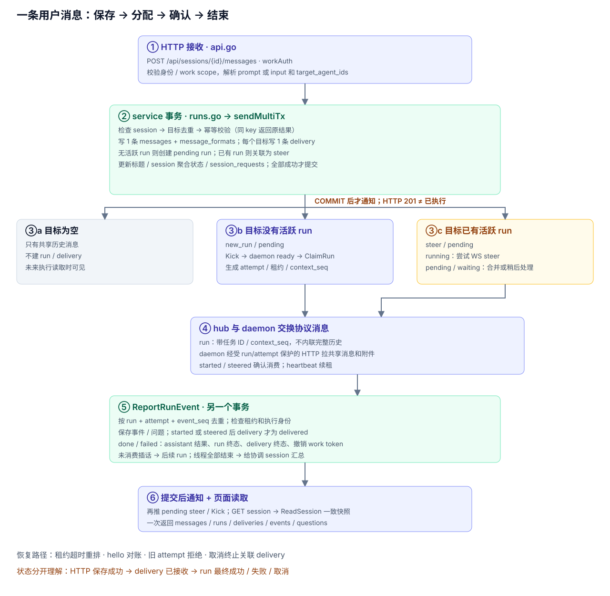

# Server 设计：文件、调用关系、数据和消息流

> 本稿以目录重构完成后的 `f16eb63` 为基线，描述当前实现。后续修改 server 时，同步维护本文与配图。代码入口：[`server/`](../../../server/)。`_test.go` 不在文件清单内。

Server 负责保存共享会话、把每条消息交给指定的 agent、跟踪执行和保存结果。真正运行 harness 的是用户机器上的 client。服务端的持久事实在 SQLite，在线 daemon 的 WebSocket 连接在内存里，附件正文在文件系统里。

阅读顺序：先看调用图，再按文件查职责；数据关系见第四节，一条用户消息的全过程见第五节。Session 与 run 的对象关系和场景例子另见 [Session 设计](session.md)。

## 一、整体拓扑

图中实线表示调用或数据访问，虚线表示 service 经接口发出的通知。`controller`、`hub` 和 `service` 都在同一个服务进程内。

### 1.1 进程怎样组装

[`cli/server.go`](../../../server/internal/cli/server.go) 的 `runStart` 负责装配，顺序是：

1. 解析监听地址、数据库、下载目录、附件目录和配额参数。
2. `store.Open` 打开 SQLite、检查 schema 版本、建表并同步内置 harness 元数据。
3. `service.New(repository)` 创建**一个** `*service.Service`；启动时把旧在线 daemon 标为离线。
4. 建立 TCP listener；必要时创建管理员，已有管理员则继续使用原令牌。
5. `hub.New(svc, logger)` 创建在线连接管理器；`svc.SetNotifier(transport)` 注入通知实现。
6. `controller.New(svc, Config{DaemonHandler: transport, ...})` 注册路由，并把附件目录与配额配置给 service。
7. `go svc.Run(ctx)` 启动租约回收和附件清理，`http.Server.Serve` 开始接收请求；收到退出信号时关闭 HTTP server。

`service/*.go` 都是这个 `Service` 的方法或包内函数，下面按文件称为“业务单元”。当前没有独立的 `SessionService`、`RunService` 等对象，也没有为每张表各建一个 service。

### 1.2 层之间怎样调用

| 调用方 | 调用对象 | 负责的事 |
|---|---|---|
| 网页、SDK、CLI | controller 的 HTTP 路由 | 用户管理、会话、消息、run、work、附件及安装下载 |
| controller | `Service` 的公开方法 | 鉴权查询、读取详情、执行业务写入；**当前读写都走 service** |
| controller 的 `/api/daemon/ws` 路由 | `Config.DaemonHandler`，实际是 hub | 将 WebSocket 请求交给 hub；controller 不管理连接 |
| hub | `Service` 的公开方法 | daemon 鉴权、上线登记、领 run、续租、处理事件、重连对账 |
| service | store 的 SQL、scanner、连接与事务原语 | 由 service 决定业务校验、操作顺序、提交或回滚 |
| service | `Notifier` 接口 | 提交后叫醒 daemon、推送插话/取消/答案、断开连接 |
| hub | daemon WebSocket | 序列化并发送协议消息；进程内保存连接和 ready 状态 |
| service 的附件业务 | 文件系统 | 发布、读取、删除附件正文，清理孤儿文件 |
| controller | `server/frontend`、下载目录 | 返回嵌入的管理网页，以及预先构建的客户端下载文件 |

**依赖方向与运行时回调不同。** hub import service，service 定义 `Notifier`，但不 import hub；CLI 把实现注入进去。因此运行时会出现 service → hub 的通知，Go 包依赖仍然是 `controller / hub → service → store`。

`Notifier` 有五个方法：`KickAll`、`KickUser`、`PushRun`、`PushRunSteers`、`Disconnect`。`KickAll` / `KickUser` 只是尝试为已经 ready 的 daemon 领活；不会让忙碌 daemon 同时领取另一个 run。插话走 `PushRunSteers`，不需要等待 daemon 再次 ready。

**store 的实际边界：**SQL 文本和通用行扫描在 store；service 持有 `store.Connection()` 返回的 `*sql.DB`，大部分事务直接用 `BeginTx`，`RenewRun` 使用 `store.Tx(ctx, callback)`。目前并不是所有数据访问都封装成了具名 repository 方法，也没有每个 service 独立的数据库连接。

## 二、每个 Go 文件负责什么

本节覆盖 `server/` 下全部 36 个非测试 Go 文件。路径按目录分组，每行都链接到对应源码。

### 2.1 入口、命令行和网页嵌入

| 文件 | 作用与关键入口 |
|---|---|
| [`cmd/agentuse-server/main.go`](../../../server/cmd/agentuse-server/main.go) | 二进制入口，把参数交给 `cli.Main`，用返回码退出。 |
| [`internal/cli/server.go`](../../../server/internal/cli/server.go) | `Main` 分发 `start / login / user / version`；`runStart` 装配 store、service、hub、controller 和后台任务；`bootstrapAdmin` 首次创建或显式重置管理员。管理子命令通过 SDK 调 HTTP。 |
| [`internal/cli/client.go`](../../../server/internal/cli/client.go) | 服务端管理 CLI 的客户端配置：读取/保存 `server-cli.json`，合并服务地址、令牌和 act-as 参数，构造 Go SDK Client。这里的 client 指 HTTP 客户端，不是 daemon 主循环。 |
| [`frontend/embed.go`](../../../server/frontend/embed.go) | 将管理前端的 `dist/` 嵌入二进制，提供 `FS` 和 `Built`。React 源码不属于本篇 Go 文件清单。 |

### 2.2 HTTP controller

| 文件 | 作用与关键入口 |
|---|---|
| [`internal/controller/server.go`](../../../server/internal/controller/server.go) | `Config`、`Server`、`New`、`ServeHTTP`；集中注册路由；提供 JSON 读写、业务错误到 HTTP 状态码的映射、外部访问地址推断。 |
| [`internal/controller/api.go`](../../../server/internal/controller/api.go) | HTTP 鉴权与大部分资源 handler：登录/cookie、用户/admin/act-as、harness、agent、daemon、session、message、work、daemon 注册和自检。`handleAddMessage` 解析请求、检查 work scope、调用 `SendMultiMessage`。 |
| [`internal/controller/runs.go`](../../../server/internal/controller/runs.go) | 多 agent 会话创建与详情返回；`sessionReadAuth` 校验 daemon 对某次 run 的读取权；run 详情、取消、回答问题的 HTTP 适配。**没有独立的 steer 写入接口。** |
| [`internal/controller/attachments.go`](../../../server/internal/controller/attachments.go) | 附件专用鉴权、multipart 接收、请求大小限制、临时文件与摘要计算，以及列表/元数据/内容下载/删除响应；通过 service 重新鉴权、检查配额并发布文件。 |
| [`internal/controller/setup.go`](../../../server/internal/controller/setup.go) | 返回 `setup.sh`；按允许的平台文件名提供客户端下载，检测下载目录是否缺少构建产物。 |
| [`internal/controller/web.go`](../../../server/internal/controller/web.go) | 托管嵌入的管理网页，处理静态资源和 SPA fallback；未构建前端时返回相应提示。 |

### 2.3 daemon 长连接 hub

| 文件 | 作用与关键入口 |
|---|---|
| [`internal/hub/hub.go`](../../../server/internal/hub/hub.go) | 整个 WebSocket 入口及连接池。`ServeHTTP` 验证 daemon 密钥、替换旧连接；`serve` 处理 hello/ready/heartbeat/event；`dispatch` 领取并发送 run；实现五个 `Notifier` 方法。连接池锁保护连接集合，每条连接的锁串行化领活。业务状态通过 service 落库。 |

### 2.4 service 业务单元

| 文件 | 作用与关键入口 |
|---|---|
| [`internal/service/service.go`](../../../server/internal/service/service.go) | 定义 `Service`、`Notifier` 和默认空通知实现；持有 repository、数据库连接、时钟、附件配置及文件锁；提供 `New / Open / Close / SetNotifier`。 |
| [`internal/service/models.go`](../../../server/internal/service/models.go) | 引用 store 的模型别名、状态常量、scanner 和身份辅助函数，供业务代码共用；不定义第二套 HTTP DTO。公开资源模型最终引用 `sdk/golang`。 |
| [`internal/service/users.go`](../../../server/internal/service/users.go) | 创建用户、生成/重置令牌、按令牌认证、查询用户和首个管理员。数据库只保存令牌哈希。 |
| [`internal/service/agents.go`](../../../server/internal/service/agents.go) | agent 增删改查、名称校验、daemon 所属用户与 harness 登记关系校验；`runtimeErr` 供执行路径检查 available/enabled。 |
| [`internal/service/harnesses.go`](../../../server/internal/service/harnesses.go) | 自定义 harness 的创建、删除和所有 harness 列表。内置元数据初始化由 store 的 `seed.go` 完成。 |
| [`internal/service/daemons.go`](../../../server/internal/service/daemons.go) | 添加/注册/重置/删除 daemon；安装令牌换长期密钥；上线时登记 harness 与 capabilities；离线、心跳、开启/关闭 harness。删除/重置会在事务内终止相关 run。 |
| [`internal/service/sessions.go`](../../../server/internal/service/sessions.go) | session 可见性、查询、列表、删除；`insertMessage` 和 `messages` 是共享的消息写入/读取原语。多目标发送的主体不在这个文件，而在 `runs.go`。 |
| [`internal/service/runs.go`](../../../server/internal/service/runs.go) | 创建多 agent session、发送消息、目标去重、幂等校验、创建 run 和 delivery、读取 run/delivery、计算 session 聚合状态。主链路是 `sendMultiMessage → sendMultiTx → newRun / replyFor`。 |
| [`internal/service/run_lifecycle.go`](../../../server/internal/service/run_lifecycle.go) | run 权限与租约校验、领活、输入准备、续租、结束/取消、租约超时重排、重连对账、不可执行任务失败处理；结束时保存结果、处理未送达插话和 work 通知。 |
| [`internal/service/run_events.go`](../../../server/internal/service/run_events.go) | 校验并去重 daemon 事件；按事件更新 delivery、问题、run、session；接受用户答案、查询待推送答案；把尚未消费的答案恢复为消息，避免重试时丢失。 |
| [`internal/service/questions.go`](../../../server/internal/service/questions.go) | 提问相关错误和 `answerText`：把答案 map 稳定地整理为可恢复的文本。问题状态和数据库操作主要在 `run_events.go`。 |
| [`internal/service/session_snapshot.go`](../../../server/internal/service/session_snapshot.go) | `ReadSession` 在同一事务内读取 session、messages、runs、deliveries、events、questions，汇总 run 数量，避免“已完成状态”和旧消息列表混在一个响应里。 |
| [`internal/service/works.go`](../../../server/internal/service/works.go) | work 查询、改名/说明/协调 agent、删除；session resolve/reopen；工作令牌校验的公开入口。修改协调 agent 和删除 work 时检查忙碌状态。 |
| [`internal/service/run_work.go`](../../../server/internal/service/run_work.go) | 建 work 及协调会话；验证协调 run 的工作令牌；线程一条消息的所有 delivery 结束后，汇总结果并给协调会话发消息；用通知表去重。 |
| [`internal/service/attachments.go`](../../../server/internal/service/attachments.go) | 附件访问权限、凭据和 run/attempt 再校验；会话容量、元数据提交、列表游标、删除元数据、存在性查询和 daemon 能力查询。 |
| [`internal/service/attachment_files.go`](../../../server/internal/service/attachment_files.go) | 配置文件目录与配额；单文件限制；锁保护下发布/打开/删除正文；`CleanupAttachments` 清理超过 24 小时的临时文件和无元数据的附件目录。正文路径为 `<dir>/<session>/<attachment>/content`。 |
| [`internal/service/notifications.go`](../../../server/internal/service/notifications.go) | 公开变更方法的通知外壳：内部事务成功后再 Kick、推 steer/cancel/answer 或 Disconnect；事务失败时不发通知。 |
| [`internal/service/background.go`](../../../server/internal/service/background.go) | `Run(ctx)` 启动时做附件清理，此后每小时清理；每 5 秒回收超时 run 并尝试派活。 |

### 2.5 SQLite store

| 文件 | 作用与关键入口 |
|---|---|
| [`internal/store/store.go`](../../../server/internal/store/store.go) | 基础表 schema、`Open / Close / Connection / Tx`、schema 版本检查、单连接/WAL/外键/`BEGIN IMMEDIATE` 配置，以及随机 ID、令牌、哈希和 SQL NULL 辅助函数。 |
| [`internal/store/run_schema.go`](../../../server/internal/store/run_schema.go) | run、delivery、event、question、消息格式/作者、发送幂等、工作令牌和线程通知表的 DDL；包含“同 session、同 agent 只能有一个活跃 run”的部分唯一索引。 |
| [`internal/store/attachment_schema.go`](../../../server/internal/store/attachment_schema.go) | `attachments`、`daemon_capabilities` 的 DDL 和索引。 |
| [`internal/store/queries.go`](../../../server/internal/store/queries.go) | service 使用的 SQL 语句和拼接片段，按业务方法命名；不决定通知、重试或多步业务流程。 |
| [`internal/store/scanners.go`](../../../server/internal/store/scanners.go) | 将查询行解码成 Agent、Attachment、Daemon、Run、Session、Message、User、Work；处理 NULL、JSON、消息作者和派生字段。 |
| [`internal/store/models.go`](../../../server/internal/store/models.go) | 对 SDK 资源模型做别名，定义状态常量与持久化流程内部结构，如 `RunClaim`、`AttachmentAccess`、`ReportedHarness`。 |
| [`internal/store/seed.go`](../../../server/internal/store/seed.go) | 从根 `internal/harness` 的内置描述 upsert harness 元数据；每次打开数据库执行，保留自定义 harness。 |

## 三、controller 与业务单元的对应关系

下表是 HTTP 入口到业务的索引。入口所在文件只负责 HTTP 适配，跨表事务由右侧业务负责。

| controller 入口 | 调用的 service 方法 | 主要业务文件 |
|---|---|---|
| `api.go`：登录、me、用户管理、act-as | `UserByToken / GetUser / CreateUser / ResetUserToken / ListUsers` | `users.go` |
| `api.go`：harness、agent 管理 | `ListHarnesses / CreateCustomHarness / DeleteCustomHarness`；agent CRUD | `harnesses.go`、`agents.go` |
| `api.go`：daemon 管理、register、daemon/me | `CreateDaemon / RegisterDaemon / DaemonByKey / ListDaemons / DeleteDaemon / ResetDaemonSetup / SetDaemonHarnessEnabled` | `daemons.go`；变更通知在 `notifications.go` |
| `api.go → runs.go`：创建 session | `CreateMultiSession` | `notifications.go → runs.go → sessions.go` |
| `api.go`：发送消息 | `SendMultiMessage` | `notifications.go → runs.go`，调用 `sessions.go` 的消息原语 |
| `api.go → runs.go`：session 详情 | `GetSession / ReadSession` | `sessions.go`、`session_snapshot.go` |
| `api.go`：session 列表、删除、resolve/reopen | `ListSessions / ListWorkSessions / DeleteSession / ResolveSession / ReopenSession` | `sessions.go`、`works.go` |
| `runs.go`：run 详情、取消、回答问题 | `GetRun / RunEvents / CancelRun / AnswerRunQuestion` | `runs.go`、`run_lifecycle.go`、`run_events.go`、`notifications.go` |
| `api.go`：work CRUD 和 work 鉴权 | `CreateMultiWork / GetWork / ListWorks / UpdateWork / DeleteWork / WorkByToken` | `works.go`、`run_work.go` |
| `attachments.go`：上传、列表、内容、删除 | `AttachmentSession / PublishAttachment / ListAttachments / GetAttachment / OpenAttachmentFile / DeleteAttachment` | `attachments.go`、`attachment_files.go` |
| `runs.go`：daemon 读 session 鉴权 | `DaemonByKey / RunAccess / GetSession / GetUser` | `daemons.go`、`run_lifecycle.go`、`sessions.go`、`users.go` |

hub 是另一条业务入口：hello 调 `DaemonConnected + ReconcileRuns`，ready 调 `ClaimRun`，heartbeat 调 `TouchDaemon + RenewRun`，event 调 `ReportRunEvent`。后台入口则调用 `RequeueRuns + CleanupAttachments`，无需伪造 HTTP 请求。

## 四、业务单元和数据库表的关系

### 4.1 先理解数据对象

`session` 保存共享历史，不绑定一个执行 agent。`message` 保存一次内容；`message_delivery` 表示“这条消息交给这个 agent 的处理记录”；`run` 表示“某 agent 在某 session 中的一次工作”；`attempt` 是 run 每次实际领取时生成的执行身份。

因此，一条消息 @ 两个 agent，是 **1 条 message + 2 条 delivery**，可能对应两个新 run，也可能分别加入已有 run。同一 run 可以消费多条消息。`message_deliveries.kind` 的 `new_run / steer` 与它的处理状态是两件事。

### 4.2 按业务单元看读写

`R` 表示读取，`W` 表示插入/更新/删除。表中合并列出该单元的主要访问；标明“调用”的是跨文件复用，并非文件里又写了一份 SQL。外键级联的影响单独列在 4.3。

| service 文件 | 读写的表 | 为什么访问 |
|---|---|---|
| `users.go` | R/W `users` | 身份、角色、令牌哈希 |
| `agents.go` | R/W `agents`；R `daemon_harnesses` | agent 配置与所属机器/harness 校验 |
| `harnesses.go` | R/W `harnesses` | 自定义 harness 和目录列表 |
| `daemons.go` | R/W `daemons`、`daemon_harnesses`、`daemon_capabilities`；R `harnesses` | 注册、在线状态、能力与可用运行时；删除/重置调用 `terminateDaemonRuns`，继而写 run 结果及关联状态 |
| `sessions.go` | R/W `sessions`、`messages`；R `message_authors / message_deliveries / works`；读取 session 时关联 `agents / works` | 共享会话权限、列表、删除、消息原语；work 查询用于线程列表可见性 |
| `runs.go` | R/W `sessions`、`session_runs`、`message_deliveries`、`message_formats`、`session_requests`；调用写 `messages`；R `agents / attachments / daemon_harnesses / daemon_capabilities / works` | 消息入库、目标分配、幂等、执行能力校验和聚合状态；`works` 用于创建 work 下的会话及读取派生信息 |
| `run_lifecycle.go` | R/W `session_runs`、`message_deliveries`、`run_questions`、`work_run_tokens`、`sessions`；W `run_events`、`message_authors`；调用写 `messages / message_formats`；R `users / agents / works / attachments / daemon_harnesses / daemon_capabilities / message_formats` | 领取、续租、结果、取消、重排、重连；通过 `run_work.go` 还可能写 `run_notifications` 和协调会话的消息/run/delivery |
| `run_events.go` | R/W `run_events`、`run_questions`、`session_runs`、`message_deliveries`、`sessions`；调用写 `messages / message_formats`；结束事件调用 `finishRun` 的全部关联操作 | 事件幂等、插话确认、提问/答案、完成/失败；恢复未消费答案 |
| `questions.go` | 无直接数据库操作 | 答案文本整理与错误定义 |
| `session_snapshot.go` | R `sessions / messages / message_authors / session_runs / message_deliveries / run_events / run_questions`；session 派生字段还读 `agents / works` | 在一个事务内返回一致的会话快照 |
| `works.go` | R/W `works / sessions`；R `agents / daemon_harnesses / daemon_capabilities`；工作令牌验证调用 `run_work.go` | 工作配置、协调 agent 校验、忙碌检查、resolve/reopen、工作范围权限 |
| `run_work.go` | R/W `works / sessions / run_notifications`；R `work_run_tokens / session_runs / message_deliveries / messages / users / agents / daemon_harnesses / daemon_capabilities`；调用 `sendMultiTx` 写协调消息及其分配 | work 创建、协调令牌有效性、线程结果汇总和通知去重 |
| `attachments.go` | R/W `attachments`；R `users / daemons / work_run_tokens / session_runs / sessions / daemon_capabilities`，以及 session 派生字段的 `agents / works` | 元数据、总配额、游标、凭据与 run/attempt 的事务内再校验 |
| `attachment_files.go` | 通过 `attachments.go` R/W `attachments` 及其鉴权表；自身操作文件系统 | 文件发布与元数据提交衔接；以元数据存在性判断孤儿文件 |
| `notifications.go` | 自身不执行 SQL；调用上述变更方法；事件完成后查询待送达 delivery | 只在业务成功后触发通知，不另存一份任务队列 |
| `background.go` | 经 `RequeueRuns` 使用生命周期表，经 `CleanupAttachments` R `attachments` | 超时恢复与文件清理 |
| `service.go / models.go` | 不直接执行资源业务 SQL | 依赖、生命周期、类型和常量装配 |

`store/seed.go` 是初始化的例外：它直接 R/W `harnesses`，不是 HTTP 业务 service。

### 4.3 按表反查业务和关联

当前共 19 张业务表；完整字段以三个 schema 文件为准。

| 表 | 保存什么 / 关键关联 | 主要负责的 service |
|---|---|---|
| `users` | 用户、角色和令牌哈希；被会话、agent、daemon、work 引用 | `users.go`；其他业务用于鉴权 |
| `harnesses` | 内置/自定义 harness 元数据，被 agent 和 daemon_harnesses 引用 | `harnesses.go`；初始化为 store `seed.go` |
| `daemons` | 用户机器、安装令牌、长期密钥哈希、在线状态 | `daemons.go` |
| `daemon_harnesses` | 某 daemon 上某 harness 的 version、available、enabled | `daemons.go`；`agents.go` 与 run 创建/领取时检查 |
| `daemon_capabilities` | daemon 的能力集合，例如 `session-runs-v1`、`attachments-v1` | `daemons.go` 更新；run 和附件业务读取 |
| `agents` | agent 的所有者、名称、daemon 和 harness 选择 | `agents.go`；run 创建时快照执行信息 |
| `sessions` | 所有者、创建者、共享历史入口、状态、标题、可选 work | `sessions.go / runs.go / works.go / run_work.go`；生命周期维护聚合状态 |
| `works` | 工作说明、协调 session 和协调 agent | `works.go / run_work.go` |
| `messages` | session 下按 ID 排序的 user/assistant 内容 | `sessions.go` 提供原语；发送、结果、答案恢复与线程通知调用 |
| `message_formats` | `message_id → is_prompt`；区分文本 prompt 和结构化 input | `runs.go`；领取与恢复逻辑读取/补写 |
| `message_authors` | assistant 消息对应的 run、agent key/name 快照 | `run_lifecycle.go` 写入；`scanners.go` 的消息查询读取 |
| `session_runs` | session + agent 的执行任务、attempt、租约、结果消息和错误 | `runs.go` 创建；`run_lifecycle.go / run_events.go` 推进 |
| `message_deliveries` | message + agent 的唯一投递、run、kind、status、prepared_attempt | `runs.go` 分配；生命周期与事件确认/完成/迁移 |
| `run_events` | 每次执行的进度、计划、插话确认、问题和终态事件；唯一键 `(run_id, attempt_id, event_seq)` | `run_events.go`；取消时 `run_lifecycle.go` 也写事件 |
| `run_questions` | 一次 attempt 的 tool 问题、用户答案、状态；按 tool_use_id 去重 | `run_events.go`；生命周期处理过期和答案恢复 |
| `session_requests` | `(session_id, user_id, request_key) → digest + message_id` | `runs.go`，保证发送消息重试不重复创建 |
| `work_run_tokens` | 工作令牌哈希 → work/run/attempt；有效性还受 run 状态与租约约束 | `run_lifecycle.go` 签发/结束撤销；`run_work.go` 验证 |
| `run_notifications` | 已经向协调会话汇报过的线程 message_id | `run_work.go`；保证同一线程消息只汇总一次 |
| `attachments` | session 下文件的元数据、摘要、来源、创建用户/daemon/run；正文在磁盘 | `attachments.go / attachment_files.go` |

核心外键形成 `sessions → messages / session_runs / attachments` 的归属关系；`message_deliveries` 同时连接 message、agent 和 run。删除 session 会级联删除相关消息、run、delivery、event、question、幂等记录与附件元数据。**数据库级联不会删除磁盘文件**，附件清理任务随后清除超过时间门槛的孤儿目录。

删除 agent 或 daemon 时，部分引用会 `SET NULL`；run 的 `agent_key / agent_name / agent_user_id / harness` 等快照仍可描述历史。daemon 删除/重置还会先通过生命周期业务终止其未完成 run、撤销工作令牌，再删除或替换凭据。

## 五、一条用户消息进入后，server 做什么

以 `POST /api/sessions/{id}/messages` 为主线。创建 session 时同时带首条消息，会在“创建 session + 发消息”的同一个事务里复用 `sendMultiTx`。

### 5.1 HTTP 接收和身份

1. `server.go` 路由将请求交给 `workAuth(handleAddMessage)`。
2. `api.go` 从 Bearer 或 cookie 取令牌：普通令牌查 `users`；工作令牌通过 `work_run_tokens + session_runs + works` 校验，并以工作主人身份执行。admin 的 `X-Agentuse-User` 可指定代办用户，必要时建立该用户。
3. `handleAddMessage` 解析 `prompt / input / target_agent_ids`，`messageContent` 生成统一 JSON 内容；`threadInScope` 检查工作令牌只能操作本工作范围的 session。
4. 调 `SendMultiMessage(ctx, user, sessionID, content, targets, Idempotency-Key, promptMode)`。@ 的执行目标来自 **`target_agent_ids`**，server 不扫描 prompt 字符串来决定调谁；前端如何继承上次目标不属于 server 行为。

### 5.2 一个事务内保存消息和所有目标

公开方法在 `notifications.go`，实际事务在 `runs.go` 的 `sendMultiMessage`。

1. `BeginTx`，通过 `getSession` 检查可见性；校验 multi_agent、JSON、目标去重后最多 8 个、幂等 key 最长 256 字节。
2. 对规范化的 input、去重后的目标数组、promptMode 计算摘要。传了 key 时查询 `session_requests`：同 key 同摘要直接返回原 message/delivery/run；同 key 不同摘要报冲突，不插入第二条消息。目标顺序参与摘要。
3. `insertMessage` 在 `messages` 写 **一条** user 消息，并在 `message_formats` 写入是否文本 prompt。
4. 对每个目标读取 agent；work 中只允许工作主人自己的 agent。再查本 session、该 agent 有没有 `pending / running / waiting` 的活跃 run：

| 目标情况 | 事务内做什么 | 事务后怎样执行 |
|---|---|---|
| 没有活跃 run | 校验 daemon/harness、`session-runs-v1` 及必要的附件能力；在 `session_runs` 建 pending run，delivery 记为 `new_run/pending` | daemon ready 后领取 |
| 已有 pending run | 不再建 run，delivery 记为 `steer/pending` 并指向已有 run | 领取时可把连续文本 prompt 合入同一次执行；未被消费的输入保留到后续处理 |
| 已有 running run | delivery 记为 `steer/pending` | 尝试直接推送 steer；等待 daemon 的 `steered` 确认 |
| 已有 waiting run | delivery 记为 `steer/pending` | 不立即推 steer；恢复 running 后事件通知会再次尝试，或结束后进入后续 run |
| 目标数组为空 | 只保存消息，不创建 delivery/run | 作为共享会话里的备注，未来执行读取历史时可见 |

5. 首条有内容的 prompt 可补上空标题（前 50 字）；更新 session 时间，再按 run 计算聚合状态。状态优先级是 `waiting → running → pending → idle`。
6. 有 key 则写 `session_requests`，通过 `replyFor` 组装响应并提交。

同一 session + agent 的活跃 run 唯一索引，以及单连接的事务序列化，防止并发发消息时创建重复活跃 run。任何一个目标校验或写入失败，**整条消息及所有目标一起回滚**，没有先成功一半的多目标投递。

### 5.3 提交后通知与 HTTP 返回

事务成功后，`notifications.go` 先 `KickAll`，再 `PushRunSteers(reply.Deliveries)`。

- Kick 会为每条 idle 连接异步尝试领取；不在线或没 ready 的 daemon 暂时不领取，pending run 留在库中。
- `PushRunSteers` 只挑 `kind=steer/status=pending` 的 delivery，再检查 run 是 running、原消息被标为文本 prompt 且内容非空，才发送 WebSocket steer。
- HTTP 返回 `201`，包含 `message / runs / deliveries`。`runs` 主要列 `new_run` 对应的 run；插话对应的已有 run 通过 delivery 的 `run_id` 查找。

**201 代表事务已提交，不代表 agent 已开始或已消费插话。** 通知不与 SQLite 构成分布式事务：连接断开可能导致暂未发送，但持久化 delivery 仍然存在，后续事件、重连或结束回退继续处理。

### 5.4 daemon ready 后领取和读取共享上下文

1. hub 收到 ready，把该连接设为 idle；`dispatch` 串行调用 `ClaimRun`，从该 daemon 的 pending run 中按创建时间等顺序选一条。
2. 在领取事务中重新检查不可执行任务；选中的 run 改为 running，生成新的 `attempt_id`，设置 60 秒租约。
3. `runInputs` 选取主任务和可合并的连续文本 prompt delivery，记录 `prepared_attempt`；读取共享消息历史并确定 `context_seq` 上界。结构化输入不会被无条件拼进同一次文本任务。
4. 读取 session 创建者作为 sender，读取 work 信息；若是当前协调 agent 的 run，签发限定本 run/attempt 的工作令牌。更新 session 状态并提交。
5. hub 把连接改为非 idle，通过 WebSocket 发 `run`，携带 run/attempt/session/agent/harness、input、task_message_ids、context_seq、sender、work 等。
6. **dispatch 不内联整个消息历史和附件正文。** client 用 daemon 密钥和 `X-Agentuse-Run / X-Agentuse-Attempt` 经 HTTP 读取 session 快照、附件元数据/内容。server 的 `sessionReadAuth / attachmentAuth` 校验该 attempt 的访问权；`ReadSession` 返回一致快照，client 读取最新共享历史并更新 context_seq，再通过 started 上报实际读取边界；任务 ID 标识本次明确要处理的输入。

所有 agent 读取同一个 session 的历史；每个 run 的 context_seq 记录该次执行准备时的边界，不存在 session_participant 或按 agent 分开的上下文库。

### 5.5 事件、插话确认、提问和最终结果

hub 收到 event 后调用 `ReportRunEvent`，而不是直接改表。业务以 `(run_id, attempt_id, event_seq)` 去重；同序号不同内容拒绝；新事件还需通过 daemon、attempt、活跃状态、租约校验。

| 输入 | server 的持久变化 |
|---|---|
| `started` | 记 `run_events`；按报告调整 context_seq；该次 `prepared_attempt` 的 pending delivery 标为 delivered |
| `progress / plan` | 保存事件、续租，供详情读取 |
| `steered` | 保存事件；按 steer_id 将对应 delivery 从 pending 标为 delivered |
| `question` | 保存问题到 `run_questions`，run 改 waiting；session 聚合为 waiting |
| 用户回答 HTTP 请求 | `AnswerRunQuestion` 校验当前 attempt 和题目，将答案及回答人写库；提交后推送 answer；此时还没把问题标为 answered |
| `answered / question_expired` | 确认回答消费或问题失效，更新问题状态，run 恢复 running；必要时把未消费答案恢复为普通消息 |
| heartbeat | 更新 daemon 最近活动时间；携带 run 时校验并延长租约，正常间隔 15 秒 |
| `done / failed` | 保存事件；`finishRun` 在 messages 写 assistant 结果及 message_authors；run 改 succeeded/failed、清租约、撤销工作令牌、结束问题、完成已消费 delivery、处理未消费输入、重算 session 状态 |

**delivered 表示已被执行端接收，不表示工作已成功。** delivery 的最终 succeeded/failed/cancelled 由 run 结束逻辑推进。

结束时，主任务、已 delivered 的投递，以及本 attempt 已准备且成功完成的输入会记为相应终态。其余仍 pending 的插话在正常完成/失败时尝试进入后续 run，未消费的 delivery 迁过去，第一个改为 `new_run`。无法创建后续执行时记录失败。用户取消会结束关联投递，不继续自动跑这些插话。

若这是 work 的线程，`notifyRunMessages` 在同一事务里检查该 user 消息的所有 delivery 是否终结，用 `run_notifications` 去重，再向协调会话追加汇总消息；能执行时复用 `sendMultiTx` 分配给协调 agent。

事件事务提交后，再尝试推送 pending steer 并 Kick。网页随后 GET session，`ReadSession` 同时读取消息、run、delivery、event、question，最终结果和状态来自同一快照。

### 5.6 断线、超时、重连和取消

| 情况 | server 的动作 |
|---|---|
| WS 写入失败或 daemon 断线 | 记录/移除连接并标 daemon 离线；不把一次网络失败当作成功执行，也不立即删除 run |
| 超过租约期限 | 每 5 秒的 `RequeueRuns` 把过期 running/waiting run 改回 pending，恢复答案、将已送达 delivery 重置待处理、使问题过期；之后再领取生成新 attempt |
| daemon 重连 hello | 更新 harness/capabilities；用 active_runs 对账，有效 attempt 保留，其余重排并撤销旧工作令牌；welcome 返回 valid_runs，随后补推待送 steer/answer |
| 旧 attempt 晚到事件或续租 | 通过 attempt 和租约检查拒绝，不能覆盖新执行 |
| 用户取消 run | 在事务中记取消事件、终止 run 和 delivery、撤销令牌并聚合状态；提交后推 cancel、叫醒其他可执行任务 |
| 删除/重置 daemon | 在事务中终止它未完成的 run、保存失败结果、撤销 run 凭据；提交后断开旧连接 |

恢复机制围绕持久化 run/delivery 和 attempt 展开。它会重试执行，不承诺外部工具副作用只发生一次；HTTP 消息幂等、事件幂等和实际 harness 执行重试需要分别理解。

## 六、附件和运行记录的边界

附件上传先在 controller 接收临时文件并计算大小/摘要；service 检查单文件限制，事务内重新验证凭据、session/run/attempt 及会话总容量，在文件锁保护下把临时文件 rename 到最终路径并写元数据。文件和 SQLite 不是同一种事务资源，失败路径和孤儿清理共同处理残留。

服务端保留消息、run 和 daemon 上报的事件/结果；本机执行账本 `~/.agentuse/ledger.db` 属于 client，不是这里的第 20 张表。本机只读 UI、token 聚合和 harness 运行也不在 server 进程中。

## 七、维护本文时检查什么

- 新增/删除非测试 Go 文件时，更新第二节的职责清单。
- 改公开业务入口或通知时，更新第三节和拓扑 SVG，核对通知是否仍在提交后。
- 改 schema、SQL 或跨表调用时，同时更新第四节的正向/反向表关系。
- 改发消息、插话、领取、确认或恢复规则时，更新第五节和消息流 SVG，写清楚事务与网络的边界。

原始资料：[`layout.md`](../../v2/designs/layout.md)、[协议](../../../internal/protocol/protocol.go)、[基础 schema](../../../server/internal/store/store.go)、[run schema](../../../server/internal/store/run_schema.go)、[附件 schema](../../../server/internal/store/attachment_schema.go)。SVG 源文件在 [`docs/images/`](../../images/)，沿用现有架构图的白底、圆角、中文字体和分层配色。
